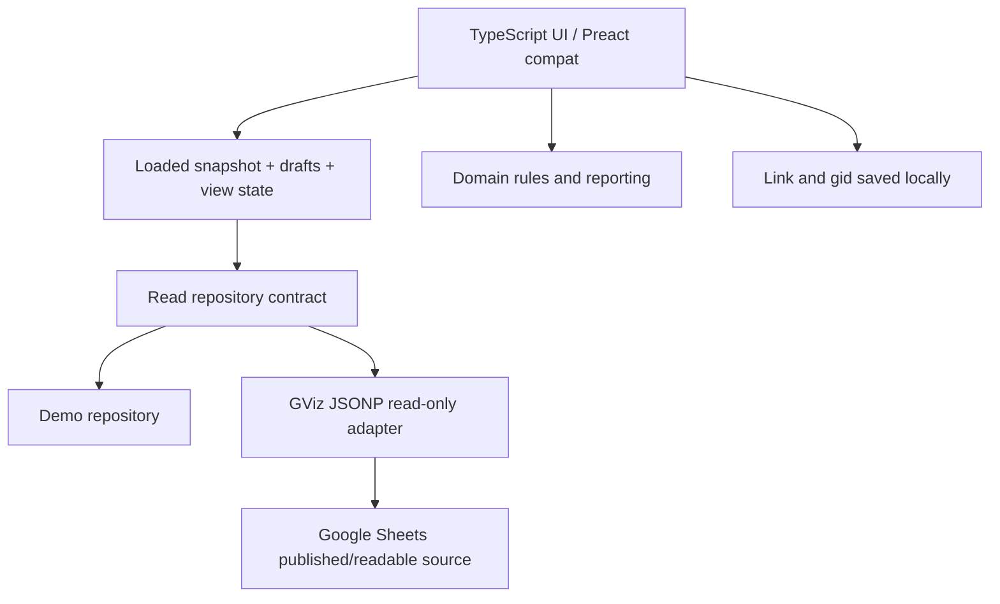

## 25/10/2026 — KIẾN TRÚC MỤC TIÊU: một WebApp, hai backend **độc lập** (đang phát triển, chưa chạy production)

**Ưu tiên hơn mô tả lịch sử “Sheets là nguồn chính” bên dưới cho việc triển khai tương lai, nhưng không suy ra main đã chuyển nguồn.** [Chỉ đạo tích hợp #74](https://github.com/cavoixanh638/HopHDND-WebApp/issues/74) yêu cầu giữ **Firebase RTDB và Supabase PostgreSQL** cùng tồn tại, thêm bộ chọn nguồn tại **tab trình duyệt**. PR #72 = Firebase edit/realtime/security; PR #73 = Supabase SQL/RLS/Repository; PR #75 = UI source chooser/preview xếp chồng PR #73. Cả ba Draft.

**Hợp đồng kỹ thuật sau tích hợp:**

1. App chỉ có một `activeSource` tại một thời điểm cho mỗi tab, tương ứng một adapter `Repository`. Phải gắn tên nguồn vào giao diện **ngay trước khi ghi**, trạng thái truy cập và bản ghi nhật ký. `FirebaseProfile.dataSource` là cấu hình chung/legacy, **không** được cập nhật khi người dùng chọn Supabase để xem thử cục bộ.
2. Firebase primary sử dụng Firebase Auth, RTDB Security Rules, `hdnd/items`, `hdnd/editors/{uid}`, `hdnd/permissions`, leases `hdnd/editLocks`, audit và freeze riêng. Supabase sử dụng Supabase Auth/JWT độc lập, PostgreSQL/RLS/RPC, audit và leases/freeze **riêng**. Mọi thao tác `save/history/permissions/freeze/subscribe` định tuyến đến backend được chọn; **không** mượn quyền Firebase để ghi Supabase.
3. Các `sourceNamespace` dành cho nháp, revision, cache, trạng thái phục hồi, danh sách/bộ lọc, source-specific subscriptions và phiên khóa phải có backend, project/instance và account hoặc session thích hợp; tuyệt đối không đưa snapshot/hàng cũ của nguồn khác sang màn hình mới. **Không ghi kép, tự đồng bộ hay tự hợp nhất dữ liệu giữa backend.**
4. Nút đổi nguồn phải chặn khi có draft chưa xác nhận, editor đang mở, lease đang giữ, save đang chờ ACK, network/reconnect, protected recovery hoặc fetch đang chạy. Chuyển thành công phải cleanup listener/editor và đối chiếu nguồn trước khi hiển thị hoặc cho phép lưu. Không tự fallback sang Firebase/Sheets khi Supabase lỗi. Không đổi backend trong khoảng thời gian chờ server ACK.
5. Đối chiếu tính năng 15 cột A–O hiện hành (cột N `specificProgress` là văn bản nhiều dòng, O `note`), 5 báo cáo, bộ lọc, popup, bố cục, phân quyền, trạng thái đóng băng. Nhập dữ liệu từng backend là sự kiện có điều kiện và có bảng kê duyệt, không được giả định hai nguồn chứa cùng một bộ hồ sơ.
6. Supabase preview của PR #75 hiện là **read-only staging**, polling 15 giây khi đủ điều kiện, **không phải Supabase Realtime hay quyền sửa production**. Realtime Supabase/Google OAuth/đường ghi phải QA riêng; Firebase Emulator PASS không thay cho PostgreSQL RLS/RPC PASS.
7. **Ranh giới người phụ trách:** PR #72 sở hữu mã bảo mật Firebase, PR #73 sở hữu cấu trúc và adapter Supabase, PR #75 sở hữu chọn nguồn; người tích hợp duy nhất quản lý các file dùng chung `App.tsx`, `use-workspace.ts`, `ItemList.tsx`, các editor, `cell-edit-leases.ts`, popup/report và docs. Không “theirs overwrite” các sửa Firebase cuối trên PR #72 vì PR #73 xuất phát từ nền snapshot cũ.

Trạng thái chính xác và bằng chứng theo SHA tại [CURRENT_STATE](CURRENT_STATE.md); chỉ dẫn build Windows [CAI_DAT_VA_CHAY](CAI_DAT_VA_CHAY.md); phát hành/khôi phục [VAN_HANH](VAN_HANH.md).

---

# ARCHITECTURE — Kiến trúc ứng dụng

> **Cách đọc:** phần “Pages 0.7.0 — Sheets là nguồn chính” đầu tiên là lựa chọn hiện hành; các phần có nhãn “đề xuất”, “legacy”, “giai đoạn” hoặc mô tả phiên bản trước là bối cảnh lịch sử, không phải bằng chứng triển khai thực tế. Schema/cột/ID chi tiết thuộc [TU_DIEN_DU_LIEU](TU_DIEN_DU_LIEU.md); các thao tác build, rollback, khôi phục và ứng cứu thuộc [VAN_HANH](VAN_HANH.md). Trạng thái chạy thật tại [CURRENT_STATE](CURRENT_STATE.md).


## Sửa kiến trúc resize/feature parity của popup — 19/10/2026

- **Không dùng lại `width:max-content;min-width:100%` của popup cũ.** `ReportDetailGrid` tính `gridWidth=Σ shownColumns.width` rồi gán rõ `table.style.width/minWidth` và `colgroup > col`; `table-layout:fixed`, vùng cuộn riêng. Tránh phân phối thừa chiều rộng làm nhập px không thể nhận biết. CSS `.report-grid-modal .column-resizer` đặt đúng ranh giới th sticky, không phủ nút sắp xếp.
- **Tái sử dụng** `ColumnHeader` (sort, drag reorder, Alt-arrow khi mở cấu hình), `ColumnResizeHandle` (preview mutate col/table DOM và commit khi thả), `ColumnFilterCell` (short-list dropdown + clear), `CellPicker` (chọn tiến độ), `ContentEditor` (popup sửa nội dung/note và xác nhận hủy), `sortItems`, `assignmentIssue`. `ColumnResizeHandle.windowDragFallback` mặc định false cho Danh sách chính; **true chỉ ở modal**; khi pointer capture trong dialog mất, global window pointermove/up trong một phiên kéo vẫn kết thúc an toàn, AbortController cleanup.
- **Độc lập dữ liệu lưu:** `report-detail-preferences` kiểm 15 khóa A–O, 70–800px, cột không trùng; `report-detail-presets` lưu tối đa 12 mẫu cá nhân và màu theo điều kiện riêng, các khóa nguồn/preview cô lập. Nhãn/loại editor lấy từ `itemLayout` nhưng thứ tự, width, hidden, filters, presets, colors không ghi `ItemLayout`/Firebase.
- **Quyền:** chỉ App được biết `firebase.canEdit`, `mayEdit`, `editingLocked`; modal không gọi writer, chỉ `updateDataDraft` và `keepDraft`. Quản trị tạo cột custom, phân quyền và nhập/xuất vẫn ở các màn hình nghiệp vụ chính. [So sánh đầy đủ](REPORT_DETAIL_PARITY_2026-10-19.md); Chrome drag test run [#39263671680](https://github.com/cavoixanh638/HopHDND-WebApp/actions/runs/39263671680) xác nhận cột 100→165px/table +65px/đóng mở giữ.

## Kiến trúc Bảng chi tiết nhanh và cấu hình cột độc lập — 19/10/2026

- `src/features/reports/ReportTable.tsx` giữ `onSelect(title,entries)`; `App.tsx` giữ `selection={title,items}` và gọi `ReportDetailGrid` khi bấm, truyền `selectedIds` và `workspace.workingItems`. Modal chỉ lọc tập recordId đã chọn, tránh query lại source và tránh nhân đôi 5 bảng thống kê. Không đổi định nghĩa tập đếm ở `aggregateReport`.
- `src/features/reports/ReportDetailGrid.tsx` là bảng con dùng `Modal` hiện có, luồng xem → lọc cột/tìm toàn bảng → sort (`sortItems`) → tùy chọn sửa nháp nếu được cấp quyền. HTML table có `colgroup`, header/filter sticky, scroll riêng và bảng rộng có thể kéo ngang. Dựng bảng **chỉ khi modal mở**; không dùng CSS Anchor/`body:has` hoặc event hover mới.
- `src/data/report-detail-preferences.ts` chứa cấu hình `DetailGridPreferences` phiên bản 1, độc lập với `ItemLayout` và `ReportLayout`. Kênh lưu là `localStorage` trên máy theo nguồn và `layoutRecoveryScope` cho preview, có validator whitelisted 15 `EXCEL_SOURCE_COLUMNS`, không nhận mã cột khác, không cho ẩn hết, độ rộng 70–800px. **Không đưa dữ liệu tùy chỉnh cột vào Excel hay Firebase profile**. Các cột ngoài A–O và chia sẻ cấu hình là yêu cầu tương lai, chỉ làm sau khi thống nhất hợp đồng mới.
- Một đường nháp duy nhất: `App.updateDataDraft` kiểm `firebase.editingLocked` / `firebase.canEdit` và quyền thực tế `mayEdit`; `workspace.update` tạo `Patch` hiện có. Grid hiển thị `workspace.workingItems` (nháp chung với Danh sách), báo cáo vẫn dựng từ `workspace.items` là snapshot nguồn. Nút `Giữ nháp trên máy` gọi `workspace.keepDraft`; **không gọi `saveData`/`repository.save` trong modal**, không xác nhận đã ghi nguồn. Bộ ghi Excel bên Google Host/Apps Script vẫn tắt trên Pages.
- CSS trong `src/styles/app.css` dùng riêng `.report-grid-*`, container modal `min(1480px,100vw-20px)`, sticky th và vùng scroll. Hiệu năng: không tạo bảng khi chưa click, không tính lại báo cáo khi gõ lọc; khi dữ liệu quá lớn cần Performance trace thực tế trước khi thêm virtualization, vẫn phải giữ print và scroll.
- Test: `tests/report-detail-preferences.test.ts` kiểm 15 cột, dữ liệu không hợp lệ, chia nguồn/preview và không ảnh hưởng ItemList. `scripts/smoke-pages-browser.mjs` dùng chuột Chrome thật bấm mép ô, assert modal bảng dữ liệu, không cho sửa khi không có quyền, mở tùy chỉnh/ẩn cột/lưu riêng.

**Ranh giới phát hành:** nhánh feature PR #3 và preview độc lập; không sửa `main:index.html`, Sheets, Excel hoặc Firebase production. Quy trình tại [VAN_HANH](VAN_HANH.md).

## Quyết định kỹ thuật hiện hành — hover báo cáo hiệu năng cao (19/10/2026)

**Áp dụng trên PR #3/preview, không phải production root.** `src/features/reports/ReportTable.tsx` dựng 5 bảng, trong mỗi ô đếm dương có `button.count-drill` phủ toàn bộ `td.report-clickable-cell`, giữ `report-cell-sizer` vô hình để bảo toàn kích thước. Button native xử lý bấm và bàn phím; `onSelect(title,entries)` mở modal, không chạy tổng hợp lại bảng do hover. Ô không có hồ sơ, ô % và header không gắn button.

**Tooltip một phần tử, không theo từng ô:** `src/components/SharedReportTooltip.ts` được mount từ `ReportTable`; số lần mount của các báo cáo được đếm, chỉ tạo **một** host `#report-shared-tooltip`/role=tooltip ở `document.body`. Nội dung cố định `Click để xem chi tiết`, 190×32px. Một bộ `pointerover/pointerout` delegated trên document xác định `button.count-drill`, không gắn handler cho mỗi ô; trên hover chỉ xử lý lúc chuyển sang ô mới, dùng tọa độ pointer + kích thước tooltip đã biết để đặt `transform:translate3d`, không gọi `getBoundingClientRect`/không thay ARIA/text và không dùng React state/timer trong pointer path. `focusin` bằng bàn phím được phép đọc rect một lần, kèm `aria-describedby`; Esc, scroll và đóng bảng ẩn tooltip. Không cần thư viện floating UI.

**Trình bày tại `src/styles/app.css`:** chỉ phủ nền `rgba(9,106,113,.14)` và `outline:2px solid #08777B;outline-offset:-2px` cho **đúng button của ô đang :hover**; `:focus-visible` dùng viền 3px `#07595B`. `outline` không làm thay đổi kích thước ô; các màu nghiệp vụ của ô/từng cột giữ nguyên. Không thay `border`, không transition, không paint cả hàng, không blur/shadow, không dùng `body:has(...:hover)` hay CSS `anchor-name/position-anchor` trong chế độ hover. Không tô mọi ô của hàng.

**Căn cứ quyết định:** phép thử Chrome CDP chuột thật 36 lượt × 2 với 5 chế độ và khoảng 7.976 nodes cho thấy bản `body:has()` + CSS Anchor có chi phí layout ~31,92ms và tổng Task ~176,53ms/36 lần; bản delegated tooltip có Layout 0ms, Task ~109,69ms/36 lần **trong chính môi trường thử**. Thử thêm nền/viền mới với CSS cũ cho 2 × 36 lượt cho thấy Layout đều 0ms, Task trung bình 83,87 so với 82,76ms; không được coi là khác biệt có ý nghĩa thống kê hay SLA trên máy thật. Đọc số đầy đủ, môi trường và giới hạn tại [báo cáo A/B](TOOLTIP_PERFORMANCE_AB_2026-10-19.md) và [nghiệm thu](KIEM_THU_VA_NGHIEM_THU.md).

**Ranh giới:** Không thay schema, status, tỷ lệ, 5 kiểu màu, kéo cột, in/PDF hoặc hành vi click tổng. Những cải tiến phân trang/virtualization chỉ xét sau khi đo DOM/paint trên tập dữ liệu thật và kiểm tương thích bảng có sticky header/tổng cuối/in. Tuyệt đối không kết luận dữ liệu Excel/Firebase hay production đã được sửa do phát hành preview.

## Pages 0.7.0+ — Sheets A–O là nguồn chính, Firebase quản trị

Pages dùng lại App và `SheetsRepository/readSheet` để đọc GViz **A–O** từ Excel trên Google Sheets hiện hành (O = Ghi chú); nhánh parser legacy vẫn nhận snapshot A–P/A–R có header tương thích. Quy tắc schema mới xem [từ điển](TU_DIEN_DU_LIEU.md). `useWorkspace` giữ đọc lại thủ công, polling 60 giây khi tab hiển thị, bảo toàn bản đọc trước khi lỗi và chờ xử lý nháp trước khi refresh. Không nhập dòng sang RTDB, không có tác vụ đồng bộ Sheets → Firebase. Về kiến trúc, dữ liệu nguồn Sheets và xác thực Firebase là hai hệ riêng; nhưng **giao diện trang chính hiện chờ xác nhận baseline cấu hình Firebase trước khi vẽ bố cục đã lưu**, tránh hiện layout mặc định rồi nhảy. Khi Firebase lỗi, phải báo rõ, không im lặng coi fallback layout là bản đã lưu.

`useFirebase` chỉ quản lý Auth Anonymous/Google và listener `hdnd/profile`, `hdnd/permissions`. App quyết định quyền quản trị từ controller, độc lập `repository.sourceKind`. Tất cả bố trí báo cáo/danh sách/danh mục/JSON profile dùng cùng save profile có baseline revision; quyền ô/cột/dòng dùng cùng Google admin. Ghi chỉ sau thao tác lưu tường minh và xác nhận máy chủ; không fallback ghi cấu hình chung bằng Google bridge hoặc local legacy trên Pages. Chưa đọc được baseline thì chặn khởi tạo; lỗi giữ nháp; khóa lưu bằng ref để chặn hai lượt trước rerender.

Khách chỉ sửa thử các ô được cấp quyền; dữ liệu thử giữ trong checkpoint browser `pages:sheets:<url>`. Báo cáo và xuất Excel lấy snapshot Sheets đã đọc. Nhập dữ liệu Excel khóa. Rules local khóa ghi `hdnd/items` cho cả admin/khách; chỉ Google verified đúng email được đổi profile/permissions. Đổi nguồn hiển thị không đổi cơ chế bảo vệ cấu hình. Quyền ưu tiên ô → dòng → cột → khóa; ID/STT chỉ xem. IDs Sheets giữ format legacy có vị trí hàng, cần quản trị rà quyền riêng khi chèn/sắp xếp hàng.

`Repository` vẫn là giao diện nguồn nội dung dùng chung; `FirebaseRepository` giữ cho lần chuyển đổi chính thức sau quyết định người dùng, không khởi tạo trên Pages hiện tại. Regression giao dịch tương lai chỉ chạy ở nhánh `hdnd-test/items` được cấp Rules riêng trong fixture emulator; nhánh này không có trong Rules phát hành. Test build chỉ dùng project giả `demo-hdnd`. [API](API.md), [hướng dẫn](FIREBASE_PAGES.md), [kết quả](CURRENT_STATE.md).

Ngày: 15/10/2026 · Revision thiết kế: 1.16 · Thiết kế cùng các bổ sung triển khai theo mốc; kết quả kiểm chứng thuộc CURRENT_STATE.

## Đề xuất sau rà soát PA1/PA2 — chưa triển khai

Phần này bổ sung thiết kế để người dùng xem xét, không phê duyệt đổi nguồn/quyền/deployment. Main0.6.2 Version6 vẫn dùng Excel hiện hữu. Lộ trình ở kế hoạch1.18 mục18.15; kết quả thực tế ở CURRENT_STATE. Nhu cầu hai chiều đã rõ: app ghi nguồn và app nhận thay đổi do mọi người nhập trực tiếp trên nguồn.

### Ba quyết định độc lập

Nguồn Google Sheets native giúp bỏ bước mở/đóng gói/upload XLSX; cần chuyển đổi và đối chiếu bản sao trước, không dùng SpreadsheetApp ghi trực tiếp Office. Vị trí chạy HTML (file độc lập hay HtmlService) là quyết định riêng: đổi định dạng dữ liệu không tự cấp cầu RPC cho HTML local. Chính sách gửi ghi (thủ công hay tự động) cũng riêng: giữ chế độ xem mặc định, dropdown/search, ID/STT chỉ xem và popup Nội dung/Ghi chú có Lưu/cảnh báo. Tự lưu dropdown là tùy chọn đề xuất, chưa thay yêu cầu đã chốt. Chỉ lưu popup mới đưa thay đổi vào hàng đợi; không gửi từng phím gõ.

### Quy tắc định danh, quyền và ghi

Server dùng fileId/sheetId đã đăng ký, field key chuẩn và mapping header đã kiểm; không phụ thuộc getActiveSpreadsheet của webapp độc lập. Tra ID gốc duy nhất ngay trước ghi; thiếu/trùng ID hoặc header mơ hồ phải dừng. Không fallbackRow/fallbackCol, không tự coi cột A hay STT là khóa, không nhận tọa độ cũ của browser làm đích. Cache ID→vị trí chỉ hỗ trợ tốc độ, cần kiểm lại ID tại đích. Cột ID được bảo vệ trong UI và xem xét protected range ở Sheet khi chuyển nguồn.

Server kiểm quyền, allowlist trường, kiểu dữ liệu, giá trị gốc và ô/cột tính toán tại thời điểm lưu. Frontend khóa công thức là hỗ trợ giao diện; không thay kiểm backend. Văn bản được ghi dạng literal/RAW để không thành công thức do ký tự đầu '='; số/ngày/boolean chỉ chuyển đổi theo schema rõ, không đoán từ chuỗi hiển thị/locale. Giữ mã có số0 đầu dưới dạng text. Render header/nội dung bằng text node, không nối dữ liệu Sheet vào innerHTML. Paste văn bản thuần; không dựa lâu dài vào document.execCommand đã deprecated.

Gom một HTTP request chứa nhiều thay đổi chưa phải batch dịch vụ: không lặp setValue từng ô rồi gọi đó là tối ưu theo lô. Native writer cần kiểm toàn bộ trước ghi, ưu tiên batch API với phạm vi/fields tối thiểu; trả xác nhận riêng cho từng ô theo khóa ổn định và giá trị đọc lại. Không coi status='success' của gói là tất cả ô đã lưu. Batch Sheets được áp dụng nguyên tử cho các subrequest hợp lệ trong một batch; việc đọc baseline trước batch không tạo giao dịch khóa người sửa trực tiếp. Audit ở file khác cũng không tự nằm trong cùng giao dịch.

LockService phối hợp các lệnh script dùng cùng khóa; không khóa giao diện Sheets hoặc các tác nhân khác. Chống xung đột native Sheets phải được kiểm lại, không mang nguyên bảo đảm ETag blob của XLSX sang từng ô. Khi cho phép sửa trực tiếp Sheet, vẫn có cửa sổ giữa kiểm ID/baseline và ghi; không hứa tuyệt đối trước trường hợp sort/xóa/sửa đồng thời. Cần thử tình huống này trên bản sao và quy định quyền/thao tác trực tiếp phù hợp trước vận hành.

### Hàng đợi không mất dữ liệu

Tách confirmed baseline, pending, in-flight, conflict và unknown; khóa theo nguồn + ID gốc + field key, không theo r_c. Mỗi client chỉ một batch ghi đang chạy. Debounce ban đầu khoảng800–1000ms, có giới hạn chờ tối đa; thông số là giả thuyết cần đo. A→B đang gửi mà gõ C thì C giữ ở pending; phản hồi B không được xóa hoặc ghi đè C. Không cập nhật baseline đã xác nhận ngay khi đưa vào queue.

Mỗi batch đóng băng payload và operationId. BUSY chỉ được tự thử lại có giới hạn/backoff+jitter khi server xác nhận chưa ghi; không đẩy batch cũ đè pending mới. Timeout/mất phản hồi là unknown, không phải bằng chứng chưa ghi: giữ payload/opId/nhật ký và đối chiếu trước khi thử lại. Chỉ bỏ phần sửa có phản hồi đúng ô/đúng phiên bản và readback khớp. locked_formula/validation/conflict giữ nháp và thông báo từng ô; giữ cả bản nguồn lẫn bản người dùng để lựa chọn. Có checkpoint bền trong browser và cảnh báo khi đóng trang; lỗi ghi storage phải báo, không hứa tuyệt đối chống mất dữ liệu. Không dựa vào gửi ngầm lúc đóng tab để bảo đảm ghi server.

### Nhận thay đổi hai chiều

Mốc thử ban đầu là polling30giây khi tab hiện, có jitter/backoff và tối đa một lượt đọc đang chờ; xem xét cache server sau khi đo. Kiểm generation/mutation cả trước lẫn sau request, merge theo ID/field, giữ ô đang nhập và cả pending/in-flight/conflict/unknown. Không thay toàn bảng sau phản hồi cũ; refresh thủ công cũng cần bảo vệ phần sửa. Ban đầu snapshot nhỏ được đối chiếu phía client; không hứa delta chỉ chứa ô đổi nếu chưa có change log bao phủ sửa trực tiếp Sheet. Revision chỉ tăng bởi app/onEdit không đủ làm nguồn chân lý cho mọi tác nhân; cần đối chiếu định kỳ với nguồn. Không dùng riêng onEdit: thay đổi qua API/script không kích hoạt nó và simple onEdit chỉ xếp hàng tối đa2 sự kiện.

### HTML trên Drive và phát hành

DriveApp.getFileById(...).getBlob() kết hợp HtmlService.createHtmlOutput(...) có thể phục vụ HTML lưu ở Drive. Đó vẫn là trang mở qua link webapp Google; không biến Drive preview hoặc file:// thành trang có google.script.run. Không thay luồng hiện tại bằng snippet trực tiếp: server/Index có cấu hình template cần được cấp đúng trước khi JS chạy; createHtmlOutput không evaluate scriptlet như HtmlTemplate.evaluate.

Chỉ quản trị được sửa HTML phát hành; chưa có bằng chứng ACL HTML hiện hữu là public-edit nên không ghi nhận điều đó như sự cố đã xác minh. Bản vận hành ưu tiên artifact đã build/kiểm, định danh phiên bản + checksum và có bản quay lại. Nếu chọn đọc HTML từ Drive, chỉ chọn artifact đã công bố; không tự tải bản đang được Drive Desktop đồng bộ hoặc file đang sửa như bản production. Cache gắn với release version; đổi HTML cần bước công bố rõ dù không redeploy backend. Backend độc lập và kiểm quyền mọi RPC, không coi việc ẩn nút hoặc biết link là quyền sửa. HTML local cần API HTTP/xác thực riêng được kiểm trên chính file:// và browser mục tiêu; không đánh đồng với phương án HtmlService đọc từ Drive.

### Bằng chứng cần có và nguồn tham chiếu

Chưa cam kết thời gian mỗi lệnh, tiết kiệm5–10lần hay số người đáp ứng. Hạn mức URL Fetch là lệnh UrlFetchApp từ server, không phải mọi browser fetch; API Sheets và thực thi Apps Script có hạn mức riêng. Kiểm riêng app↔Sheet, nhập liên tiếp cùng ô, phản hồi đảo thứ tự/mất, BUSY, JSON sai, công thức bị từ chối, nguồn sort/xóa/đổi header, offline/reload, polling trả muộn và tải20–50người. Đối chiếu dữ liệu/công thức/danh mục/quan hệ/bố trí và bảo vệ nháp cũ trước chuyển source key. Không có chuyển nguồn hoặc public sharing từ việc cập nhật tài liệu này.

Nguồn chính thức: [RPC và thứ tự thực thi](https://developers.google.com/apps-script/guides/html/communication), [LockService](https://developers.google.com/apps-script/reference/lock/lock-service), [batch API](https://developers.google.com/workspace/sheets/api/guides/batch), [hạn mức](https://developers.google.com/apps-script/guides/services/quotas), [onEdit](https://developers.google.com/apps-script/guides/triggers), [Drive File](https://developers.google.com/apps-script/reference/drive/file), [HtmlService](https://developers.google.com/apps-script/reference/html/html-service), [template](https://developers.google.com/apps-script/guides/html/templates), [quyền bound script](https://developers.google.com/apps-script/guides/bound).

## Bổ sung 0.6.2 — đường ghi Office có điều kiện

ExcelRepository → Google RPC → ExcelService → ExcelTransactions → ExcelWriteCore đã tích hợp. RPC save trả JSON string qua Apps Script callback; adapter parse rồi validate kết quả từng dòng trước khi UI xác nhận và xóa nháp. JSON sai định dạng hoặc thiếu xác nhận thì giữ nháp. UI /dev đã kiểm trên bản sao riêng: đổi Chuyên viên, đọc lại đúng và khôi phục bytes có điều kiện với ETag/hash pass (xem [CURRENT_STATE](CURRENT_STATE.md)). Sau khi người dùng duyệt và tự cấp Google consent, writer được đăng ký và phát hành ở app chính Version6 ngày15/10; kiểm caller/đọc nguồn và trạng thái UI đạt, chưa tự gửi ghi nguồn thật. Parser A–P dùng chung giữa GViz và server. Loại nguồn Google không suy từ readOnly; capability được chọn khi mở app theo registry server, không đổi repository bất chợt làm mất nháp. File HTML không có Google RPC vẫn dùng SheetsRepository chỉ đọc/giữ sửa trên máy.

Server chỉ nhận nguồn đã đăng ký. Registry trong Script Properties giữ sheetName, ownerEmail và hai thư mục owner-only: backup XLSX và journal JSON. Registry main đã được thiết lập qua bước activation được duyệt; upload module tự nó không bật writer hoặc cấp consent Google. Test UI đóng gói riêng với TestHost chỉ nhận copy cố định và USER_ACCESSING/MYSELF. Đọc blob/metadata cần Drive OAuth thực của tài khoản truy cập; không nhúng token/mật khẩu trong HTML.

Manifest của activation overlay và UI-test khai báo Advanced Drive service v2 (`Drive`, `drive`, `v2`). Activation giữ nguyên đúng ba OAuth scopes đã duyệt: `spreadsheets`, `drive`, `script.external_request`; UI-test giữ hai scopes vốn có: `drive`, `script.external_request`. `USER_ACCESSING/MYSELF` không đổi. Với default Cloud project, Apps Script tự bật Drive API khi advanced service được thêm/lưu; nếu gắn standard Cloud project thì phải bật Drive API riêng trong Cloud Console. Xem [tài liệu Advanced Google services](https://developers.google.com/apps-script/guides/services/advanced) và [Cloud projects](https://developers.google.com/apps-script/guides/cloud-platform-projects). Main đã có Google consent/registry và phát hành Version6; kiểm caller/đọc nguồn và UI sẵn sàng ghi đạt. Việc triển khai không tự gửi thay đổi đang có ở trình duyệt.

`checkDashboardExcelConnection` chỉ gọi status, snapshot và config rồi log backendReady, nhãn actor, số dòng, số cảnh báo và configRevision. Nó không log nội dung ô, không gọi save và không gửi HTTP ghi. Candidate local hiện có 191 tests/24 files và typecheck đạt.

Batch kiểm toàn bộ baseline/code/codec trước backup; backup tải lại đúng SHA256 trước PUT. Receipt và chỉ mục thao tác phải lưu trước PUT If-Match. Metadata→blob→metadata với ETag không đổi bảo đảm snapshot nhất quán; Script lock không thay CAS đối với người sửa Office. Mất phản hồi không tự PUT lại: receipt/hash dùng để đối chiếu. Committed replay cùng payload trả kết quả;412 giữ conflict; unknown giữ sửa. Chỉ mục ID/hash nhỏ ở Properties tránh độ trễ chỉ mục Drive, nội dung/audit nằm ở journal riêng. Cache ID/ETag trong lượt tránh tạo hai receipt khi vừa tạo file.

Không tự rollback đè người sửa mới. Codec giữ parts/cells khác, không tính lại cached formula. Giao diện xử lý conflict/khôi phục backup/retention, nhiều người, quota và công thức cần bước kiểm riêng. Lịch sử hiện giới hạn100 batch, lỗi nếu phân trang thiếu. Lưu data-only không ghi layout không đổi; cập nhật phân công kiểm quan hệ, sửa văn bản không tự đổi phân công cũ. Hợp đồng và giới hạn chuẩn ở [API](API.md); trạng thái thực tế ở [CURRENT_STATE](CURRENT_STATE.md).

Các mô tả giai đoạn chỉ đọc bên dưới là lịch sử thiết kế. Trạng thái phát hành và phạm vi đã kiểm chuẩn nằm ở CURRENT_STATE.

Bổ sung 0.2.0: runtime dùng **Preact compat**, source TypeScript/TSX theo API tương thích React; build React giữ so sánh. Script trong repo ghép JS/CSS và kiểm cú pháp artifact. Đã có GViz JSONP chỉ đọc, parser A–P và cấu hình link/gid trên giao diện; mock trong bộ nhớ là nguồn mẫu tùy chọn. Số đo/giới hạn tại [báo cáo kiểm tra](KIEM_THU_VA_NGHIEM_THU.md), lý do runtime tại [ADR 001](decisions/001-single-html-prototype.md).

## 1. Quyết định phát hành giai đoạn 1

Sản phẩm được chia thành nhiều module TypeScript/React/Vite khi phát triển và đóng thành **một HTML duy nhất** để chia sẻ trên Google Drive. Tệp chứa giao diện, core JavaScript và CSS; người xem mở hoặc tải tệp bằng browser. Việc mở cần mạng và quyền đọc nguồn Google Sheets. Không cam kết HTML chạy trực tiếp trong Drive preview.

Đọc Sheets qua adapter GViz JSONP chỉ đọc. Giai đoạn 1 không ghi dữ liệu từ app; nhóm 20–30 người dự kiến nhập trực tiếp trong Sheets, cùng 2–3 người xem app. Mục tiêu tương lai 20–50 người, chủ yếu thao tác qua app, cần kiến trúc ghi có xác thực và đo kiểm trước khi chọn. Apps Script `google.script.run` không phải phương án ưu tiên cho giai đoạn đầu vì buộc host giao diện trên Google. Server-side write có thể được xem xét về sau khi có auth, phân quyền và kiểm soát xung đột.

Dữ liệu giả qua mock repository là nguồn local để phát triển. Nguồn nghiệp vụ hiện giữ nguyên spreadsheet ID `1VzcGF_-dAS-6yanFk-xPQ2vbdcv9bDEp` và gid mặc định `60961344`; yêu cầu kết nối này cấp quyền đọc nguồn, không cấp quyền ghi hoặc đổi chia sẻ. HTML tải về không chứa dữ liệu Sheet; muốn xem dữ liệu vẫn phải online và nguồn phải đọc được qua GViz.

### Bổ sung 0.5.1 — cấu hình dùng chung

Nguồn nghiệp vụ là Excel hiện hữu, chỉ đọc. Kho cấu hình là Google Sheets native riêng, tab ẩn _HDND_APP A:H; vị trí triển khai và tình trạng kiểm chứng xem [CURRENT_STATE](CURRENT_STATE.md), hướng dẫn quản trị ở [Đồng bộ cấu hình](DONG_BO_CAU_HINH.md).

RPC google.script.run đọc và ghi catalogs/reports/items ở giao diện Apps Script; HTML thông thường chỉ đọc kho qua GViz nếu có quyền. JSON cấu hình có schemaVersion, khóa nguồn spreadsheetId/gid và revision. Server kiểm tra nguồn, khóa ngắn hạn, revision kỳ vọng và operationId; ghi các chunk tiền tố j: rồi đánh commit marker sau khi đủ chunk. Reader không áp dụng bản ghi dở; retry operation đã xác nhận không tạo bản trùng. Đây không phải transaction cho dữ liệu Excel hay khóa người sửa Sheet trực tiếp.

Browser dùng URL/URLSearchParams để kiểm link. Apps Script V8 không có hai API này ([tài liệu chính thức](https://developers.google.com/apps-script/guides/v8-runtime)); Code.gs kiểm URL nguồn canonical cố định bằng regex và so khớp URL/ID/gid, core-entry không đưa parser browser vào server. Test server chạy khi hai API này undefined. Lỗi đọc cấu hình gặp trước deployment v3 đã được sửa và kiểm read/write thật sau đó; kết quả và lịch sử thuộc CURRENT_STATE.

Chạy dưới USER_ACCESSING để quyền tài khoản Google kiểm soát truy cập Sheet. Deployment hiện dùng MYSELF; kho giữ riêng theo lựa chọn của người dùng ngày 14/10. Không suy ra quyền từ việc có link Excel hoặc HTML. Chưa mở cho tài khoản khác; không ghi nội dung nghiệp vụ bằng giao thức cấu hình.

Trang danh sách dùng toàn viewport. Bảng rộng max(tableWidth 600–6000, tổng độ rộng cơ sở cột hiện); trình duyệt chia phần dư khi bảng rộng hơn tổng cơ sở. Header dùng pointer capture để chuyển cột bằng chuột/cảm ứng, Alt+←/→ thay thế. Tay nắm resize tách khỏi thao tác chuyển cột; chế độ xem không có control chỉnh. CellPicker chỉ mở khi bấm ô; chuyên viên tìm không dấu, giữ lựa chọn hiện tại nếu bị lọc và tôn trọng quan hệ phòng. Nội dung/Ghi chú là popup văn bản tự do có Lưu vào nháp và ba lựa chọn thoát. Checkpoint 10 giây không thay việc lưu bản chung.
### Bổ sung 0.5.2 — tải cấu hình gốc trước editor

Hook cấu hình phân biệt loading/ready/empty/error; App chỉ cho vào editor chung khi Google host đã tải base. Lần đọc đầu tiên luôn được tiếp nhận, kể cả mở trang kết nối/đồng bộ khi đang chờ. Generation loại phản hồi nguồn cũ; mutation counter loại lượt đọc bắt đầu trước khi ghi; ref khóa lưu trước rerender. Background refresh trong editor không thay base hoặc nháp, server vẫn kiểm revision. Không khởi tạo toàn bộ profile khi chưa xác nhận kho trống.

ItemList remount ở ranh giới view/editor để dùng đúng base đã tải; checkpoint chỉ hoạt động trong editor. Checkpoint khác base được giữ cho đến lựa chọn giữ/bỏ/nạp để đối chiếu, không tự áp dụng và không tự xóa khi xem. Mật khẩu HTML chưa triển khai và không thay thế xác thực/kiểm quyền ở server.

## 2. Các lớp và nguyên tắc phụ thuộc



`domain` không gọi React, browser, Sheets hoặc localStorage. Parser chịu trách nhiệm ánh xạ A–P. Repository tách nguồn dữ liệu khỏi bảng/tính toán; điểm khởi tạo App gọi `readSheet` để kiểm tra nguồn ứng viên trước khi thay repository. Adapter nguồn Excel hiện readOnly=true nhưng canDraft=true: UI cho sửa nháp trong chế độ riêng; repository vẫn từ chối commit khi writer chưa được kiểm chứng. Lịch sử mẫu không hiển thị cho nguồn thật.

## 3. Source modules và artifact

Cây dưới đây mô tả source layout dự kiến; artifact production là một HTML, không phải các module rời:

```text
src/
├── app/                 # khởi tạo app và điều hướng
├── features/
│   ├── overview/        # KPI
│   ├── items/           # danh sách, lọc và xem chi tiết
│   ├── reports/         # pivot, chi tiết, in
│   ├── catalogs/        # hiển thị danh mục
│   ├── settings/        # cấu hình giao diện/báo cáo
│   ├── history/         # xem lịch sử nếu nguồn cung cấp
│   ├── transfer/        # placeholder cho nhập/xuất giai đoạn sau
│   └── help/            # hướng dẫn, giới hạn, phiên bản
├── domain/              # models, statuses, reporting, search
├── data/
│   ├── repository.ts    # hợp đồng đọc dùng chung
│   ├── sheets-repository.ts # GViz JSONP, chỉ đọc
│   ├── gviz-parser.ts   # ánh xạ A–P và cảnh báo
│   ├── sheet-config.ts  # URL/gid, localStorage
│   └── mock-repository.ts # dữ liệu giả local
├── state/               # snapshot, draft/view state
├── components/          # thành phần giao diện dùng chung
└── styles/              # tokens, layout, table, print
shared/                  # schema/field definitions dùng chung
scripts/                 # build onefile và kiểm tra tài liệu
fixtures/                # dữ liệu kiểm tra giả
```

Build cần Node.js, Vite và các dependency đã khóa. Xem và sử dụng HTML artifact không cần Node.js. Pipeline phải phát ra đúng một HTML tự chứa core JS/CSS; kiểm tra thủ công số file trước khi chia sẻ. Không sửa artifact build trực tiếp.

Giai đoạn 1 chưa cung cấp Excel. Onefile và lazy-loaded Excel library không mặc định tương thích: khi có nhu cầu sẽ làm spike giữa nhúng thư viện vào HTML và tải CDN theo nhu cầu, ghi rõ phụ thuộc mạng và xử lý lỗi. Không hứa Excel hoặc dữ liệu Sheets hoạt động offline.

## 4. Mô hình dữ liệu và legacy

Bảng Sheets hiện có 16 cột; adapter ánh xạ theo tiêu đề/vị trí đã được xác nhận, không để domain/UI phụ thuộc chữ cột:

| Cột cũ | Trường nghiệp vụ dự kiến |
|---|---|
| A | mã legacy/hiển thị |
| B | số thứ tự |
| C | nội dung trình |
| D | sở/ngành |
| E | loại văn bản; cần phân biệt document type với NQ/BC |
| F–I | cấp và tiến độ các bước Thành ủy, xây dựng nghị quyết, trình ban hành |
| J–M | chuyên viên, phòng, lãnh đạo VP, lãnh đạo UBND |
| N | tiến độ cụ thể |
| O | ghi chú |
| P | không trình nữa/rút |

Đích thiết kế là bổ sung `recordId`, revision, thời điểm/người sửa, trạng thái lưu trữ và operation ID; ID nội bộ ổn định không được sinh từ số dòng. Danh mục/quan hệ đích dùng ID ổn định cùng nhãn. **Snapshot Sheets 0.2.0 dùng nguồn + vị trí dòng làm key chỉ đọc trong snapshot; không phải stable record ID và không được dùng để ghi.** Trạng thái/danh mục vẫn là nhãn chuỗi, chưa có IDs ổn định hoặc xác thực người dùng. Parser giữ dòng thiếu/trùng mã và báo cảnh báo; loại mâu thuẫn được giữ chưa phân loại, không tự sửa Sheet.

## 5. Thống kê và trạng thái

Một `selectReportItems()` xác định phạm vi và `aggregateReport()` tính tổng, nhóm, tỷ lệ, chưa ánh xạ cùng tập ID chi tiết. KPI, bảng và danh sách chi tiết dùng chung bộ quy tắc. Ẩn cột không đổi tổng; trạng thái lạ được nêu rõ chứ không bị loại âm thầm. Rút và lưu trữ khác nhau; câu “Sở xin rút” không tự xác nhận đã rút.

Quy tắc tỷ lệ là thiết kế cần được xác nhận theo trạng thái nghiệp vụ: tử số hoàn thành / mẫu số đang trình trong cùng phạm vi; mẫu số 0 hiển thị `—`. Nếu nguồn hiện tại không cho phân biệt chính xác, thể hiện giới hạn và chưa khẳng định tỷ lệ chuẩn. Domain prototype có thể giữ nhãn chuỗi để đọc dữ liệu hiện có; việc chuẩn hóa IDs là bước schema/migration về sau.

## 6. Cache, cập nhật và bản nháp

GViz adapter trả snapshot chỉ đọc; UI hiển thị nguồn và thời điểm đọc thành công. Mốc 0.2.0 làm mới thủ công và mỗi 60 giây khi tab hiện, gộp yêu cầu đọc cùng nguồn đang chạy. Lỗi giữ snapshot trước với thông báo; đổi nguồn xóa snapshot/nháp và bỏ phản hồi bất đồng bộ từ nguồn cũ. Nhịp này cần đánh giá lại khi tăng người dùng; chưa đo quota đồng thời. Chưa có cache dữ liệu bền.

`sheet-config.ts` chỉ lưu URL chuẩn và gid vào `hdnd.sheet-config.v1`, không lưu bản ghi/secret. App đọc cấu hình đã lưu hoặc default link người dùng cung cấp. Nút Kiểm tra không đổi nguồn/lưu; Kết nối chỉ thay nguồn khi đã đọc và parse thành công. Storage bị chặn vẫn cho kết nối trong phiên và báo cần nhập lại. Lựa chọn trên một browser không cập nhật HTML hoặc cấu hình của người khác; không có cấu hình nguồn trung tâm ở mốc này.

State hỗ trợ bản nháp giao diện và cấu hình theo từng nguồn/browser. Cấu hình dùng chung 0.5 có repository Apps Script; chỉ đồng bộ catalog/report/item layout, không gửi item patches lên Sheets/Excel. Draft cấu hình gắn source và revision gốc; xung đột phải bị từ chối và giữ nháp để đối chiếu. Read/write catalogs/items/reports và stale conflict đã kiểm bằng hai tab cùng tài khoản; kết quả hiện hành ở CURRENT_STATE. Viewer ngoài owner chưa có quyền đọc kho riêng. Popup Nội dung/Ghi chú lưu thay đổi vào draft hiện hành; đây không phải write-back nghiệp vụ.

## 7. Giao tiếp dữ liệu

### Giai đoạn 1

Repository read contract chỉ cần khởi tạo cấu hình đọc, liệt kê snapshot và metadata về nguồn/thời điểm. GViz JSONP adapter chỉ đọc. JSONP là cơ chế browser callback, không cung cấp xác thực hay quyền ghi từ ứng dụng; nguồn phải được cấu hình cho phép đọc theo chính sách tổ chức. Không công khai thông tin nhạy cảm trong query/config.

Demo repository triển khai cùng hợp đồng bằng fixtures giả cho local development. Lỗi tải, quyền đọc, timeout và dữ liệu không hợp lệ phải được phân biệt để UI không trình bày cache cũ như dữ liệu mới.

### Cấu hình dùng chung 0.5.1 — owner-only, RPC đã kiểm trong phạm vi thử riêng

Kho là spreadsheet native riêng với tab ẩn `_HDND_APP`, schema A:H. Server kiểm tra spreadsheet nguồn cố định, cấu trúc payload và revision hiện hành. Mỗi phần cấu hình được chia chunk mang revision; thao tác ghi dùng operation ID, khóa ngắn hạn, xác minh revision kỳ vọng và idempotency. Sau khi tất cả chunk được ghi, commit marker được cập nhật nguyên tử để reader bỏ qua revision dở dang. Thất bại trước marker giữ nguyên revision đã công bố. RPC dùng cho thao tác quản trị; endpoint GViz dùng để đọc revision đã commit cho viewer. Đã kiểm RPC save/read-back và từ chối stale revision bằng hai tab cùng tài khoản. Kho giữ riêng; nhiều account/máy và quota chưa nghiệm thu. Tình trạng không được suy ra từ tests giả, xem CURRENT_STATE.

### Ghi dữ liệu nghiệp vụ, chưa triển khai

Các hợp đồng như `saveItems(patches)`, `createItem`, `setDropped`, `archiveItem`, `getItemHistory`, import và restore vẫn là khả năng tương lai. Muốn thêm ghi dữ liệu cần xác thực/quyền, kiểm tra payload, revision/conflict, operationId/idempotency, audit log, backup và phản hồi partial failure. Không dùng endpoint ghi công khai; không mở rộng đối tượng deployment khi audience chưa được xác định.

## 8. Quyền và nguồn Sheets

Giai đoạn 1 phụ thuộc quyền đọc của người dùng đối với HTML trên Drive và nguồn Sheets. Hai quyền này được xác định riêng. Chia sẻ HTML không tự cấp quyền đọc Sheet; quyền đọc Sheet không đồng nghĩa quyền ghi qua app. Prototype chưa xác thực app user và không áp dụng role-based writes.

Spreadsheet ID/gid và default URL được quản lý trong `sheet-config.ts`; UI cho nhập link theo yêu cầu mới. Chỉ nhận HTTPS `docs.google.com/spreadsheets/d/...`, loại thông tin đăng nhập/cổng khác và query chia sẻ dư thừa. JSONP callback riêng mỗi lượt, timeout 15 giây, cleanup callback/script khi xong hoặc lỗi; không eval payload. Chưa có OAuth cho Sheet riêng tư. Chia sẻ HTML không cấp quyền nguồn và không được tự đổi quyền Sheet để né lỗi đọc. Cấu hình không được chứa secret.

## 9. Hiệu năng và thư viện

- Build React/TypeScript trước chia sẻ; không biên dịch JSX trong browser.
- Core JavaScript + CSS nén tối đa 350 KiB là mục tiêu chưa đo; ghi kích thước artifact, thời gian khởi tạo và độ trễ GViz ở môi trường phát hành.
- Tìm kiếm dùng chỉ mục chuẩn hóa khi snapshot đổi; lọc sau khi tải, không gọi Sheet mỗi phím.
- Mục tiêu trang danh sách mặc định 50 dòng; thử 5.000 để tìm giới hạn, không hứa hỗ trợ khi chưa đo.
- Mục tiêu tìm kiếm dưới 200 ms trên 1.000 dòng sau khi tải; chưa có số đo.
- Lịch sử/Excel không nằm trong đường tải giai đoạn 1; không tải thư viện không dùng.
- Đọc Sheets cần mạng. Cache có thể giúp xem lại snapshot cũ nếu được triển khai, nhưng không đồng nghĩa dữ liệu offline mới nhất.

## 10. Chuyển đổi dữ liệu

Chuyển đổi và thử nghiệm phải dùng bản sao/dữ liệu giả. Bảo toàn mã legacy; kiểm tra dòng thiếu/trùng mã, trạng thái không ánh xạ, phân công bất nhất và mẫu nội dung dài. Không tự nhận diện loại văn bản hoặc đổi nhãn khi dữ liệu mâu thuẫn. Stable IDs và catalog IDs cần migration có báo cáo đối chiếu trước/sau. Mốc chuyển đổi tương lai phải tránh hai kênh ghi cùng lúc và cho phép phục hồi mà không làm mất thay đổi hợp lệ.

## 11. Kiểm tra kiến trúc

| Khu vực | Điều cần kiểm tra khi triển khai |
|---|---|
| Artifact | Một HTML duy nhất; CSS/core JS nằm trong file; không có module runtime rời |
| Browser | Mở/tải HTML bình thường; không phụ thuộc Drive preview; lỗi quyền/mạng được giải thích |
| Adapter | GViz JSONP chỉ đọc; payload ánh xạ đúng 16 cột; lỗi và dữ liệu lạ không bị che |
| Domain | NQ/BC, rút/lưu trữ, tỷ lệ, nhóm chưa ánh xạ, tổng và chi tiết thống nhất |
| Demo | Cùng read contract, fixtures không chứa dữ liệu thật |
| Sau này nếu có ghi | Xác thực, quyền, conflict, retry/idempotency, audit, backup và restore được kiểm thử riêng |

Không đánh dấu tính năng hoàn tất từ tài liệu kiến trúc. Tình trạng thực tế và kết quả kiểm tra thuộc [CURRENT_STATE](CURRENT_STATE.md).

## 12. Ghi đồng thời và giới hạn Sheets — thiết kế tương lai

Phần này áp dụng nếu sau này thêm server-side write; chưa thuộc giai đoạn 1. Luồng dự kiến: xác thực danh tính và quyền → kiểm tra payload → khóa ngắn hạn nếu nền tảng hỗ trợ → đọc lại record theo ID → so sánh revision/giá trị gốc → ghi batch → cập nhật metadata, nhật ký và operation → trả kết quả. Không giữ khóa trong lúc gọi dịch vụ ngoài.

Khóa chỉ điều phối các lượt qua cùng app; không khóa người sửa trực tiếp trong Sheets. Khi nhập trực tiếp Sheets vẫn có khoảng đua giữa kiểm tra và ghi, cần nêu rõ giới hạn. Sheets không có transaction nhiều bảng; operation cần trạng thái như `pending/applied/completed/needs_review`, ID idempotent, checkpoint cho batch và khả năng đối soát sau lỗi giữa ghi dữ liệu và ghi audit. Không tuyên bố toàn batch atomic.

## 13. Nhập, xuất và backup — ngoài giai đoạn 1

Nhập tương lai theo luồng xem trước → ánh xạ → kiểm tra → đối chiếu thêm/sửa/không đổi → áp dụng. Không tự bỏ dòng, đổi mã hay ghi toàn bảng. Excel cần giữ bố cục 16 cột quen thuộc khi phù hợp và hỗ trợ đọc backup `_BACKUP_DATA_` cũ nếu dữ liệu hợp lệ. JSON backup cần schemaVersion, nguồn, thời điểm, items, catalogs, cấu hình, lịch sử và metadata cần thiết. Restore cần preview, snapshot và báo cáo đối chiếu; cache import không được coi là ghi nguồn chính. Các tính năng này chưa có trong artifact giai đoạn 1.

## 14. Kiểm thử và hiệu năng

Kiểm tra khi phát triển cần bao phủ nghiệp vụ NQ/BC, trạng thái lạ, rút/lưu trữ, ẩn cột, tỷ lệ, tìm kiếm tiếng Việt; adapter cần thử mapping 16 cột, quyền đọc, lỗi mạng và dữ liệu không hợp lệ. Nếu triển khai ghi sau này, bổ sung quyền, conflict, operation ID, timeout/partial failure, audit và restore. Kiểm tra browser gồm mở/tải HTML, một-file artifact, bàn phím, in khi có, cache cũ và lỗi quyền. Dùng dữ liệu giả, trừ thử nghiệm tích hợp được chủ dự án cho phép trên bản sao.

Mục tiêu kế hoạch: tìm kiếm dưới 200 ms trên 1.000 dòng sau tải, danh sách 50 dòng mỗi trang, thử 5.000 dòng, core JS + CSS nén không quá 350 KiB. Chưa có kết quả đo và không được hiểu là cam kết quy mô.

## 15. Lựa chọn thư viện giao diện

Source TypeScript/TSX dùng API tương thích React; runtime prototype chọn Preact compat sau phép thử cùng source và luồng UI cơ bản. Build React giữ để so sánh lại khi thêm tính năng, không duy trì hai codebase. Số đo/giới hạn trong báo cáo kiểm tra; không suy dung lượng prototype thành tốc độ app đầy đủ. Singlefile độc lập với cách tổ chức source.
## 16. Lệnh build và phát hành

Lệnh hiện tại xem [Cài đặt và chạy](CAI_DAT_VA_CHAY.md). Build source bằng Node/Vite tạo HTML đơn, sau đó chủ sở hữu chia sẻ artifact trên Drive với quyền phù hợp. Mọi bước chia sẻ production, quyền truy cập và smoke check cần được ghi khi workflow được kiểm chứng. Source, artifact và phiên bản phải truy vết được.

## 17. Gom tùy chỉnh, giữ đầy đủ khả năng điều chỉnh — thiết kế kế tiếp

Phát sinh từ yêu cầu rà lại bản cũ ngày 13/10/2026. Phần này là thiết kế đích; HTML 0.4.0 đã triển khai tên/thứ tự/ẩn-hiện bảng, thứ tự/ẩn cột báo cáo, preview/Lưu/Hủy/reset và chế độ riêng. Trong chế độ tùy chỉnh, control từng bảng đặt cạnh preview của chính bảng đó. Editor source/trục/mapping/định dạng/thêm bảng vẫn chưa có. Bằng chứng thuộc [CURRENT_STATE](CURRENT_STATE.md), yêu cầu thuộc FEATURES.

### 17.1. Bố trí thao tác

Theo chỉ đạo mới, điều hướng thường chỉ có Tổng quan, Danh sách nội dung và Hướng dẫn. Nhóm cấu hình mở từ bánh răng nhỏ ⚙ Tùy chọn rồi bấm vào chế độ riêng; không đặt nút Tùy chỉnh hoặc chọn cột cạnh từng bảng trong màn hình xem. Kết nối dữ liệu cũng mở từ nhóm này. Tổng quan giữ KPI, cách nhóm, bảng và In/PDF; tìm/lọc/phân nhóm là thao tác xem. Chế độ tùy chỉnh mở rõ trạng thái và đường Lưu/Hủy/Về xem, giữ mọi lựa chọn được cam kết bên trong nhóm tương ứng.

| Nhóm cấu hình | Điều chỉnh phải mở được | Fxx |
|---|---|---|
| Bảng báo cáo | Tạo/quản lý/thứ tự/ẩn/xóa/khôi phục; mở editor từng bảng | F07–F11 |
| Bảng danh sách | Chọn đủ 16 cột, nhãn/thứ tự/độ rộng/ẩn, kéo bù trừ hoặc tự do, reset và mở rộng | F14, F21–F22 |
| Danh mục & phân công | 11 danh mục; tìm/thêm/sửa/ngừng dùng/thứ tự/nạp thực tế/default; chuyên viên theo phòng và xem trước thay hàng loạt | F16–F17 |
| Nguồn dữ liệu | Link/gid/check/connect/làm mới; chẩn đoán và thời điểm; cấu hình ghi/xác thực chỉ khi có backend | F30–F34, F36 |
| Nhập, xuất & sao lưu | Excel dữ liệu/lịch sử, JSON cấu hình, backup dữ liệu; preview nhập/restore và đối chiếu | F25–F28 |
| Lịch sử | Lọc theo nội dung/trường/thời gian và nhật ký chung; chỉ dùng nguồn lịch sử thực sự khả dụng | F24 |

Không tạo menu cho chức năng chưa có rồi để người dùng bấm nút giả. Khi một nhóm chưa triển khai, tình trạng nằm trong docs/Hướng dẫn. Một nút Tùy chỉnh mở phần căn bản trước; người dùng mở Tùy chỉnh đầy đủ hoặc tìm tên tùy chọn để truy cập mọi điều chỉnh đã triển khai. Không dùng việc ẩn mặc định làm lý do giảm tính năng.

Triển khai tại mốc 0.3.0: `report-preferences.ts` lưu `hdnd.report-layout.v1:<nguồn>` với schemaVersion/source/reports. Chỉ nhận ba IDs mặc định, tên 1–160 ký tự, visible boolean và cột ẩn hợp lệ; metadata trình bày ghép với ReportConfig gốc, không đổi nguồn/rule bằng payload bố trí. `ReportSettings` giữ bản nháp, dùng ref cho Esc/beforeunload để không đọc trạng thái cũ; navigation không đổi trang khi đang sửa báo cáo. Storage bị chặn vẫn áp dụng phiên và báo giới hạn. Ẩn tất cả bảng không xóa cấu hình/KPI. Bố trí danh sách chỉ giữ trong component ở mốc này; từ 0.4.0 lưu theo nguồn/browser và có checkpoint như mục 18.

### 17.2. Một editor báo cáo, bốn nhóm

| Nhóm | Phạm vi giữ từ cũ và bổ sung cần thiết |
|---|---|
| Trình bày | Tên/đậm/nghiêng/gạch chân/màu/tô từ khóa và nền; bật mô tả; mô tả TU có NQ/BC/TTTU/BTV/BCH. Nhãn là text, không cho chèn mã HTML |
| Dữ liệu | Phạm vi all/NQ/BC/xin ý kiến TU/NQ phải xây dựng/từ khóa; ô nhập từ khóa; trường chia cột TU/HĐND/xây dựng/sở/phòng/lãnh đạo VP; cách nhóm, phạm vi đang trình và mặc định trạng thái trống |
| Cột | Thêm/nạp từ giá trị thực tế/bỏ/ẩn/đổi nhãn/thứ tự/màu. Dùng key riêng với nhãn hiển thị; không cắt danh sách thành 6 trạng thái. Bỏ khỏi trình bày không xóa dữ liệu hoặc làm mất tổng |
| Quy tắc tính | Quy tắc gộp, thứ tự và cách khớp rõ; chọn cột hoàn thành; bật % từng dòng/tổng; xem bản ghi bị ảnh hưởng và giá trị chưa ánh xạ. Với trục không phải tiến độ, tỷ lệ chỉ bật khi có định nghĩa hoàn thành hợp lệ |

Preview dùng cùng bộ tính với báo cáo thật; thiết kế đích cần hiển thị tổng/phạm vi/số chưa ánh xạ và mẫu bản ghi. Trạng thái lạ được giữ; quy tắc gộp chỉ đổi phân nhóm báo cáo, không sửa Sheet. Các quy tắc có nhiều khả năng khớp hoặc khác cấp xử lý cần hiện rõ để người dùng chọn, không tự xác nhận hoàn thành như cách gộp cũ. Tỷ lệ theo dòng dùng cùng tập ID của tổng dòng, kể cả cột ẩn; editor quy tắc và tỷ lệ theo dòng chưa triển khai ở 0.4.0.

### 17.3. Dữ liệu cấu hình và vòng đời

- Định nghĩa metadata trường đầy đủ: key, nhãn gốc, kiểu editor, khả năng xem/sửa và dùng trong báo cáo. ID/STT xem được; ID nội bộ không là trường tự sửa. Không tạo một định nghĩa cột cho bảng xem và bản khác cho bảng sửa.
- Cấu hình có schemaVersion, nguồn spreadsheet/gid và danh sách report/column/rule có ID; bản mẫu mặc định và bản người dùng tách nhau. Validation kiểm kiểu/phạm vi/key trùng/mapping mồ côi trước khi áp dụng; reset từng đối tượng hoặc toàn cấu hình với phần thay đổi rõ ràng.
- Mở editor → bản nháp cấu hình → preview → Áp dụng/Lưu hoặc Hủy. Hủy/đóng/Esc có bảo vệ thay đổi chưa áp dụng. Đổi bảng/trường không âm thầm xóa quy tắc; cảnh báo và cho rà trước.
- Giai đoạn một HTML: lựa chọn giao diện/báo cáo lưu riêng trên browser và theo nguồn, không ghi Sheets. Export/import JSON cho phép chuyển cấu hình giữa máy, có preview và reader tương thích dữ liệu cũ. Không gọi cấu hình local là cấu hình chung của mọi người.
- Danh mục/quan hệ nghiệp vụ dùng chung và thao tác thay hàng loạt cần repository ghi/quyền riêng; không áp dụng vào bản ghi thật chỉ vì editor local đã có. Auth và chia sẻ cấu hình tập trung là mốc sau; vẫn giữ các tùy chọn này trong ma trận.
- Mã nghiệp vụ/config độc lập component; UI dùng lại control của cùng loại trường. Mở từng editor theo nhu cầu, không dựng toàn bộ editor/danh mục khi tải trang. Không thêm thư viện chỉ để tạo panel/định dạng đơn giản; tiếp tục kiểm kích thước một HTML khi mở rộng.

### 17.4. Điều kiện kiểm tra tùy chỉnh

Từng tùy chọn có đường mở UI, mẫu đầu vào, kết quả preview, kiểm lưu/mở lại/Hủy/reset và tài liệu. Đổi nhãn/màu/thứ tự/ẩn không đổi tổng; đổi phạm vi/rule đổi tổng hoặc tỷ lệ chỉ theo tập bản ghi được nêu. Cột nguồn mới không biến mất âm thầm. Đổi nguồn không mang cấu hình sai sang nguồn khác. Import JSON lỗi không thay cấu hình đang hoạt động. Chỉ những khả năng đã có bằng chứng mới được đánh dấu ở CURRENT_STATE.

Tham chiếu: [SYSTEM](SYSTEM.md), [FEATURES](FEATURES.md), [kế hoạch](KE_HOACH_VIET_LAI.md), [tài liệu và bàn giao](TAI_LIEU_VA_BAN_GIAO.md).

## 18. Triển khai 0.4.0 — tùy chỉnh gần bảng và checkpoint

- Màn hình xem vẫn gọn. Khi chủ động vào chế độ tùy chỉnh, mỗi report có control cạnh preview của chính report; danh sách có nhóm cột ngay phía trên bảng với vùng cuộn riêng. Preview dùng cùng domain reporting; thứ tự/ẩn chỉ đổi trình bày, không đổi tổng. Report layout v1 đọc được cấu hình 0.3 thiếu columnOrder.
- ItemLayout giữ toàn bộ metadata A–P và lịch sử tùy nguồn, thứ tự/visibility/độ rộng cơ sở pixel từng cột và tableWidth. Chiều rộng bảng thực là `max(tableWidth, tổng width cơ sở của cột đang hiển thị)`; tableWidth 600–6000 px là minimum, không giới hạn theo viewport. Khi tableWidth lớn hơn tổng width cơ sở, browser chia phần dư cho các cột nên rendered width có thể lớn hơn width cơ sở đã lưu. Bảng rộng hơn viewport cuộn ngang. Cột cơ sở 60–1600 px, ít nhất một cột. Khi đang nhập dở, clamp riêng phần render, không tự sửa bản nháp; storage phục hồi dùng validator cấu trúc riêng.
- display-id thuộc domain, chỉ chuẩn hóa mã nhận diện được thành NQ01/BC01; số trên 99 giữ đủ. recordId, displayCode nguồn và mapping ghi không đổi. Tìm kiếm nhận cả mã gốc và alias; trùng alias có cảnh báo, không dùng alias làm khóa.
- CatalogConfig local theo nguồn/browser chứa 11 danh sách và specialistRooms nhiều phòng. Seed lấy giá trị/quan hệ rõ từ dữ liệu, không suy diễn giá trị chưa phân công. Mục đang dùng chặn đổi tên/xóa; chưa bulk rewrite. Quan hệ đã biết mâu thuẫn chặn cả đường Lưu root và Lưu trong bảng; chưa biết không bị tự gán. Catalog IDs/quan hệ chung vẫn là thiết kế backend tương lai.
- useRecoverableDraft dùng checkpoint schema/base/draft/savedAt riêng source/editor; tự lưu định kỳ 10 giây, debounce 800 ms và rời/ẩn trang. Đầu vào chưa hoàn chỉnh được phục hồi, manual save vẫn validation nghiêm ngặt. Base phải khớp chính xác trước áp dụng nháp. Cấu hình đã lưu và checkpoint không ghi chung một key; lưu/hủy/quay về giá trị gốc xóa checkpoint.
- Danh mục lưu riêng cả form chưa bấm Thêm/Lưu tên và danh mục đang chọn, tránh phục hồi tên vào sai nhóm. Pending getter/ref đọc trạng thái mới nhất khi Esc/thoát; thoát chính gồm cả form và config. Esc trong rename chỉ hủy lớp nhập tên.
- useWorkspace chỉ checkpoint patch dữ liệu mẫu với bản gốc/revision, không checkpoint/ghi Sheets. Lưu một phần giữ phần lỗi; popup nội dung Lưu chỉ chuyển vào nháp dữ liệu, chưa xác nhận ghi nguồn. Demo đã lưu trong phiên không trở thành cơ sở dữ liệu bền.
- Các editor có ba lựa chọn khi rời thay đổi: Lưu/Không lưu/Tiếp tục; kết nối Lưu phải đọc nguồn ứng viên thành công mới áp dụng. Đổi sang mẫu khi đang nhập link cũng bảo vệ. Reload/đóng tab dùng cảnh báo native browser (không tùy biến ba nút); checkpoint hỗ trợ phục hồi, không bảo đảm không mất dữ liệu khi crash/storage chặn.

Không thêm dependency cho các control/storage này. Kích thước và bằng chứng ở CURRENT_STATE; mô hình cache Sheets offline, export/import và auth vẫn chưa triển khai.


## 20. Bổ sung 0.6.0 — nháp nguồn thật và khung riêng

Repository tách canDraft khỏi readOnly. use-workspace giữ snapshot, patch, checkpoint và khóa lưu; refresh nền không thay baseline khi có nháp. Kết quả thiếu dòng/không khớp patch không được coi là lưu thành công; chỉ xóa nháp của các dòng đã xác nhận. Nháp khác nguồn/base được giữ để tải ra hoặc bỏ có chủ ý. Autosave10 giây chỉ ở browser, không gọi ghi Excel.

CellPicker dùng popover neo tại nút ô; các danh mục theo thứ tự dùng chung, chuyên viên tìm không dấu/lọc phòng. ContentEditor và Modal bảo vệ việc đóng X/Esc/nền khi chưa lưu. ID/STT chỉ xem; popup Lưu vào nháp khác nút Lưu/Đồng bộ dữ liệu. HTML cho sửa nháp và lưu bố trí cục bộ, ghi kho private dùng Google RPC đã xác thực; không tự nhận lưu local là lưu chung.

ItemLayout.frameWidth áp cho item-list-card (auto hoặc 320–6000px), max-width100%; .table-wrap cuộn bảng bên trong. tableWidth600–6000 vẫn riêng ở nâng cao. Validator/checkpoint/server dùng cùng nghĩa. Config schema1 đọc thiếu frameWidth thành auto, nhưng gửi items/all thiếu trường này bị từ chối để client cũ không làm mất dữ liệu mới. editorUrl giữ link /exec chuẩn, kể cả lưu từ /dev.

getDashboardSourceStatus chỉ chẩn đoán đọc nguồn, backendReady luôn false ở mốc này. SpreadsheetApp mở được workbook không chứng minh ghi về blob Excel. Adapter chỉ được bật sau khi roundtrip blob và xung đột với người sửa trực tiếp đạt trên bản thử; LockService của Apps Script không khóa người nhập trên Excel. Probe nằm server/probes và scripts/probes, không vào gói server/dist, token chỉ ở server và không ghi log. Đường Drive whole-file chưa được chọn làm adapter sản xuất.


### Bổ sung 0.6.1 — capability và tên thao tác

UI không mở action lưu vào Excel khi repository.readOnly chưa có writer; vẫn canDraft và checkpoint. Popup Áp dụng vào bảng giữ patch trên browser, nút Giữ thay đổi trên máy ghi checkpoint; hai thao tác không gọi server ghi dữ liệu. Lưu bố trí dùng chung/Đọc danh mục và bố trí từ Google chỉ đi qua kho native riêng. Kết quả probe If-Match được ghi trong CURRENT_STATE, không tự bật capability ghi. Khi nối writer phải phân biệt loại nguồn với quyền ghi; không chỉ flip readOnly để vô tình biến nguồn thật thành dữ liệu mẫu.

### Core Excel thử riêng và điều kiện trước adapter

Canonical pure codec nằm tại [server/ExcelWriteCore.gs](../server/ExcelWriteCore.gs) và được build vào server/dist. Core không tự thực hiện network, auth hay chọn ID nguồn; việc đóng gói core không chứng minh writer đã tích hợp hoặc ghi Cloud Excel hoàn tất. Đọc package workbook/relationship/sharedStrings, tìm hàng theo mã nguồn gốc duy nhất (khác alias NQ01), đối chiếu giá trị gốc và chỉ patch C–P được gửi. ID/STT, công thức, metadata mở rộng và ô gộp không phải anchor bị chặn. Các part/ô khác giữ raw bytes/XML; chèn ô thiếu phải nằm đúng hàng và thứ tự cột, hàng tự đóng không được nuốt hàng kế tiếp. Văn bản lưu inlineStr với escape và CR, không biến dấu = thành công thức.

Driver cloud tạo workbook giả, ghi có điều kiện If-Match rồi đọc blob để xác nhận; echo API không đủ. OfficeConcurrencyProbe tách riêng để kiểm người sửa trực tiếp Office trước write, phiên bản cũ, ghép ô khác và đọc muộn. Mọi probe chỉ dùng tệp giả/copy đã chỉ định, không phải backend sản xuất. Quyền drive.file của dự án thử không mặc nhiên truy cập file Excel hiện hữu; cần giải pháp chọn tệp/quyền rõ trước tích hợp. LockService không khóa Office, ETag giả pass không thay nghiệm thu Office/nhiều người.

Office thử riêng đã có bằng chứng ETag phản ánh sửa trực tiếp, stale412 và ghép ô khác/đọc muộn. Trạng thái pending/committed của probe trong ScriptProperties chỉ dành tệp giả, không phải idempotency/audit sản xuất. ExistingCopyWorkbookProbe chỉ chuẩn bị target copy cố định, kiểm tên/private/MIME, rollback với ETag; manifest Drive rộng đã được người dùng chấp thuận và lưu vào dự án thử; Google OAuth mới đã được API xác nhận đủ trong dự án thử, app chính vẫn giữ nguyên quyền. Khi thành adapter vẫn phải có allowlist nguồn, quyền server, bản gốc từng trường, operation ID/backup/timeout/partial kết quả và luồng đọc nhất quán. Không dùng alias hoặc rowNumber làm định danh, không bật readOnly=false để đổi nhầm sourceKind thành demo.

Dự án thử kiểm đủ drive/external_request bằng ScriptApp.requireScopes trước lấy token, lock hoặc HTTP; getAuthorizationInfo chỉ log trạng thái quyền. Hàm kiểm chỉ đọc đối chiếu tài khoản Drive với owner bằng boolean. Không coi việc function chạy được hoặc manifest đã lưu là bằng chứng mọi scope được cấp; không log token/authorization URL. Nếu thiếu consent, Google dừng để xin quyền thay vì gửi thao tác ghi.
