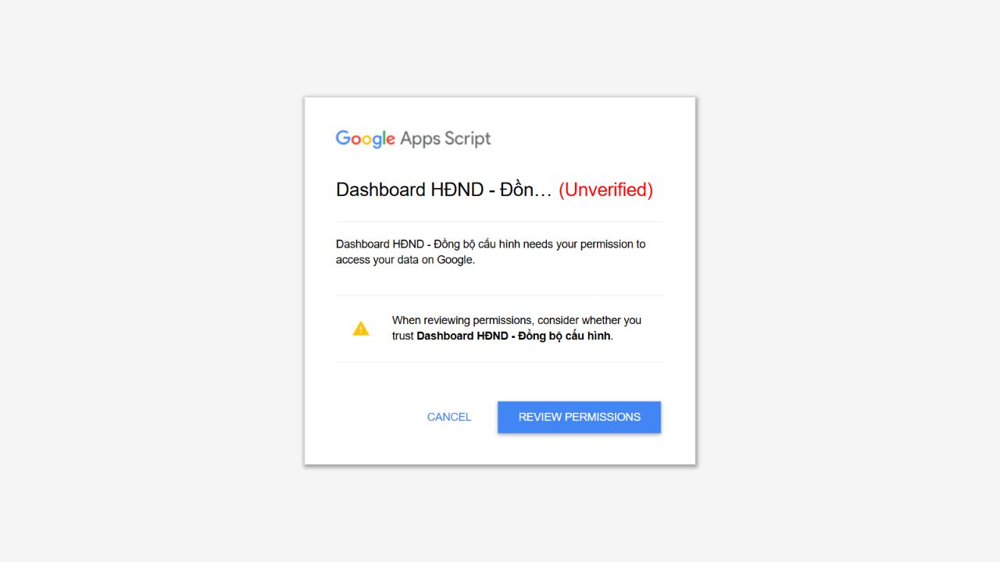

# Kiểm thử và nghiệm thu — lịch sử các mốc, cập nhật 19/10/2026

## Tooltip chung cố định và số không có biểu tượng — mốc xác nhận 19/10/2026

**Exact code:** `f0880c7fc7fa36e3720250fff9d41a4317385fad`, [Verify run #39222179712](https://github.com/cavoixanh638/HopHDND-WebApp/actions/runs/39222179712) **PASS**. TypeScript/build, **352 unit tests PASS/20 skipped**, **20 Firebase emulator tests PASS**, Chrome browser smoke trên GViz giả lập PASS. `SHARED_TOOLTIP_STRESS` trong Chrome mock: 300 sự kiện pointerover/out mô phỏng, 5ms tổng, một tooltip duy nhất; đây không phải phép đo tốc độ khung hình/độ trễ thiết bị thật.

**Các hành vi đã khóa bằng test:** vùng bấm phủ toàn bộ ô số dương trong cả 5 báo cáo, tổng nhóm/tổng cộng; bỏ hoàn toàn ký hiệu ↗ và cue "Xem" cạnh số; một panel `role=tooltip` **190×32 px**, đúng text `Click để xem chi tiết`, chỉ bật khi hover/focus có số, nội dung không phụ thuộc số lượng, không có `title` của browser, không có hover handler per button, một DOM node dùng chung. Chrome smoke kiểm liên tục 300 lượt cùng một node, pointer thực mở tooltip tại góc ô và click mở đúng dialog. Ô `—`, header, % không thành nút; bàn phím Tab/Enter/Space giữ nguyên. Việc mở danh sách nhiều hồ sơ vẫn có thể có độ trễ và cần benchmark độc lập.

**Phát hành:** [Publisher #39222487605](https://github.com/cavoixanh638/HopHDND-WebApp/actions/runs/39222487605) **PASS**, [Pages deploy #39222509495](https://github.com/cavoixanh638/HopHDND-WebApp/actions/runs/39222509495) **PASS**. Mở `https://cavoixanh638.github.io/HopHDND-WebApp/preview/shared-fixed-tooltip-2026-10-19/` để nghiệm thu; `preview/current/` được cập nhật, các preview trước còn nguyên. Root vẫn unchanged; PR #3 open/unmerged, không ghi Excel/Firebase.

## Bản PR #3 / preview sửa lỗi 19/10/2026 — bằng chứng và giới hạn

**Commit mã nguồn được kiểm:** `7a3a409e16b1b6621d121b09a57e9e7960c20568` · [Verify source run #39184896725](https://github.com/cavoixanh638/HopHDND-WebApp/actions/runs/39184896725): **SUCCESS**. Trong job: TypeScript PASS, **43 unit test files đạt/2 bỏ qua, 350 unit tests đạt/20 bỏ qua**; **20 Firebase Emulator tests đạt**, `docs:check`, `build:pages`, `build:pages:test` và **Chrome smoke với Google Sheets giả lập PASS**. Các warning `permission_denied` trong emulator là kết quả kiểm luật từ chối ghi, không phải đã kết nối Firebase production.

**Kiểm tra Chrome smoke đã có:** sort bằng nút và bằng tiêu đề, đủ các cột nguồn A–O trong Danh sách; chuyển tab, bảng không nhảy khi lọc, trạng thái hiện tại; bảng xây dựng NQ có header `Tổng số nội dung` tiếp theo là `Không phải trình`; số đếm có thể bấm mở `dialog.report-detail-modal`, modal tắt blur, đóng được. Build HTML là artifact của exact SHA. Unit test bảo vệ schema report `columnWidths`, đúng năm bảng và nội dung cột.

**Phát hành riêng bản xem trước:** [publish preview #39185030924](https://github.com/cavoixanh638/HopHDND-WebApp/actions/runs/39185030924) PASS, xác minh digest artifact SHA `fa6868898a364939a4c16fb4cf0bcc020e24713e5a8ee334e8450a036af39f02` từ run source. [Pages deployment #39185044694](https://github.com/cavoixanh638/HopHDND-WebApp/actions/runs/39185044694) SUCCESS; `preview/current` và `preview/ux-fixes-2026-10-19` xuất cùng nội dung. **Không merge PR #3, không đổi `main:index.html`**, không đo tốc độ bằng dữ liệu/Chrome của người dùng.

**Bảng điều kiện nghiệm thu trên trình duyệt thật (CHƯA PASS):**

| Mục cần thử | Điều kiện đạt | Tình trạng |
|---|---|---|
| Kéo cột nguồn F21 | Trong chế độ chỉnh, kéo ranh giới từng cột sang trái/phải; lưu bố cục; tải lại vẫn đúng kích thước; không vô tình sort/đổi thứ tự | Chưa thử browser/admin thật |
| Kéo cột 5 báo cáo F07/F09 | Kéo cột tên nhóm, tổng, trạng thái, %; độ rộng cột đầu không bị CSS 230px khóa; lưu từng báo cáo và đọc lại cấu hình trên thiết bị khác | Chưa thử browser/admin thật |
| Sort F13/F21 | Cả click tiêu đề và icon đều chuyển tăng → giảm → về gốc, header thể hiện trạng thái, không giật bảng hoặc cản thao tác kéo | Browser mock PASS; thao tác thật chưa nghiệm thu |
| Xem nội dung F06 | Bấm số lượng từ ô, tổng nhóm, tổng bảng phải hiện đủ đúng hồ sơ; mở/đóng tương đương độ mượt khi mở danh sách riêng | Logic/mock PASS; chưa benchmark Chrome Performance/React Profiler với dữ liệu thật |
| Năm báo cáo, tỷ lệ F01–F10 | Đủ 5 bảng, TBKL đúng, build có `Không phải trình` ngay sau tổng, trạng thái HĐND kết thúc đúng, KPI/tỷ lệ/chi tiết cùng phạm vi | Bảng mock PASS; `getKpis` vẫn có chỗ đếm `Hoàn thành` chưa đối chiếu, **CHƯA PASS toàn bộ** |
| Admin Firebase F23/F36 | Giao dịch lưu bố cục, danh mục, quyền ghi đúng phần và hiển thị thất bại/xung đột; không mất nháp, không tự sửa Excel | Emulator PASS, production chưa thử; **CHƯA PASS** |

Từ khóa `CHƯA PASS` ở trên phản ánh phần nghiệm thu chưa làm, **không có nghĩa CI thất bại**. Không lấy số lượng mock hoặc số liệu Excel kiểm ở thời điểm cũ làm kết quả sản xuất. Theo dõi lỗi và trạng thái ở [CURRENT_STATE](CURRENT_STATE.md).
> **Bản sao GitHub:** một số ảnh bằng chứng trong tài liệu lịch sử chưa được đồng bộ vào `docs/assets/`. Tên tệp được giữ để tra cứu trên bản lưu gốc; không xem đường dẫn này là ảnh có sẵn hoặc bằng chứng đã kiểm trên website.

## Pages 0.7.0 — Sheets và Firebase quản trị, 15/10/2026

Kết quả lượt hiện hành: **209 unit/hook/component tests đạt**, **12 emulator tests đạt** riêng, typecheck/build legacy/build Pages/build thử/docs check đạt. Các test mới kiểm App đọc GViz đúng URL/gid ngay cả khi Firebase chưa sẵn sàng, manual/poll60s và tab ẩn, giữ snapshot/nháp khi lỗi, không ghi dữ liệu nguồn, admin dùng chung đường lưu profile, khách không lưu bố trí và nhập Excel bị khóa. Controller kiểm chưa đọc baseline/khác revision/khóa lưu trùng/đọc lại thật/logout. Emulator kiểm danh tính verified Google chính xác, khách không sửa cấu hình kể cả multi-location update, quyền Sheets cell/row không cần dòng RTDB và khóa ghi `hdnd/items`. Regression giao dịch Firebase tương lai chạy riêng nhánh fake `hdnd-test/items` chỉ trong fixture.

UI HTML đã build cho emulator: đọc **51 nội dung trực tiếp từ GViz**, không có Firebase business rows; khách bị khóa cấu hình chung, sửa thử Nội dung NQ01 chỉ thành nháp local, refresh không xóa nháp. Sau thao tác, emulator vẫn không có items/profile; console ứng dụng không error/warn. Ảnh (tệp chưa đồng bộ: `assets/sheets-guest-draft-0.7.0.png`). Chưa kiểm lại OAuth Google thật trên Pages, chưa áp dụng Rules thật hoặc ghi dữ liệu nguồn. Số byte build và phạm vi chính xác ở [CURRENT_STATE](CURRENT_STATE.md).

## Lịch sử: Firebase-only Pages0.7.0 — trước quyết định giữ Sheets

Kết quả chuẩn và số liệu build tại [CURRENT_STATE](CURRENT_STATE.md), cách chạy/giới hạn tại [FIREBASE_PAGES](FIREBASE_PAGES.md).196 unit/hook/Excel tests và9 emulator tests đạt; chưa chạy trên Firebase thật. Trình duyệt kiểm HTML emulator: Anonymous,3 dòng giả, khóa riêng ô NQ02, popup cảnh báo, tự lưu có xác nhận, tab2 nhận không F5, nút export tải file3 dòng đúng giá trị. Bằng chứng (tệp chưa đồng bộ: `assets/firebase-autosave-0.7.0.png`). Google popup chưa hoàn tất trong IAB; chưa nghiệm thu OAuth/authorized domain thật. Không kết luận toàn bộ F01–F36 đạt hoặc đã đo tải50 người.

## Mốc local 0.6.2 — 15/10/2026

191 tests/24files; typecheck và build HTML/server đạt. HTML149.008byte/gzip43.601byte; không thêm dependency.

Test adapter/RPC mock giữ đúng mã nguồn NQ1, không dùng aliasNQ01 hoặc tự gửi lại sau mất phản hồi. Engine17 test IO fake kiểm backup/journal trước PUT,412, lost reply, replay cùng payload và giữ prepared khi chưa rõ. Service13 test fake Google/ZIP chạy actual codec/parser/engine: đổi Chuyên viên, đọc lại/history/replay, parts khác/style/ô khác, private/scope/source/baseline, journal-ID cache/Properties khi Drive index chậm và kiểm quan hệ khi đổi phân công. Hook/component kiểm Google writable vẫn là Google, refresh60s, trim, checkpoint/operationId, data-only không ghi bố trí và không thoát khi chưa lưu được. Fake ZIP không chứng minh workbook cloud; không coi các test này là20–30 người hoặc app đang mở đã được sửa.

Ngày15/10 lúc10:55, UI riêng /dev trên bản sao đã đổi dropdown Chuyên viên Trương Việt Hải→Nguyễn Văn Kỳ tại mục “công nghiệp sinh thái” (UI hiện NQ37), báo **Đã lưu 1 nội dung vào Excel và đọc lại xác nhận**, pending hết và readback đúng. Callback ban đầu lỗi với phản hồi object dù backend ghi xong; RPC save chuyển JSON string và adapter parse/validate, malformed JSON bị từ chối để giữ nháp. Lúc10:56:18 bản sao được khôi phục có điều kiện; ETag/hash pass. Ảnh lưu/readback bản sao (tệp chưa đồng bộ: `assets/ui-excel-save-pass-0.6.2.png`), ảnh khôi phục (tệp chưa đồng bộ: `assets/ui-excel-restore-pass-0.6.2.png`). Đây là bằng chứng riêng cho copy test, không phải main/nguồn chính.

### Main v6 — kiểm kết nối chỉ đọc, 15/10/2026

Theo duyệt người dùng, activation prep hoàn tất11:29; `checkDashboardExcelConnection` chạy11:30:08 với `backendReady=true`, actor `phucpixel2025@gmail.com`, count51, warnings0, configRevision12. Helper chỉ đọc status/snapshot/config và log summary; không gửi thay đổi. Deployment `/exec` hiện hữu giữ URL, version6 lúc11:31, app0.6.2 với `USER_ACCESSING/MYSELF`. Reload UI mới lúc11:34 hiện đúng actor/nguồn chính (ID `1VzcGF_-dAS-6yanFk-xPQ2vbdcv9bDEp`, gid60961344), 51 items và chế độ sửa; không submit dữ liệu lên nguồn chính. Ảnh main sẵn sàng (tệp chưa đồng bộ: `assets/main-excel-ready-0.6.2.png`), ảnh kiểm tra kết nối (tệp chưa đồng bộ: `assets/main-excel-connection-pass-0.6.2.png`). Đây xác nhận backend/UI kết nối, không phải phép ghi nguồn thật. F31 chưa hoàn tất; các phần công thức/cache/quota/nhiều người và workflow backup/conflict còn cần kiểm.

## Mốc 0.6.1 — quyền thử và nơi lưu

Người dùng đã cấp quyền dự án conditional probe riêng. Log Google ngày 14/10 lúc 15:37: ghi đầu200, ghi dùng ETag cũ412, blob đọc lại giữ HDND_COMMITTED, pass=true; cleanup đưa tệp giả vào Trash200. [Script thử](../server/probes/DriveConditionalProbe.gs), ảnh (tệp chưa đồng bộ: `assets/conditional-drive-pass-0.6.1.png`). Phạm vi chỉ tệp giả tự tạo, không Office/Excel thật hoặc nhiều người nhập trực tiếp. Không chấp nhận kết quả này làm nghiệm thu F31.

138 tests/19 files, typecheck và docs check (18 Markdown/268 liên kết/36 mã Fxx) đạt; build HTML/server trước đó đạt; artifact 142.124 byte/gzip 41.537 byte. /dev nhận 0.6.1; /exec vẫn 0.5.2/v5, không phát hành lại. Quyền app chính/kho giữ nguyên.

Google UI: menu Danh mục và bố trí dùng chung mở trang có mô tả/link kho riêng và đọc Google→app. Tùy chỉnh bảng vẫn mở được. Popup Ghi chú NQ01 dùng Áp dụng vào bảng; marker thử HDND_KIEM_TRA_NHAN_061 tạo1 phần sửa chưa ghi nguồn. Nút Chưa thể lưu vào Excel ở thanh dữ liệu và chế độ chỉnh đều disabled; Giữ thay đổi trên máy xác nhận chỉ browser. Đã kiểm marker đúng trước khi bỏ phần thử và trả cột Ghi chú về bố trí chung12; đọc51 dòng, console không error/warn. Không discard nháp của người dùng ở file HTML/trang đang dùng, không ghi NQ01 vào nguồn.

Hình minh họa Thông báo nơi giữ thay đổi và trạng thái lưu Excel (tệp chưa đồng bộ: `assets/clear-save-state-0.6.1.png`)

Luna sửa câu chữ UI/hướng dẫn theo file được giao, tổng chỉ huy review sửa các nhãn còn sót và guard thoát. Ghi Excel còn dở; action disabled chỉ làm rõ giới hạn, không coi là đã sửa chức năng ghi. Bước tiếp theo thuộc kế hoạch 1.15.

### Workbook giả — kiểm Google lúc19:39

[Driver](../server/probes/WorkbookRoundtripProbe.gs) dùng [core thử](../server/ExcelWriteCore.gs), fixture3tab tự tạo từ [script](../scripts/probes/create-write-fixture.py). Log có sameFileId/mimePreserved/firstStatus200/staleStatus412/blobMatchesUpload/contentReadBack/noteReadBack/otherPartsPreserved/otherCellsPreserved đều đúng, pass=true. Hash các part khác và raw XML ô không chỉnh nguyên; bao gồm công thức báo cáo/styles/tab phụ. Dò ID1 gốc rồi sửa C4 và chèn O4, không dựa ID hiển thị. Cleanup Trash200. Chưa kiểm mở Office đồng thời trong phép thử này, chưa adapter app.

Hình minh họa Workbook giả ghi/đọc và từ chối phiên bản cũ (tệp chưa đồng bộ: `assets/workbook-roundtrip-pass-0.6.1.png`)

Các lần lỗi trước pass đều dọn tệp giả Trash200: MIME xlsx phải đổi MIME bản sao blob thành application/zip để unzip; mã fixture phải ID1; parser row phải phân biệt hàng tự đóng để không nuốt đến dòng kế tiếp. Sửa core và thêm test cho hàng2/3 tự đóng trước4. Suite129/18+typecheck và docs check đạt sau sửa, gồm16 test core. Các test kiểm giá trị gốc/unknownfields/IDSTT/formula/merged/UTF/CR/dò mã dòng đã di chuyển.

Kiểm UI /dev thêm: sửa Nội dung thành marker HDND_KIEM_TRA_THOAT_061 → Áp dụng vào bảng → Về chế độ xem hiện cảnh báo rõ; Giữ thay đổi trên máy và về xem giữ1 phần sửa, không gọi commit nguồn. Kiểm marker rồi bỏ đúng phần thử, console không warn/error, kho12. Không bỏ nháp HTML của người dùng.

Hình minh họa Cảnh báo trước khi rời chế độ sửa (tệp chưa đồng bộ: `assets/exit-save-state-0.6.1.png`)

### Quyền và bản sao đọc muộn

ExistingCopyAccessProbe trả404/canRead=false lúc19:03; connector cùng lúc xác nhận bản sao vẫn tồn tại/owner-only. Quyền drive.file thử chưa cho dự án truy cập tệp có sẵn. Không thêm quyền Drive vào app chính; không đổi sharing.

Blob bản sao đọc muộn123.364byte/SHA256 eb7fd758b5e296026443fa820df27e1f3f5112a2d6acfab3ba70ea034bc247f9 có18parts/3tabs/142 ô công thức, C4 đã phục hồi. So sánh tất cả giá trị và biểu thức công thức không có khác biệt; worksheet/sharedStrings/styles được viết lại, tác nhân chưa rõ. Không suy từ phép đọc blob ngay sau setValue trước đó thành kết luận native writer không bao giờ ghi được Excel. Sửa thống kê150→142 vì prefix `<f` đếm nhầm8 `<fill>`; script kiểm dùng namespace và phần tử worksheet f.

### Office trực tiếp — workbook giả, một tài khoản

Tệp giả tự tạo19:45, UI giữ .xlsx/Private to only me. Sửa C5 qua Office rồi Saved to Drive. Driver đọc blob xác nhận Office marker/ETag mới trước bất cứ PUT nào. Yêu cầu dùng ETag trước sửa bị từ chối412; nạp blob mới/ghép C4 theo ID1, đọc lại đúng marker app và Office; hash part không sửa/raw ô khác/ID/MIME giữ. Log19:48:23 pass=true. Tab Office đang mở đọc C4 thấy marker writer. Đọc lại19:50:30 có lateReadOnly/officeValuePreserved/appValuePreserved/pass=true. Đã đóng tab Office thử và cleanup19:55 trả trashed=true/HTTP200. Không thử nhiều người hay workbook nguồn thật; không coi là nghiệm thu F31 hoặc authorization cho ghi nguồn.

Hình minh họa Giữ sửa Office và từ chối ghi phiên bản cũ (tệp chưa đồng bộ: `assets/office-concurrency-pass-0.6.1.png`)

Probe bản sao hiện hữu và manifest Drive rộng chỉ chuẩn bị local; chưa upload/chạy. Quyền mới chờ lựa chọn người dùng. Nếu kiểm bản sao, rollback phải có ETag của lần thử, không ghi đè sửa xảy ra sau test; nguồn ID/link Excel chính không được dùng trong probe.

### Chuẩn bị quyền Drive rộng sau lựa chọn của người dùng

Người dùng chấp thuận Drive rộng **chỉ dự án thử riêng**. Đã lưu manifest drive/external_request và ExistingCopyWorkbookProbe vào dự án thử; Google yêu cầu Authorization required khi chạy hàm GET checkExistingCopyAccess, chưa xác nhận OAuth mới hoặc chạy writer. Probe dùng ID copy cố định, kiểm tên/private/MIME/labels.trashed của Drivev2, đọc lại ETag trước ghi, và rollback có điều kiện rồi đối chiếu bytes gốc trước pass. Main app chỉ Sheets/private, chưa thêm writer hoặc quyền Drive.

Luna thêm9 test mock: metadata404, tên/MIME sai, tệp trong Trash/thiếu trạng thái, permissions trống/public, ETag đổi khi đọc đều không PUT/POST và nhả lock; thiếu scope dừng trước token/lock/HTTP. Full138/19, typecheck đạt. Đây là kiểm guard local, không phải ghi bản sao cloud đã thành công. Trình tự tiếp: người dùng cấp quyền mới trên Google → kiểm GET bản sao200 → mới chạy roundtrip/rollback trên copy; không ghi nguồn.

GET23:05 vẫn404 trong khi connector xác nhận copy/private/owner tồn tại. Sau thêm getAuthorizationInfo theo scope + requireScopes, execution23:14 log REQUIRED và báo thiếu drive; dừng trước GET/About/ghi. Hộp Review permissions đã được hiện để người dùng tự cấp. Ảnh bước Google (tệp chưa đồng bộ: `assets/drive-scope-required-0.6.1.png`). Mã không chủ động log token hoặc URL xác thực; Google tự hiện đường cấp quyền khi thiếu scope. Chưa xác định tài khoản sai hoặc chứng minh quyền mới đã cấp.

### Quyền thực tế và bản sao cấu trúc nguồn — PASS

Google23:19: driveAuthorization NOT_REQUIRED, About200/tài khoản khớp owner, GET copy200 XLSX/ETag. Không nhận tin nhắn đã cấp quyền làm bằng chứng duy nhất; đã kiểm API thật. Không đổi scope app chính.

Execution23:21:51–23:22:13 chạy ExistingCopyWorkbookProbe trên19fv9wGwsT2U0zPaFWpa-mnoKLsW2xBD7 đã xác minh private/title/MIME/labels/ETag. C4 có marker thử theo code gốc; readback/hash upload/các part và raw ô khác/sameID/MIME đúng; stale412. Rollback chỉ khi ETag vẫn đúng lần thử, đọc lại SHA blob bằng bản trước thử. Log mới in pass=true và restoredOriginalBytes=true sau xác nhận khôi phục. Không ghi Excel nguồn/kho; giữ copy sau thử. Proof JSON riêng ở .private-probes/existing-copy-roundtrip-result.json, không đưa dữ liệu workbook vào artifact app.

Hình minh họa Bản sao nguồn ghi/đọc và khôi phục đúng bytes (tệp chưa đồng bộ: `assets/existing-copy-roundtrip-pass-0.6.1.png`)

Giới hạn: một thao tác C4 trên copy, không nghiệm thu nhiều người/cache công thức/timeout/retry/backup bền. Các test fake bảo vệ trước ghi không thay thử cloud mọi nhánh. Writer chưa nối app và /exec chưa phát hành lại. Bước tích hợp nằm kế hoạch1.16; ghi source thật chưa được cấp quyền bởi thử copy.

## Mốc 0.6.0 — bản thử /dev ngày 14/10/2026

113 tests/17 files, typecheck, build HTML/build server đạt. HTML 138.001 byte/gzip 40.892 byte; không thêm dependency. Google /exec chưa phát hành lại, vẫn v5/0.5.2. Bằng chứng lượt này dùng /dev riêng, cùng tài khoản chủ sở hữu.

| Kiểm tra | Kết quả |
|---|---|
| Một bước vào chỉnh, popover Sở/Chuyên viên | Một lần bấm mở danh sách tại ô; search ky tìm Nguyễn Văn Kỳ; ID/STT không sửa |
| Popup Nội dung | Esc khi đã đổi hiện3 lựa chọn; Lưu vào nháp không ghi nguồn |
| Popup Ghi chú | X khi đã đổi hiện3 lựa chọn; bỏ sửa popup không xóa nháp Ghi chú đã lưu trước đó |
| Trình/Rút | Chọn Đã rút tạo1nháp, danh sách Đang trình50/51; bỏ nháp trở lại51/51, không ghi nguồn |
| Lưu dữ liệu nguồn | Writer chưa bật, báo lỗi rõ và giữ1 nháp; autosave checkpoint quan sát10 giây; sau kiểm đã bỏ nháp thử |
| Khung riêng | 800px cho card800/table1500;2400px bị cap card1209/table1500, trang1265 không tràn |
| Lưu bố trí Google | Base10 →11/frame800; tab độc lập đọc11 và đo800; trả auto12, tab độc lập đọc12/card1209/table1500, giữ columns/catalogs người dùng |
| Client cũ và URL preview | Test thiếu frameWidth bị chặn, /dev không làm editorUrl sai; UI save bố trí đạt sau sửa |

Hình minh họa Cảnh báo đóng Ghi chú chưa lưu (tệp chưa đồng bộ: `assets/note-warning-0.6.0.png`)

Hình minh họa Lỗi ghi Excel giữ nháp (tệp chưa đồng bộ: `assets/edit-draft-0.6.0.png`)

Kiểm writer trên bản sao riêng, không trên nguồn: patch C4 bằng ZIP bảo toàn18 parts/3 tabs/142 formulas; Drive files.update giữ ID/link, blob tải lại đúng hash bản sửa. SHA256 gốc a74e4e77aa00f6dd895aa2bccdbbb360d50820141274f0db248418f53aa72bdc; bản sửa/readback2bf5e6489b7c10f1a6ada4f4cf72aff0225ffaf2bc0aa35b58baf1af5fa5ba04. Đã trả blob bản sao về gốc. SpreadsheetApp setValue/flush/getValue báo marker nhưng blob tải lại vẫn hash gốc và C4 không đổi; test này **không đạt ghi Excel**. Không dùng echo API làm nghiệm thu. Script/hash riêng ở .private-probes và server/probes, không đưa dữ liệu nguồn vào artifact HTML.

Probe If-Match mới chỉ chuẩn bị và chờ người dùng cấp quyền dự án riêng, chưa có kết quả. Hộp yêu cầu quyền (tệp chưa đồng bộ: `assets/drive-probe-permissions-0.6.0.png`). Chưa chứng minh an toàn khi20–30 người nhập trực tiếp Office; không bật writer thật. X/Esc có bằng chứng UI, click nền chưa kiểm đầy đủ. HTTP localhost không truy cập được trong trình duyệt lượt này; không coi kiểm /dev là kiểm file://. Các nhánh partialack/race giữ nháp là test repository giả.

## Mốc 0.5.2 — 14/10/2026

104 tests/17 files, typecheck, build HTML và build server đạt. Không thêm thư viện. Thêm tests/config-state.test.ts với 12 regression tests cho tải chậm/đổi màn, read lỗi và retry, khác revision khi chỉnh, read cũ trả sau save, gửi ghi trùng, đổi nguồn, khởi tạo chỉ khi kho xác nhận trống, HTML không ghi và checkpoint giữ trong view/khác base/nạp/bỏ. Dùng scheduler hook nhỏ và repository giả; không coi là kiểm Google thật.

Google cập nhật deployment v5 lúc 10:06, giữ cùng URL/USER_ACCESSING/Only myself. Đọc cấu hình6 và 51 dòng thật đạt; chỉnh bảng width1500→1600 rồi Lưu và thoát báo Đã lưu chung7; tab kiểm tra độc lập cùng tài khoản đọc7 và giá trị1600. Khôi phục1500 rồi Lưu báo8; tab kiểm tra Làm mới đọc8, editor hiện1500. Không ghi nội dung nguồn. Màn chỉ đọc được ghi rõ Dữ liệu nguồn · Chỉ đọc.

Hình minh họa Lưu cấu hình thật thành công (tệp chưa đồng bộ: `assets/shared-save-0.5.2.png`)

Hình minh họa Deployment v5 thành công (tệp chưa đồng bộ: `assets/deployment-0.5.2.png`)

Giới hạn: chưa thử nhiều tài khoản/máy, chưa giả lập lỗi mạng bằng trình duyệt Google; các nhánh read lỗi/race được kiểm bằng tests local. Chưa kiểm hết modal checkpoint khác base qua UI Google. Không đổi quyền private hoặc triển khai mật khẩu/backend mới.

## Mốc 0.5.1 — 14/10/2026

Typecheck, 92 tests/16 files, build và cú pháp core/server đạt. Một HTML 125.393 byte, gzip 37.642 byte. Không thêm dependency. Kiểm HTTP desktop bằng dữ liệu mẫu; nguồn Excel thật vẫn đọc 51, không ghi.

| Luồng | Bằng chứng thực tế |
|---|---|
| Độ rộng | Nhập 2400 → getBoundingClientRect.width = 2400; frame 728, scrollWidth 2403. Bảng cuộn, trang không tràn ngang toàn bộ |
| Cột | Alt+→ và pointer drag Sở qua Nội dung đổi thứ tự; Alt+← đưa Nội dung trước ID, Lưu/mở lại giữ thứ tự. Chế độ xem không resize/focus/drag |
| Chuyên viên | Click ô mở picker; mau d lọc tên mẫu D, current A được giữ nếu không khớp. Chọn D đúng quan hệ phòng |
| Nội dung | Sửa popup → đóng → cảnh báo ba lựa chọn → tiếp tục → Lưu vào nháp → Lưu parent thành công 1 bản ghi, nội dung + CV D giữ trong phiên |
| Nháp | Quan sát checkpoint chu kỳ 10 giây. Checkpoint không phải lưu nguồn hoặc đồng bộ |
| Catalog 0.5 | Move lãnh đạo mẫu 3 → Lưu: báo cáo/preview, lọc, selector và mở catalog lại đúng 3/1/2; test mục trạng thái đã xóa không tự quay lại |
| Artifact cuối | Mở một Dashboard_HĐND.html qua HTTP, đọc 51 dòng nguồn; demo bảng 2500px và pointer drag Nội dung trước ID/Lưu đạt; console không error/warn |
| Server | Fake Google services kiểm init/section preservation/conflict/partial commit/retry/validation/lock; chưa bằng chứng cloud thật |
| Cloud | v3 owner-only (v4 09:15 cập nhật lời hướng dẫn, read rev6 sau reload đạt): init1/catalog2/item3–4/report5–6 đều read/write qua RPC, đọc lại tab khác đúng; stale base2 width2200 bị chặn khi bản chung3 width2400, nháp còn nguyên. Hiện rev6 trả width/tên thử về gốc, giữ thứ tự VP theo ảnh |

Hình minh họa Bố trí bảng dữ liệu mẫu (tệp chưa đồng bộ: `assets/table-edit-0.5.1.png`)

Hình minh họa Deployment riêng thành công (tệp chưa đồng bộ: `assets/deployment-0.5.1.png`)

Lỗi URL parser chỉ gặp trước v3, đã sửa và xác minh RPC sau đó. Duyệt tài liệu có một lượt ghi nhầm lỗi tái diễn sau revision2; parent đối chiếu UI revision6 và sửa.

Hình minh họa Cấu hình chung đọc lại ở tab thứ hai (tệp chưa đồng bộ: `assets/shared-config-0.5.1.png`)

Người dùng đã chọn giữ kho riêng; Drive API kiểm chỉ một owner. Hai tab cùng account không thay nghiệm thu hai máy/tài khoản.

Không tuyên bố đã kiểm file://, share HTML trên Drive, ghi Excel thật, quota 20–50 người hay đồng bộ nhiều máy. ANYONE bị auto review chặn vì chưa xác định người được truy cập; bản thử dùng MYSELF. Không tự cấp OAuth hoặc bỏ qua cảnh báo Google.

## Mốc 0.4.0 — bảng, danh mục và nháp phục hồi

13/10/2026. Typecheck, **68 tests/12 file**, kiểm cú pháp JS inline đạt. Build Preact một HTML **107.053 byte, gzip 32.553 byte**, không thêm dependency. Browser qua Vite HTTP desktop, đọc nguồn chỉ định và thao tác dữ liệu giả; không ghi/đổi quyền Sheets. Mở file/Drive, crash và responsive 0.4.0 chưa kiểm chứng.

| Luồng | Kết quả quan sát |
|---|---|
| Report | Ba control cạnh preview; đổi thứ tự cột phản ánh cùng bảng; save/exit/recovery có guard |
| Danh sách | ID NQ01/BC03 riêng; Nội dung chuyển trước ID; numeric khung 1050/cột 520, keyboard tăng 530 px; độ rộng trống báo lỗi, không đóng; nhóm cột có vùng cuộn |
| Danh mục | 11 nhóm; tìm không dấu, thêm/đổi tên/xóa giá trị thử chưa dùng; rename giá trị đang dùng bị chặn; Esc rename chỉ hủy ô tên |
| Quan hệ | Chuyên viên mẫu A thuộc hai phòng; đổi phòng trong mẫu lọc đúng danh sách chuyên viên; tùy chọn toàn cơ quan có control |
| Thoát | Report, danh sách, riêng dữ liệu mẫu, nội dung popup, catalog config/form và link/gid có ba lựa chọn; lưu URL sai giữ nguồn/modal; hủy trả giá trị cũ |
| Phục hồi | Quan sát tự lưu rồi mở tab thử khác cùng origin: tiêu đề chưa Lưu và tiến độ mẫu chưa Lưu được phục hồi; bỏ nháp đã thử; các tab phụ đóng |

Tests mới gồm item-preferences, display-id, catalogs, draft-checkpoints và workspace-recovery; test report-preferences bổ sung thứ tự/migration, search bổ sung ID alias. Kiểm schema/storage/source/nháp đang nhập dở/base/patch sai bằng fake. Guard hook/ref thực tế được kiểm browser, chưa có bộ test tự động cho mọi vòng đời native browser.

Log dev từng ghi một lỗi HMR lúc prop onClose mới chưa ghép vào App (22:52); sau tích hợp typecheck/build và nạp lại source đạt. Không phát hiện lỗi mới trong các thao tác cuối; không dùng log cũ để kết luận artifact lỗi. Nháp khi quay lại giá trị gốc xóa checkpoint; sự cố trước checkpoint vẫn có thể mất phần nhập mới. Lịch sử/demo đã Lưu chỉ giữ trong phiên, chưa cache Sheets offline.

Kiểm lại trên phiên sạch sau tích hợp: nhập tiêu đề thử, quan sát tự lưu, đưa về đúng tên gốc, thoát rồi mở lại không có thông báo phục hồi và không có tiêu đề thử. Console phiên kiểm cuối không lỗi/cảnh báo mới. Sửa grid min-width để preview cuộn trong bảng: document scrollWidth bằng clientWidth (1265 px) ở lượt desktop này, không còn tràn cả trang.

Kiểm tài liệu sau cập nhật: 17 Markdown, 153 link tương đối, đủ 36 mã FEATURES duy nhất, đạt.

Hình minh họa Nhóm cột ngay gần bảng dữ liệu mẫu (tệp chưa đồng bộ: `assets/columns-0.4.0.png`)

Hình minh họa Tùy chỉnh báo cáo cạnh preview (tệp chưa đồng bộ: `assets/customize-0.4.0.png`)

Phần thiếu được giữ tại CURRENT_STATE/FEATURES, không đánh dấu toàn bộ app đạt chỉ vì có menu danh mục hoặc autosave. Quy trình file:// bị công cụ chặn; chưa kiểm Drive/người nhận, print nhiều trang, tải đồng thời hoặc ghi/auth.

## Mốc 0.3.0 — bố trí bảng trong chế độ riêng

13/10/2026, cùng môi trường; source UI qua Vite HTTP cục bộ. Typecheck đạt; 42 tests/7 file đạt (36 nền + 6 report-preferences). Build chính sau sửa Esc tạo đúng một HTML 75.309 byte, gzip zlib 24.743 byte; kiểm cú pháp JS inline đạt. Không thêm thư viện. Chưa thử trực tiếp file:// hoặc HTML tải từ Drive.

| Luồng browser desktop | Kết quả |
|---|---|
| Tổng quan mặc định | Không có textbox/checkbox cấu hình; ba tab xem và nhóm bánh răng |
| Đổi tên NQ, đưa lên đầu, ẩn BC rồi Lưu | Chỉ hai bảng đúng thứ tự/tên; KPI 51/51/0/0 không đổi; reload giữ bố trí |
| Tên trống và Hủy | Tên trống báo lỗi; xác nhận bỏ tùy chỉnh giữ bố trí đã lưu |
| Ẩn tất cả bảng | KPI còn; có hướng dẫn mở lại qua bánh răng |
| Khôi phục mặc định | Xác nhận vào nháp, Lưu trả đúng ba bảng/tên/thứ tự mặc định |
| Danh sách | Chọn cột chỉ xuất hiện trong chế độ riêng; bật Ghi chú rồi về xem giữ cột và ẩn controls |
| Esc ngay sau nhập tên | Ban đầu có lỗi do listener đọc trạng thái cũ; sửa ref, thử lại hiện xác nhận bỏ nháp |
| Console | Không lỗi/cảnh báo tại lượt kiểm tra trước sửa Esc; không phát hiện lỗi UI sau sửa |

Tests mới kiểm tên/ID/cột/visibility không hợp lệ, thứ tự/ẩn không đổi phạm vi báo cáo, layout lưu theo source/gid/mẫu, corrupt/schema/source khác, storage chặn và không ghi cấu hình lỗi đè bản tốt. Browser không đo tải nhiều người, in nhiều trang hay responsive mới; không coi các phần đó đã đạt.

Ảnh sau sửa Esc đã lưu; lần chụp trước gặp lỗi/hạn mức duyệt tự động, lần thử sau thời điểm đặt lại hạn mức thành công qua cùng cơ chế duyệt:

Hình minh họa Chế độ tùy chỉnh 0.3.0 (tệp chưa đồng bộ: `assets/customize-0.3.0.jpg`)

Phạm vi chưa có: thêm/xóa bảng, định dạng title/mapping/source/trục, JSON/Excel, cache dữ liệu bền, ghi/auth/lịch sử thật. Cột danh sách còn state component, chưa lưu bền. Tên/thứ tự/hiển thị báo cáo lưu riêng browser/source; không đổi cấu hình của tất cả người nhận HTML.

## Rà độ phủ chức năng ngày 13/10/2026 — tài liệu sau mốc 0.2.0

Đọc mã active HTML cũ/hai script và source mới; Luna lập inventory phần đơn giản, tổng chỉ huy kiểm lại báo cáo/editor/popup/cấu hình và tích hợp. Bảng đối chiếu 36/36 mã duy nhất, vị trí dòng mã cũ, giới hạn và phần thiếu thuộc [CURRENT_STATE](CURRENT_STATE.md), không lập thêm bảng trạng thái tại đây. Đã phân biệt popup cũ chỉ có mã/nội dung/phân công; ID/STT chỉ xem; từ khóa/cờ khối KPI chỉ chỉnh gián tiếp qua JSON; full-data backup cũ ở Excel, khác JSON cấu hình.

`npm run docs:check` đạt: 17 Markdown, 127 link tương đối, đủ 36 mã FEATURES duy nhất. Rà lại 36 dòng đối chiếu trong CURRENT_STATE. Lượt này không đổi source/artifact, không chạy lại tests/browser hoặc xác nhận server cũ đã deploy; kết quả 36 tests và HTML 65.387 byte vẫn thuộc mốc 0.2.0 phía dưới. Các editor và mốc 1B ở kế hoạch 1.6/ARCHITECTURE mục 17 là thiết kế cần triển khai, chưa được ghi là pass UI.

## Mốc 0.2.0 — cấu hình link và đọc nguồn Sheets

Ngày 13/10/2026, cùng máy/runtime. Tests dùng dữ liệu giả; kiểm tra tích hợp browser HTTP đọc nguồn được người dùng chỉ định, không ghi dữ liệu hoặc đổi quyền. Nguồn: `https://docs.google.com/spreadsheets/d/1VzcGF_-dAS-6yanFk-xPQ2vbdcv9bDEp/edit?gid=60961344`.

| Kiểm tra | Kết quả quan sát |
|---|---|
| Typecheck và unit tests | Đạt; 36 tests/6 file: 10 nghiệp vụ, 15 cấu hình, 7 parser, 4 adapter |
| Build chính | Một HTML 65.387 byte; gzip bằng zlib 22.473 byte; kiểm cú pháp JS inline đạt |
| Link chia sẻ đầy đủ, không gid | Giữ gid 60961344 của cùng file; Kiểm tra báo 51 nội dung |
| Kết nối và tải lại UI | Nguồn chuẩn chứa gid đúng, đọc thành công; cấu hình khôi phục sau reload |
| Danh sách nguồn thật | 51/51 nội dung tại lượt kiểm tra; không có nút Sửa bản nháp/cột lịch sử mẫu |
| URL host khác | Lỗi tiếng Việt, link nguồn đang dùng giữ nguyên |
| Chuyển mẫu rồi kết nối lại | Banner đúng nguồn, quay về đọc Sheets thành công |
| Console | Không thấy lỗi/cảnh báo ở lượt kiểm tra cuối |

Tests cấu hình kiểm tra canonical URL, gid query/hash/override, reject host/path/credential/port sai, storage roundtrip/corrupt/blocked. Parser kiểm 16 cột, tiêu đề nhiều dòng, trùng/thiếu mã, loại mâu thuẫn, ô thiếu, formatted fallback và payload lỗi. Adapter giả lập kiểm timeout/script lỗi/cleanup, payload lỗi và seed snapshot/read-only. Chưa mô phỏng hết hành vi quyền/mạng thật hoặc kiểm nhiều người.

Ảnh kết nối không chứa nội dung bản ghi thực tế:

Hình minh họa Kết nối nguồn — 51 nội dung (tệp chưa đồng bộ: `assets/connection-0.2.0.jpg`)

Giới hạn: đây là kiểm source qua HTTP cục bộ, chưa mở artifact trực tiếp file:// hoặc từ Drive do công cụ chặn giao thức đó. Chưa OAuth/nguồn riêng tư, đo chu kỳ polling/quota thực tế, nhiều tài khoản, nhiều người, in/Excel, hoặc ghi nguồn. HTML không chứa dữ liệu thật; lưu link riêng trên browser không đổi cấu hình của mọi người. Không có phép so sánh React/Preact mới ở 0.2.0. Số đo gzip không khẳng định Drive nén khi truyền file.

## Mốc bản thử 0.1.0 — báo cáo lịch sử

Ngày: 13/10/2026. Máy Windows hiện tại, Node v24.15.0; fixture giả 24 dòng. Browser UI: Codex in-app browser, server Vite HTTP cục bộ mode Preact. Không dùng dữ liệu thật.

## Kiểm tra tự động

- Typecheck đạt; `npm test`: 10 test/3 file đạt. Kiểm tra tìm không dấu, NQ/BC, rút/lưu trữ, unknown/cột ẩn, nháp không ghi, revert, conflict/replay/partial batch và payload không hợp lệ.
- Build Preact/React cùng source đạt; đúng một HTML; script kiểm cú pháp bundle inline mà không thực thi trong Node.
- `npm audit`: 0 cảnh báo sau khi bỏ plugin singlefile có phụ thuộc cảnh báo; đây chỉ là kết quả ở thời điểm kiểm tra.

## Đóng gói

| Bản thử cùng source | HTML chưa nén | Gzip đo bằng Node zlib |
|---|---:|---:|
| Preact compat | 55.406 byte | 19.006 byte |
| React | 259.977 byte | 79.767 byte |

Đây là prototype chưa có Excel/Sheets adapter. Gzip dùng so sánh, không khẳng định Drive truyền file được nén gzip. Không kết luận thời gian mở app/độ trễ lưu chỉ từ dung lượng.

## Luồng UI đã quan sát

| Luồng | Kết quả |
|---|---|
| Tìm NQ-MAU-001 | Khớp NQ-MẪU-001, đúng 1 kết quả |
| Sửa tiến độ thành Hoàn thành | Có nháp; KPI vẫn 20/4/5/4 trước Lưu |
| Lưu | KPI thành 20/3/5/5; lịch sử Sở chưa trình → Hoàn thành |
| Popup Ctrl+Enter | Đưa nội dung vào nháp, không ghi ngay |
| Hủy | Xác nhận trong app; nội dung về bản đã lưu |
| Ẩn cột Hoàn thành của bảng NQ | Tổng vẫn 13, tỷ lệ 23%; thông báo 3 nội dung trong cột ẩn |
| Bấm ô số lượng 1 | Đúng 1 nội dung cùng nhóm/trạng thái |
| Desktop và 390 px | Trang không tràn ngang toàn bộ; bảng cuộn trong khung |

Ảnh chỉ chứng minh bố cục ở thời điểm chụp, không thay kiểm tra nghiệp vụ:

Hình minh họa Bản thử dữ liệu giả (tệp chưa đồng bộ: `assets/prototype-0.1.0.jpg`)

## Benchmark hàm, chưa phải browser

`npm run benchmark`: 50 lượt mỗi cỡ fixture, P95 trên Node/máy hiện tại.

| Dòng | Tạo chỉ mục | P95 tìm kiếm | P95 tính ba báo cáo |
|---|---:|---:|---:|
| 1.000 | 3,71 ms | 0,41 ms | 4,64 ms |
| 5.000 | 16,59 ms | 2,19 ms | 21,78 ms |

Chưa đo DOM/render, mạng/Sheets; số đo tùy máy/lượt chạy. Chưa dùng số này nghiệm thu tốc độ tìm UI hoặc quy mô người dùng.

## Giới hạn cần kiểm tra tiếp

Ở mốc 0.1.0 browser công cụ chặn file URL; chưa mở trực tiếp HTML tải từ Drive. Mới kiểm cấu trúc/cú pháp artifact và UI source qua HTTP. Chưa kiểm in nhiều trang, Sheets, quota/quyền, dữ liệu thật, restore và tất cả F01–F36. Kết quả Sheets mới xem mốc 0.2.0 phía trên.
