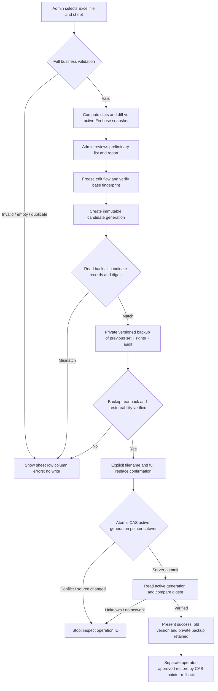

# PR #94 — Firebase-only, Excel A–O and versioned dataset replacement

**29/10/2026 — DRAFT / SECURITY HOLD.** Branch `feat/firebase-only-excel-replacement-20261029` starts at `main` commit `ad3b544812ae53ff397eb1821078d17acdd45e99` after PR #92. This document is a *new* handoff; no historical handoff or CURRENT_STATE was modified.

## Business requirements

- The public/admin views read Firebase primary data. Google Auth for the sole administrator remains; Google Sheets must **not** be a live, polled, selectable data source.
- Retire the personal display preset tools and the checkbox “Chọn chuyên viên toàn cơ quan”, and the invisible personal layout/filter left behind by browser storage. Preserve table-level Room/Specialist filters and PR #92 styling, grouping, resize, CAS, summary cards, stage-filter buttons.
- Compact the two Overview / Danh sách top navigation tiles, retaining active appearance, focus/keyboard usability and mobile responsiveness.
- Parse a user-selected sheet of an ordinary Excel workbook, matching the real source's A–O columns and their business meaning. Never require the user to write technical `recordId` or `documentKind` fields.
- Replace the *whole active dataset*, never append. Removed records disappear from the active version. System configuration, auth identities, backups and shared layout survive; per-record permissions and edit history must **not** leak to reused IDs.

## Intended state machine



### Proposed Firebase tree (candidate Rules, **not deployed**)

```
hdnd/
  items/{id}                              # legacy generation; retained
  activeDataset                           # sole atomic cutover pointer
  datasetVersions/{generation}/
    manifest                              # operationId,digest,count,createdBy
    items/{id}                            # staged immutable generation
  datasetPermissions/{generation}         # generation-scoped rights; no inheritance
  datasetEditLocks/{generation}/{id}/{field}
  datasetBackups/{operationId}            # PRIVATE full previous data/rights/locks
  profile                                 # unchanged shared layout/report/catalog
  editors                                 # unchanged admin/employee identities
```

**Design invariant:** One atomic pointer transition selects either the whole old or the whole new collection; no delete-all/create-row loop. Legacy and prior generations remain stored for restore until an explicitly separate cleanup program is approved. Writer, autosave drafts, cell leases and permissions are scoped to generation. Existing `FirebaseRepository.importItems` and `firebase-primary-bootstrap.ts` add-only/empty-root guards are left intact.

## Files changed in this PR

- `source/src/features/items/ItemList.tsx`, `source/src/styles/app.css`: no personal presets or global-specialist checkbox; tight nav.
- `source/src/data/business-excel.ts`, `source/tests/business-excel.test.ts`: explicit sheet; template; A–O parser; strict issues; stable ID mapping.
- `source/src/data/versioned-dataset-replacement.ts`: plan/stage/verify/backup/CAS/operation check/restore model.
- `source/src/features/settings/BusinessExcelReplacementPanel.tsx`, `ExcelTransferPanel.tsx`: file picker/preview/staged workflow shell.
- `source/src/state/use-firebase.ts`, `source/src/app/App.tsx`, `source/src/data/cell-edit-leases.ts`: active-generation subscription, namespaced rights/leases/drafts.
- `source/firebase/database.versioned-replacement-candidate.rules.json`: **new isolated candidate, NOT active production Rules**.
- `source/tests/versioned-dataset-replacement.test.ts`, `source/scripts/test-firebase.mjs`: test candidate with emulator and malicious/public denial.

## Current release gate (must be reviewed independently by Codex)

**The UI has `replacementEnabled={false}`, and PR is DRAFT; deployment/merge prohibited.** The candidate Rule cannot be made active until all tests prove:
1. Admin alone stages candidate, backs up and atomically activates; guest cannot stage/activate or read private backups; FROZEN + editingLocked enforced.
2. Read-back digest and row-field comparison; empty/duplicate/invalid sheet rejected; multi-sheet requires manual sheet selection.
3. At least two concurrent admin tabs: one wins version pointer; other cannot overwrite; stale operationId is recognized on disconnect and never replayed as a new cutover.
4. A lease/draft of version N cannot edit version N+1, including reused `recordId`; no inherited row/cell permissions, history or audit on new generation.
5. Private backup includes data, rights, history, locks and is verifiable, restoreable without deleting current generation; old-version denial after switch and reenabled old rights on authorized restore.
6. Preview uses **actual** list/report components on the candidate, counts/stage filters match; all old records absent from active generation after switch; no mixed views.
7. React/TypeScript/unit/RTDB Emulator/Chromium smoke and before/after screenshots all pass on **exact final HEAD**.
8. Google Sheets URL controls, GViz traffic, polling and source-switch actions are absent in **production build**; Google Auth still works.
9. No source file, live data, backups, private Google Sheet, or customer document may be committed or uploaded to public artifacts.

**Known limitations requiring further implementation/independent review:** The UI currently exposes a candidate *table* preview but not the full read-only Report + List on the candidate; full server-side dataset switch with private backup has not been production-proven; candidate RTDB Rules need an explicit passing emulator suite and security review; conflict on network failure needs deterministic API and UI check; screenshots of the compacted navigation are not yet collected. The feature remains fail-closed until those gates are satisfied.

## Safety

No production Rules/Functions/Hosting deployment, source migration, account changes, data import/delete or Pages publish. Only source code and synthetic tests in this public GitHub PR. Keep it DRAFT until Codex accepts security and the owner separately authorizes release.
