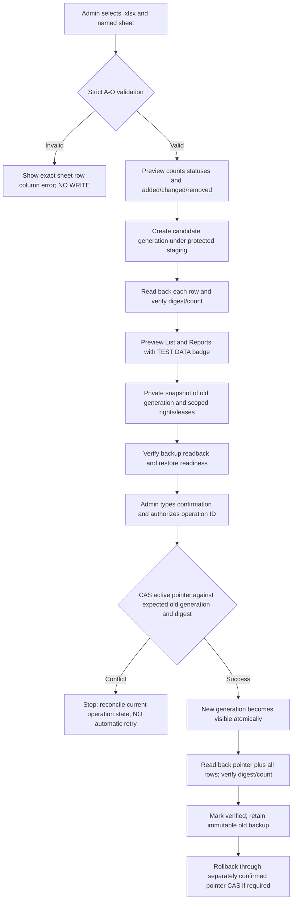

# PR #95 — Firebase-only Excel replacement: architectural handoff (review draft)

> **Status 2026-10-30: NOT IMPLEMENTED END TO END — DO NOT MERGE OR DEPLOY.**
> This document records verified existing behavior, the safety design and outstanding implementation. No production data was read, written, deleted or deployed.

## Scope split

1. **U26 — compact list:** remove the individual display preset toolbar, dormant preset activation and "Chọn chuyên viên toàn cơ quan"; retain column filters and shared layout. Shorten the two main navigation cards with visible active/focus styles. The old preset data remain only as inactive local backup; the active preset pointer is cleared. Verify persisted source-specific presets cannot silently overlay a new common layout.
2. **X26 — Excel input:** source is a selected named .xlsx sheet in A–O *business* format, never `recordId/documentKind`. Strict header/order, filename, row/column diagnostics, duplicate codes, essential fields and business status validation. No implicit first-sheet fallback. Data preview must be read-only. Excel is an IMPORT INPUT, not a live data source. Keep Google sign-in for the single administrator.
3. **R26 — dataset replace:** admin-only approval of a verified, independently stored candidate; switch one atomic *active dataset pointer*, never `remove(items); set(items)`.

## Current repository constraints observed

- `FirebaseRepository` subscribes and writes **`hdnd/items`**. It implements cell CAS by `revision`, `operationId`, `baseValues`, editProofs, audit history and lease manager. This is not currently dataset-epoch-aware.
- `firebase-primary-bootstrap.ts` only permits **empty-root initialization**, and `FirebaseRepository.importItems` is **add-only**. Do not remove their preconditions; an independent replacement protocol is required.
- `use-firebase.ts` currently selects `excel`/`database`/`primary`, and `App.tsx` still initializes `SheetsRepository`, exposes a link connection panel, comparison paths and transition import. `use-workspace.ts` polls sources of kind `google`. These paths must be removed for real Firebase-only release; **NOT YET REMOVED** in this branch.
- `database.exclusive-candidate.rules.json` currently validates the legacy `hdnd/items` layout. New active-pointer, generation and backup Rules are **NOT YET IMPLEMENTED OR DEPLOYED**.

## Correct data model and transaction architecture (target)

The active pointer must point to exactly one **complete immutable generation**. All list/report reads, per-cell edits, audit and row-level permission Rules must resolve against the same generation; no fallback that concatenates old and new records. Existing clients on the old schema are dangerous unless denied by Rules or fenced by an epoch. Versioned dataset rows need fresh revision/history and scoped rights so a reused code cannot inherit prior history or grants.

**Suggested RTDB domains for security review, not production schema yet:**
- `hdnd/datasets/{generationId}/items/{recordId}`: immutable snapshot initially; mutable only with current active epoch proof and cell lease
- `hdnd/activeDataset`: `{generationId,revision,digest,operationId,committedAt}` single CAS
- `hdnd/importCandidates/{operationId}`: admin-only staging, immutable once verified
- `hdnd/privateBackups/{operationId}`: *not publicly readable*; must respect RTDB access limits and ideally stay off public repo/artifacts
- `hdnd/importOperations/{operationId}`: idempotency, expected digest, source generation, verify state, cutoff revision, rollback reference
- `hdnd/generationPermissions/{generationId}` and generation-qualified locks / history; never reuse old per-row grants under a new generation.

Do not rely on admin-only UI visibility: **Rules must require the verified single Google admin identity** at every candidate/backup/pointer write. Anonymous guests retain only cell grants under the active generation. Active-pointer read must be available for authorized viewers.

## Preflight and commit invariants

- Candidate from selected workbook is nonempty, <=1,000 records; headers exactly match A–O contract. Detect duplicate or blank codes, bad STT, unknown statuses, formulas and cross-sheet errors. Use deterministic IDs based on codes; never truncate to a colliding slug. Unrecognized or contradictory values halt before stage.
- Preview contains counts by document type (NQ QPPL/NQ HC/BC) and report stages, and the number of additions, modifications and removals. Compare by **business code**, not row index.
- Candidate stage write is distinct from active items; after write, server readback must match each item and digest. Do not report success from the `set()` promise alone.
- Before commit capture **full old generation plus dependent permissions, leases, history, revisions and any associated data** in a verified private backup. A backup must have a tested restore path and remain immutable after swap.
- Admin confirms filename/old-new counts and exact operation ID. On file change or live source revision change, invalidate approval and redo validation/backups.
- Atomic switch uses active pointer CAS with old generation/revision/digest and operation ID. Two tabs with one admin race; only one can win. Replays query operation status, **never blindly re-submit** after network timeout.
- Force old tabs to reload/rebase on generation change, invalidating old drafts, row leases and undo buffers. Server Rules must reject old-generation writes even if the record ID recurs.
- Reuse of business code must **not** preserve old per-cell grants or history by accident; permissions are either reapproved per generation or deliberately mapped with a visible administrator migration preview.
- Postcommit success requires a fresh server read of pointer and rows matching candidate digest/count; failure to reach server is **UNKNOWN COMMIT STATUS** and must be resolved by operation-ID lookup.
- Rollback is another confirmed, audited CAS pointer switch to a verified immutable backup generation. Never delete backup as part of primary swap.

## Testing and release gate

**Implemented so far on this draft branch:** first-step read-only Excel A–O parser with named-sheet selection, deterministic IDs, pure impact stats and non-mutating admin UI review; list visual compaction.

**Not implemented:** staging storage, dataset pointer, backend Rules, backup/restore, atomic cutover, dual-tab fencing, client generation subscriptions, Firebase-only source routing, live filter/report candidate preview, end-to-end emulator flows and browser screenshots. The existing technical importer and Sheet connectors remain in the application; no live behavior has been switched.

**Mandatory before removing DRAFT:** happy path, wrong headers/order, multiple sheets, zero rows, duplicate codes, missing values, status errors, interrupt candidate write, interrupt post-commit read, repeated operation ID, two admin tabs, old draft after replacement, stale edit lease, permission leak by reused code, backup+rollback verification, list/report/filter equality, browser read-only preview screenshots, full TypeScript/unit/Emulator/Chromium and Codex independent security review.

No merge/publish, no Firebase Rules/Functions/Hosting deployment, no production source switching, no business-data edits, no public Excel/backup artifacts.

## Implementation checkpoint — integrity guard module (2026-10-30)

- Added `src/data/dataset-replacement-integrity.ts` and isolated Vitest coverage. Candidate manifests are SHA-256 over **fixed business field order**, sorted by record ID, independent of input order, including revision/archived flags; duplicate IDs/codes and nonfresh revisions are rejected. Readback mismatch aborts. A pure active-pointer CAS decision recognizes stale tabs and exact-idempotent replay.
- **This is read-only preflight logic, NOT Firebase staging, backend validation, an atomic commit or rollback.** It deliberately exports no Firebase write action. Server-authoritative transaction/Rules, immutable generation lifecycle, private backup, user-scoped permissions and stale lease fencing remain mandatory blockers; client hashes alone confer no authority. Do not route app traffic or allow replace based on this module alone.
- Gate: check this commit's source/Emulator/Chromium CI. Codex independent review remains outstanding. No production permissions or data touched.

### Lượt 002 — staging-key and live-preview guard (2026-10-30)

- `verifyCandidateServerReadback` checks an **actual keyed snapshot**: every server key must equal `recordId`, exact count must match, then full field SHA-256 must match the client-approved manifest. A flat array or an arbitrary object is not accepted. Tests cover key mismatch, extra row, altered row and a successful readback.
- `datasetPreviewFingerprint` normalizes list ordering while covering all editable fields, ID, code, STT, revision and archive status. The Excel review panel hides stale results and asks for a fresh check if the live visible dataset changes. Tests cover permutation neutrality and mutation/stale revision detection.
- Security caveat: SHA-256 establishes integrity of inspected inputs only; it does **not** authenticate the source, establish private backups, authorize a write, ensure all rights/leases are generation-scoped or guarantee a server commit. No code path performs a real dataset replacement.
- Pending independent Codex review: check field coverage and `validateFirebaseItem` semantics; verify no old client can write `hdnd/items` once generation switching is implemented; design emulator-backed Rules + transaction race, verified private backup/restore and per-generation authorization before any release.
