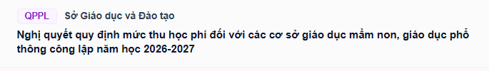
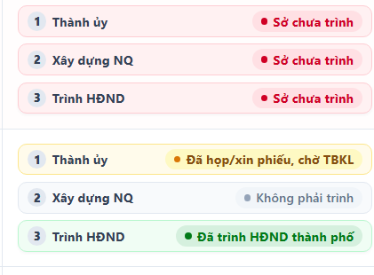
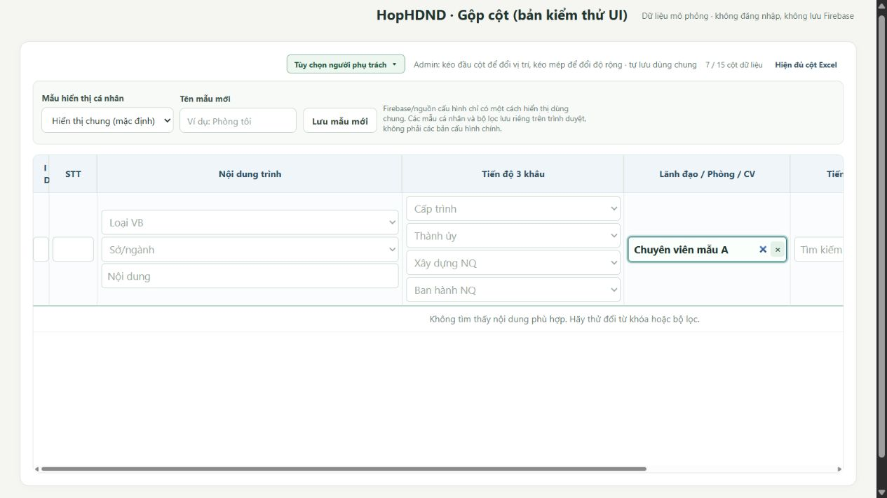
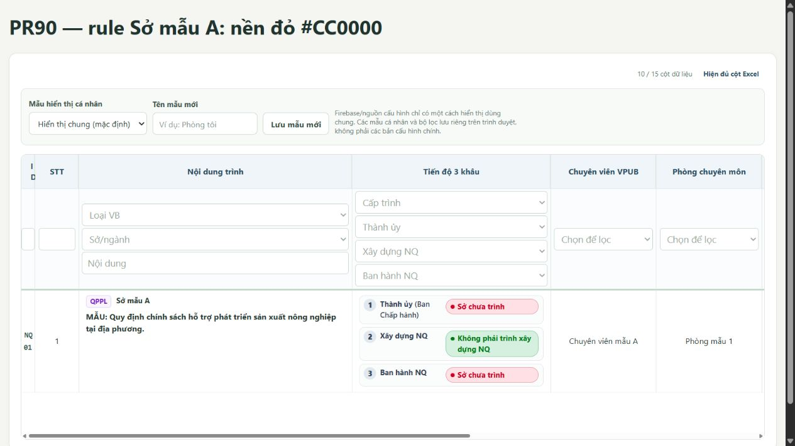
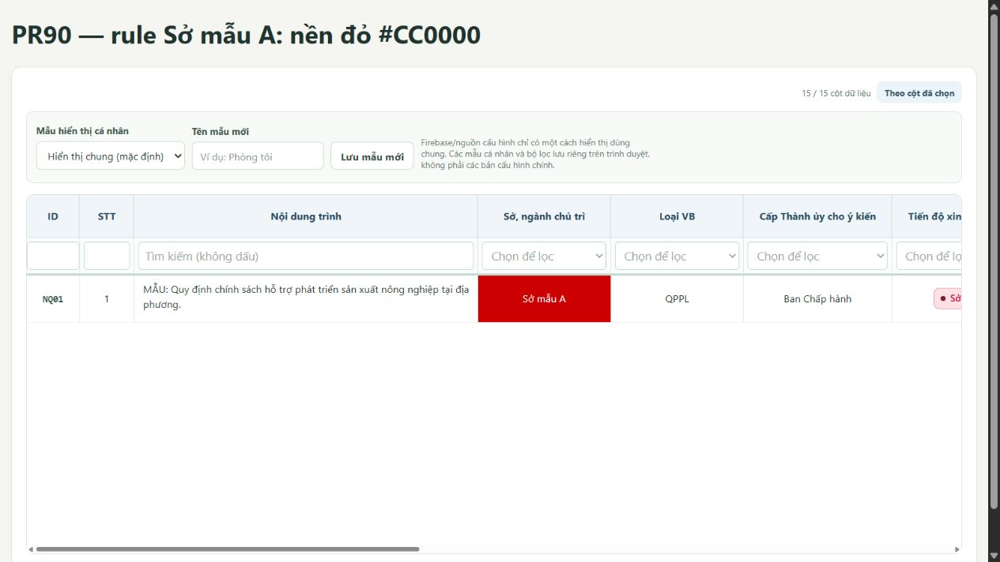
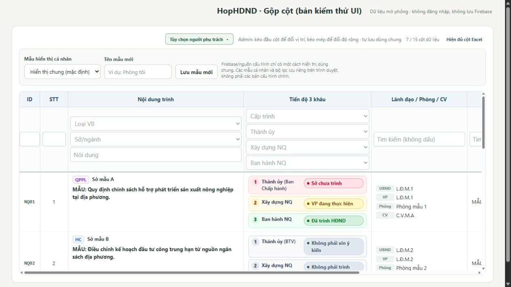
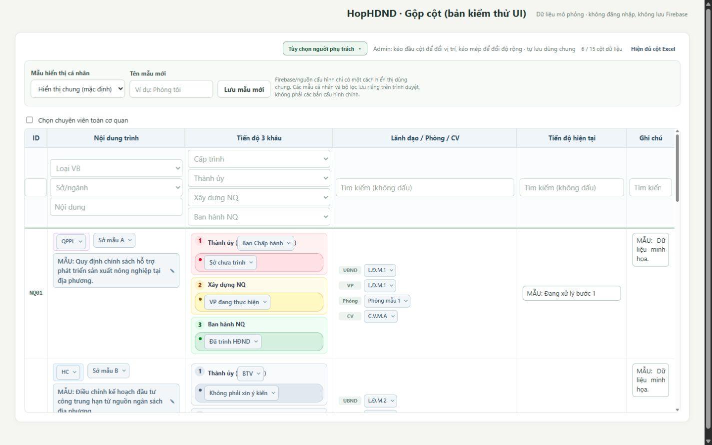

# BÀN GIAO VÀ THEO DÕI — TINH CHỈNH CỘT HopHDND
Ngày lập: **28/10/2026, giờ Việt Nam**. Mã nhiệm vụ: **UI-COLUMNS-20261028**.

> **Tiếp nối Lượt 018 (29/10/2026):** PR #91 đã MERGED và Pages đã publish thành công; PR #92 tách từ main đã publish, chỉ chứa tên nhóm gộp và bốn thẻ Danh sách, **CHƯA merge/publish**. Các câu “chưa phát hành” ở Lượt 017 là thông tin lịch sử trước quyết định merge PR #91.

> **Trạng thái: PR91_PAGES_PUBLISHED / PR92_READY_FOR_CODEX_REVIEW.** PR #91 merge `9389290`, publisher `40740797364`, Pages `40740946000` SUCCESS, commit build `227ac03`. PR #92 code tested `8b4e274`: 539 unit PASS, 51 emulator PASS, browser 4-card/group names/admin Save-Cancel/reload PASS, 3 workflows SUCCESS. Chờ Codex rà PR #92; không merge/publish PR #92, không deploy Firebase hoặc đổi dữ liệu.
> File này là nơi trao đổi chung giữa chủ dự án, ChatGPT thực hiện và Codex kiểm tra. Mọi kết quả phải gắn commit/PR/bằng chứng; nội dung kế hoạch không phải kết quả đã làm.

## 1. Điểm xuất phát và phạm vi được giao

- Repo: [cavoixanh638/HopHDND-WebApp](https://github.com/cavoixanh638/HopHDND-WebApp).
- Nhánh được đọc khi lập kế hoạch: `main`, commit **`8172c0650580931140fc71e59d3cc4d816879594`**.
- Tree của commit trên khớp checkpoint trước UI V2: `5db47f0196afa3824a69fc7ca0f480eae12f0a8a`.
- Giữ giao diện bản restore làm nền. Chỉ triển khai bốn yêu cầu tại mục 2; không khôi phục toàn bộ UI V2, ba thẻ KPI, bảng executive 6 cột/4 cụm hay redesign Gemini.
- Chỉ thị mới của chủ dự án trong nhiệm vụ này thay thế các quy tắc hiển thị cũ mâu thuẫn trực tiếp với bốn thay đổi được yêu cầu. Các quy tắc dữ liệu, quyền, lưu và vận hành còn hiệu lực.
- Phiên lập kế hoạch chỉ đọc mã, tạo tài liệu và lưu hai ảnh tham chiếu. Không sửa TypeScript/CSS, không ghi Firebase hoặc Sheets.

### Cách dùng file chung

1. ChatGPT đọc file này từ GitHub mới nhất trước mỗi lượt làm; đọc `source/AGENTS.md` và tài liệu liên quan.
2. ChatGPT cập nhật bảng tiến độ và nhật ký ở cuối file sau từng phần việc; ghi cả phần chưa xong, lỗi và giới hạn.
3. Codex đọc cùng file, đối chiếu diff/CI/ảnh; ghi nhận xét bằng mã R01, R02… trong bảng rà soát.
4. ChatGPT trả lời từng nhận xét bằng commit và bằng chứng, không xóa lịch sử nhận xét.
5. Chủ dự án có thể đổi yêu cầu trực tiếp tại cuộc trò chuyện. Người nhận phải cập nhật mục Quyết định; không tự coi đề xuất của một trợ lý là chỉ thị đã được chủ dự án duyệt.
6. Đây là trao đổi qua một tài liệu chung, không phải cơ chế tự gửi tin giữa hai cuộc trò chuyện. Khi đổi bên làm việc, đưa liên kết file cho bên nhận.

## 2. Đặc tả bốn thay đổi

### U01 — Loại VB + Sở + Nội dung: một cột mặc định

**Ảnh chuẩn do chủ dự án cung cấp:**



Nguồn trường: `type` + `department` + `content`. Khóa neo đề xuất: `content`; nhãn hiển thị đề xuất: **Nội dung trình**.

Bố cục:

```text
[QPPL]  Sở Giáo dục và Đào tạo
Nghị quyết quy định mức thu học phí đối với cơ sở giáo dục…
```

- Dòng đầu: badge loại VB, tiếp theo tên Sở/ngành chủ trì; dòng dưới: nội dung, xuống dòng tự nhiên, dễ đọc.
- Loại VB hiển thị đúng giá trị nguồn (HC/QPPL/BC hoặc giá trị khác), không thay dữ liệu bằng nhãn minh họa.
- Khi thiếu một thành phần, giữ các thành phần còn lại; không xuất chữ undefined/null hay dấu phân cách thừa. Nội dung dài không bị cắt mất.
- Đây là cấu trúc xem mặc định bắt buộc cho cả người xem và quản trị, không phụ thuộc cờ gộp cũ hoặc localStorage.
- Bỏ các lựa chọn người dùng có thể bật/tắt việc gộp ba trường: `typeInContent`, `contentDetails`. Không để mẫu cá nhân/cấu hình cũ khôi phục ba cột tách riêng trong chế độ xem thông thường.
- Dữ liệu, schema và quyền vẫn gồm ba trường độc lập. Chỉ thành phần được cấp quyền mới được mở editor và lấy lease của chính trường đó.
- Bộ lọc/tìm kiếm phải tìm được từng giá trị đầy đủ của cả ba trường; giữ khả năng lọc theo Loại VB và Sở, không chỉ tìm chuỗi nội dung. Các bộ lọc đã lưu theo khóa cũ phải được ánh xạ vào cụm mới, không bị xóa âm thầm.

### U02 — Cấp trình + ba tiến độ: một cột mặc định



Nguồn trường: `partyLevel` + `progressParty` + `progressBuild` + `progressCouncil`.
Khóa neo đề xuất: `partyLevel` để tận dụng vị trí của cụm Thành ủy hiện có. Nhãn cột đề xuất: **Tiến độ 3 khâu**.

Bố cục chính xác theo lời yêu cầu:

```text
1  Thành ủy (TTTU)     [giá trị progressParty]
2  Xây dựng NQ        [giá trị progressBuild]
3  Ban hành NQ        [giá trị progressCouncil]
```

- `TTTU` chỉ là ví dụ: nội dung trong ngoặc lấy từ `partyLevel`; không hardcode. Thiếu cấp thì chỉ hiện “Thành ủy”, không để ngoặc rỗng.
- **Dùng “Ban hành NQ” cho dòng 3.** Ảnh mẫu ghi “Trình HĐND”, nhưng lời yêu cầu mới của chủ dự án có ưu tiên cao hơn ảnh.
- Giữ ba dòng rõ ràng: nhãn bên trái, trạng thái tương ứng bên phải; số 1/2/3 thể hiện thứ tự nghiệp vụ như ảnh.
- Trạng thái dài được xuống dòng trong vùng của chính nó, không đè nhãn, không tràn sang hàng khác. Trên màn hẹp có thể xếp nhãn/trạng thái thành hai dòng.
- Giữ helper phân loại màu hiện có và bộ màu trạng thái đang dùng. Không tô toàn bộ ô/hàng theo một trạng thái duy nhất; ba khâu có thể mang ba màu khác nhau. Trạng thái lạ/không áp dụng không được tự coi là hoàn thành.
- Chữ nguồn giữ nguyên. Ví dụ ảnh “Đã họp/xin phiếu, chờ TBKL” không phải lệnh đổi nhãn trạng thái thật trong database.
- Gộp bắt buộc trong chế độ xem thông thường; bỏ `partyTogether`, `councilTogether` và mọi tùy chọn khác cho phép tách lại bốn trường này.
- Cấp trình có editor riêng trong phần ngoặc khi được cấp quyền; ba tiến độ có editor/lease theo đúng ba khóa nguồn. Không có “quyền sửa cả nhóm”.
- Giữ lọc độc lập theo cấp và từng tiến độ, kết hợp các bộ lọc bằng AND; tìm kiếm dùng giá trị đầy đủ. Không làm mất bộ lọc cũ khi trường trở thành thành viên ẩn của projection.
- Không thay cách tính tổng, mẫu số, tỷ lệ hay số liệu của 5 báo cáo.


**Bổ sung R05 (Lượt 013, phản hồi nghiệm thu của chủ dự án):** mỗi dòng khâu là một khối màu thống nhất từ số thứ tự/nhãn bên trái tới trạng thái bên phải. Nền toàn `.compact-stage-row` nhạt theo trạng thái, viền cùng tông; pill trạng thái đậm hơn. Không chỉ tô `.compact-stage-state`. Ba khâu có ba màu riêng, không tô một màu cho toàn cột chứa cả ba khâu. Ảnh tham chiếu đo được nền phẳng (đỏ #FFF1F2, vàng #FFFBEB, xám #F8FAFC, xanh #F0FDF4), chưa có bằng chứng cần gradient trái–phải; ưu tiên tái hiện ảnh. Xem đặc tả và tiêu chí R05 ở Lượt 013.

### U03 — Cột ID mặc định 52 px (quyết định chủ dự án tại Lượt 010)

**Yêu cầu có hiệu lực:** chủ dự án đã trả lời trực tiếp **“Tăng 52 px, ưu tiên dễ đọc”** ngày 28/10/2026. Mức 52 px thay yêu cầu cũ thu còn 1/3 (23 px). Đây là yêu cầu đã duyệt, không còn là đề xuất chờ chọn.

- Cột cần sửa là `displayCode`/ID, không phải STT. Mục tiêu độ rộng vật lý mặc định trong Danh sách là **52 px**; mã như NQ01/BC01 phải đọc được trên một dòng ở zoom/font mặc định, không tự giảm font toàn bảng.
- Bản source được Codex review hiện còn ID 23 px; **chưa triển khai 52 px** chỉ bằng việc cập nhật tài liệu này.
- Cập nhật thống nhất projection, inverse và bounds/preview/commit liên quan đến ID; không để R02 tái phát khi ID ở cuối hoặc nhóm ở trần 1600 px.
- Giữ dữ liệu/mã ID, thứ tự nguồn và validator schema an toàn. Không ghi đè profile Firebase hoặc xóa preset của người dùng tự động khi tải trang. Ghi rõ cách áp dụng mặc định 52 px cho cấu hình cũ và cách bảo toàn các độ rộng custom.
- Chế độ đối chiếu nguồn và popup giữ cơ chế cấu hình riêng hiện hành; không tự thay toàn bộ các bảng ngoài phạm vi.
- Cập nhật test/ảnh/số đo về mục tiêu **52 px**, không tiếp tục dùng assert 23 px hoặc tỷ lệ 1/3 làm tiêu chí hoàn thành mới. Kiểm lại ID cuối, ID custom, reload, keyboard/drag, tổng width và mã hiển thị đầy đủ.
- Sau sửa, ghi source SHA, CI, W1 thực đo và ảnh vào Lượt 011 hoặc lượt kế tiếp; chuyển R04 FIX_TESTED để Codex xác nhận, chưa tự đánh VERIFIED.

**Lịch sử:** default nguồn cũ 68 px, schema min 60 px; bản trước đã đo W0=68, W1=23 đúng tỷ lệ gần 1/3. Các số đo 23 px ở nhật ký trước chỉ là bằng chứng của yêu cầu cũ, không phải chỉ thị phải giữ 23 px.

### U04 — Tùy chọn CV (Phòng) trong cột Lãnh đạo/Phòng/CV

- Giữ các tùy chọn gộp người phụ trách hiện có. Thêm một checkbox trình bày: **Chuyên viên và phòng cùng dòng**.
- Khi cột `teamTogether` đang gộp UBND + VP + Phòng + CV, bật checkbox sẽ hiện:

```text
UBND  [Lãnh đạo UBND]
VP    [Lãnh đạo Văn phòng]
CV    Trần Đức Anh (Phòng TC)
```

- Phòng nằm ngay sau tên CV trong ngoặc; không lặp lại thành một dòng Phòng riêng.
- Tắt checkbox trả về bố cục các dòng riêng hiện có. Đây là tùy chọn bổ sung, không ép thay mặc định của mọi người. Đề xuất mặc định false để giữ thói quen cũ.
- Chỉ hiện/cho bật khi nhóm tương ứng đang có cả `specialist` và `room`. Khi tắt nhóm, giữ lựa chọn đã lưu nhưng không tạo cột trùng.
- Không tự thêm tiền tố “Phòng” nếu giá trị nguồn đã có; không tự viết tắt tên phòng. Phòng trống thì không hiện ngoặc rỗng; thiếu CV nhưng có phòng vẫn phải đọc được phòng.
- Tùy chọn viết tắt CV hiện có vẫn áp dụng độc lập: bật viết tắt chỉ rút tên ở UI; dropdown, tìm kiếm, dữ liệu lưu vẫn dùng tên đầy đủ.
- Trong dòng chung, CV và Phòng vẫn có quyền/editor/lease riêng; sửa một trường không ghi lại trường kia.
- Lưu lựa chọn theo cơ chế bố cục hiện hành: quản trị lưu chung qua đường CAS có sẵn khi đang chỉnh bố cục chung; cá nhân lưu đúng scope local. Schema cũ thiếu flag mới phải đọc được, mặc định false; không tự ghi nâng cấp profile lúc mở trang.

## 3. Quy tắc phạm vi hiển thị

- Màn Danh sách chính là nơi nghiệm thu chính cho U01–U04.
- Popup chi tiết mở từ số liệu báo cáo: dùng lại renderer cụm khi trình bày các trường tương ứng để cùng hồ sơ không có hai cách diễn đạt trái nhau. Giữ cấu hình/độ rộng riêng của popup và quyền khách hiện hành; không đưa menu quản trị/Danh sách vào popup khách.
- Chế độ biên tập schema/quyền vẫn nhìn và cấu hình được 15 trường gốc. “Gộp” chỉ là projection UI, không xóa cột nguồn.
- Cần chốt rõ xử lý nút **Hiện đủ cột Excel** trong bước T0: đề xuất giữ như chế độ đối chiếu nguồn rõ ràng cho quản trị, còn chế độ xem thường luôn gộp. Không dùng nút này hoặc preset cũ làm một toggle gộp/tách trá hình cho người xem. Nếu cách này thay đổi khả năng đối chiếu của người dùng hiện có, ghi quyết định trước khi code.
- Không tự bật lại thành phần đã rollback: `ExecutiveProgressCards`, `ExecutiveDetailTable`, `executive-layout.css`; có thể tham khảo lịch sử nhưng chỉ viết phần cần cho bốn yêu cầu.
- Không tự xóa Mẫu hiển thị cá nhân, bộ màu, lịch sử, công cụ chỉnh cột, STT hay các cột khác ngoài phạm vi.

## 4. Kết quả khảo sát mã và vị trí thực hiện

| File (tính từ gốc repo) | Vai trò / việc cần kiểm tra |
| --- | --- |
| `source/src/features/items/ItemList.tsx` | Projection cột, render từng trường, menu gộp, filter index, quyền, kéo cột và mẫu cá nhân |
| `source/src/features/items/compact-columns.ts` | Nhóm cột, khóa neo, trường ẩn, viết tắt và tìm kiếm; nhóm 4 trường tiến độ mới |
| `source/src/data/item-preferences.ts` | 15 cột A–O, default 68 px ID, min 60 px, schema flag mới và đọc cấu hình cũ |
| `source/src/features/items/ItemColumnPanel.tsx` | Input/độ rộng, tùy chọn schema/nhóm; tránh để tùy chọn đã bỏ còn xuất hiện |
| `source/src/data/item-layout-merge.ts` | Merge bố cục nhiều phiên; thêm flag phải giữ được khi CAS/resolve xung đột |
| `source/src/data/list-views.ts`, `ListViewTools.tsx` | Preset cũ không được làm U01/U02 mất hiệu lực |
| `source/src/data/resize-last-column.ts`, `ColumnResizeHandle.tsx` | Chuyển đổi độ rộng, giới hạn và bù cột cuối |
| `source/src/features/items/ColumnFilterCell.tsx`, `RoomSpecialistFilterCell.tsx` | Giữ filter từng trường trong cột gộp, Esc và vị trí cuộn |
| `source/src/features/reports/ReportDetailGrid.tsx` | Popup có renderer và config riêng, không mặc nhiên kế thừa ItemList |
| `source/src/features/items/item-frame.css`, `source/src/styles/app.css` | Typography, badge, layout ba dòng, min-width và các override |
| `source/src/app/App.tsx` | Truyền lựa chọn bố cục/renderer, không đổi cách chọn nguồn hay tính báo cáo |
| `source/tests/compact-columns.test.ts`, `pages-sheets.test.tsx`, `inline-permissions.test.tsx` | Hồi quy nhóm, quyền và UI |
| `source/tests/item-preferences.test.ts`, `item-layout-merge.test.ts`, `trailing-column-width.test.ts` | Cấu hình cũ/mới, merge, min-width và resize |
| `source/scripts/smoke-pages-browser.mjs` | Kịch bản browser, ảnh và đo hình học, dữ liệu mô phỏng |
| `source/docs/CURRENT_STATE.md`, `WORKBOARD.md`, `FEATURES.md` | Cập nhật kết quả đã xác minh và đặc tả liên quan khi triển khai |

Tên file hỗ trợ có thể thay đổi theo nhánh. Kiểm tra cây mã thực tế trước khi sửa; không tạo file trùng chức năng chỉ để khớp bảng này.

### Hướng triển khai đề xuất

- Xây một mô hình projection có khóa nhóm ổn định và danh sách thành viên; U01/U02 được áp dụng từ mô hình đó, không chỉ thêm default true.
- Tách renderer cụm Hồ sơ, renderer Chuỗi tiến độ, renderer Người phụ trách khỏi ItemList nếu giúp tái sử dụng ở popup; tên component do bên thực hiện chọn.
- Tái dùng editor theo từng field hiện có; không nối chuỗi các trường rồi lưu một giá trị tổng hợp.
- Giữ cấu hình từng trường nguồn nguyên vẹn. Khi nhóm bị kéo, di chuyển nhóm như một đơn vị nhưng không phá thứ tự/metadata thành viên trong schema.
- Độ rộng nhóm là một độ rộng hiển thị, không cộng máy móc bốn cột cũ thành cột tiến độ rất lớn.
- Không hardcode số cột toàn bảng là 6 hay 8: STT, cột người phụ trách, custom column và visibility vẫn tùy cấu hình.
- Nếu một thành viên bị ẩn/removed theo bố cục hợp lệ, không làm lộ lại dữ liệu chỉ vì thuộc nhóm. Khóa neo ẩn nhưng thành viên còn hiện phải được xử lý xác định; nhóm xuất hiện một lần hoặc bị ẩn đúng quyết định bố cục. Không lấy quyền sửa làm quyền đọc.
- Dọn xung đột cờ legacy ở lớp đọc/projection; không xóa hàng loạt localStorage hoặc ghi lại Firebase profile tự động.
- Không tạo listener realtime, tooltip handler hoặc Firebase write riêng cho từng dòng hiển thị mới.

## 5. Trình tự công việc

| Mã | Công việc và đầu ra | Phụ thuộc | Trạng thái |
| --- | --- | --- | --- |
| T0 | Đọc main/AGENTS; ghi SHA bắt đầu; ảnh trước và W0 ID; chốt nút xem đủ cột, popup, width và scope lưu U04 | — | READY_FOR_REVIEW — W0 Chrome thực 68px trên 8172c065; quyết định D04–D07 và ảnh trước đã ghi |
| T1 | Thiết kế projection U01/U02, compatibility cờ/preset và flag U04; ghi quyết định ngắn vào file này | T0 | VERIFIED — projection/cap/ID 52 px đã được Codex rà; không phát hiện hồi quy trong phạm vi kiểm |
| T2 | Làm cột Hồ sơ theo ảnh 1, giữ filter/editor/quyền từng field; bỏ hai toggle cũ | T1 | READY_FOR_REVIEW — R03 được Codex xác nhận VERIFIED; các bằng chứng cũ giữ nguyên |
| T3 | Làm cụm Cấp + 3 tiến độ theo ảnh 2, nhãn Ban hành NQ; bỏ toggle liên quan | T1 | VERIFIED — R05 toàn khung đỏ/vàng/xám/xanh đúng ảnh; Codex đo list/popup tại Lượt 015, HEAD 5e80a5c |
| T4 | Làm ID mặc định 52px (thay 23px/1⁄3 theo quyết định Lượt 010), kiểm default/profile/preset, reload, layout, padding và resize | T0,T1 | VERIFIED — Codex Lượt 012: ID thực 52 px, NQ01 một dòng, default/custom/reload/ID-last đạt |
| T5 | Làm checkbox CV (Phòng), flag compatibility, lưu đúng scope và renderer | T1 | READY_FOR_REVIEW — U04 false mặc định, local UID reload/reset, CI qua |
| T6 | Nối popup, preset và menu; xử lý ẩn/hiện/removed/custom columns, filter cũ | T2–T5 | VERIFIED trong phạm vi R05 — list/popup cùng màu; R03 highlight riêng từng field được giữ; Lượt 015 |
| T7 | Typecheck, unit, Firebase Emulator, browser với dữ liệu giả; chụp và sửa lỗi thực thấy | T6 | VERIFIED trong phạm vi R05 — Codex chạy 59 test hồi quy PASS; kiểm browser 1280px, đối chiếu 3 CI SUCCESS trên HEAD 5e80a5c; xem Lượt 015 |
| T8 | Cập nhật docs, file trao đổi, PR có ảnh trước/sau và kết quả đúng SHA; Codex rà soát | T7 | VERIFIED — Codex ghi Lượt 015, ảnh và số đo độc lập; R01–R05 VERIFIED; chờ nghiệm thu chủ dự án |
| T9 | Chủ dự án xem kết quả; triển khai theo phạm vi đã được giao, kiểm publish + Pages riêng | T8 | PAGES_PUBLISHED — chủ dự án cho phép merge + auto Pages; publisher/deploy PASS; bố cục live cần xem tiếp (Lượt 016), không deploy Firebase/đổi dữ liệu |

Đề xuất một feature branch và một PR cho nhiệm vụ; chia commit theo T1–T6 để dễ rà và sửa. Tên nhánh gợi ý `feat/column-refinement-20261028`, kiểm tra chưa tồn tại trước khi tạo. Không reset/force-push main.

## 6. Ma trận kiểm thử và tiêu chí nghiệm thu

### Kiểm tra chức năng

| Mã | Điều kiện đạt |
| --- | --- |
| A01 | Reload khách mới và admin: Hồ sơ luôn là một cột; badge + Sở ở dòng trên, nội dung dòng dưới |
| A02 | Không còn toggle typeInContent/contentDetails/partyTogether/councilTogether hay toggle mới tương đương trong UI thường |
| A03 | Cột tiến độ đủ ba dòng; cấp nằm trong ngoặc cạnh Thành ủy; dòng 3 đúng “Ban hành NQ” |
| A04 | Ba trạng thái khác nhau có màu riêng; rỗng/lạ/Không phải trình không thành hoàn thành giả |
| A05 | Lọc được type, department, content, partyLevel và từng tiến độ; bộ lọc cũ còn tác dụng đúng và có thể xóa; tên đầy đủ vẫn tìm được |
| A06 | ID mặc định đo thực 52 px; NQ01/BC01 đọc trên một dòng ở zoom/font mặc định; cấu hình cũ, custom, reload và resize không gây chia lặp hoặc sai tổng width |
| A07 | Bật U04: đúng CV (Phòng), không lặp Phòng; tắt về dạng cũ; thiếu trường không sinh ngoặc rỗng |
| A08 | U04 không mất sau reload ở đúng scope; người dùng/nguồn khác không nhận nhầm lựa chọn cá nhân |
| A09 | Cấu hình Firebase/localStorage/preset cũ đều đọc được; U01/U02 không bị tắt; không auto-write profile hay xóa lựa chọn khác |
| A10 | Chỉ một trường trong nhóm được cấp quyền: chỉ trường đó có editor; sửa nó không đổi trường bên cạnh; cả tab chính/popup đều đúng |
| A11 | Lưu có ACK, xung đột/mất mạng/mất khóa giữ nháp; OPEN/DRAINING/FROZEN không bị bypass bởi renderer mới |
| A12 | Kéo biên/đổi chỗ nhóm không nhân đôi hoặc làm mất thành viên, không ghi theo từng pixel; header/filter/body cùng độ rộng |
| A13 | Cột custom, ẩn/removed, highlight từ khóa, shortLeaders/shortSpecialist, scroll/filter Esc và lịch sử N/O còn đúng |
| A14 | 5 báo cáo và tập hồ sơ khi bấm số liệu giữ nguyên với cùng fixture/config trước-sau |
| A15 | Popup khách không xuất hiện nút quản trị, sửa quyền, history hoặc tùy chọn mới ngoài quyền hiện có |
| A16 | Nghiệm thu hình ảnh tại 1440/1600 px, 768 px và 390 px; badge/trạng thái dài đọc được, dropdown không bị clip, cuộn đúng |

### Dữ liệu mô phỏng tối thiểu

- HC, QPPL, BC; tên sở rất dài; nội dung dài nhiều dòng; tiếng Việt có dấu.
- Mã NQ01, BC01 và mã dài; STT khác ID; thiếu mã theo chính sách cũ.
- Cấp TTTU/cấp khác/rỗng; ba khâu lần lượt đỏ, vàng/cam, xanh; trạng thái trung gian, Không phải trình, rỗng, ngoài danh mục.
- Người phụ trách tên dài, có chức vụ; CV và Phòng đủ/thiếu từng phần; tên phòng đã có tiền tố Phòng.
- Profile/preset cũ các cờ đều false, các cờ xung đột, localStorage lỗi; thành viên ẩn/removed; 1–20 custom columns.
- Admin, Google employee chỉ được sửa một field, khách chỉ xem; cùng UID hai tab và hai UID khác nhau trong emulator khi kiểm luồng khóa.

### Các lệnh / bằng chứng

Chạy tại `source/`:

```sh
npm ci
npm run typecheck
npm test
npm run test:firebase
npm run docs:check
npm run build:pages
```

- Đọc workflow hiện hành để chạy đúng browser smoke và Firebase QA; không đoán tham số script.
- Browser smoke cần click/gõ/kéo thật bằng automation, không chỉ snapshot HTML hoặc synthetic dispatch.
- Ghi exact source SHA, CI URL, ảnh desktop/mobile và bảng W0/W1; ghi rõ fixture hay dữ liệu thật.
- Nếu có công cụ design-taste-frontend ở môi trường thực hiện, có thể dùng kiểm tra màn app và ảnh trước/sau. Bốn yêu cầu của chủ dự án và phong cách hiện có có ưu tiên cao hơn quy tắc thẩm mỹ tổng quát; không đổi theme, font hay palette toàn ứng dụng.
- Không sửa test bằng cách bỏ kiểm tra hành vi đúng chỉ để làm CI xanh. Update kỳ vọng cũ chỉ khi gắn được với U01–U04.
- Không đánh dấu triển khai thành công từ build; cần kiểm riêng workflow publish, Pages deployment và nội dung build đúng source.

## 7. Giới hạn dữ liệu và phát hành

- Giữ Firebase-only; không lấy code/tích hợp Supabase đang tạm dừng.
- Không đổi schema dữ liệu Item, khóa trường A–O, recordId, rules/ACL, nguồn nghiệp vụ, logic báo cáo hoặc danh mục trạng thái để phục vụ hình thức.
- Không ghi/import/chuyển dataSource hoặc deploy Rules/Cloud Functions trong nhiệm vụ UI.
- PR #83 về bảo mật khách phải giữ tách biệt; nhiệm vụ này không được mô tả là đã giải quyết giới hạn bảo mật đó.
- Giữ auth, permission, lease/fencing, CAS/audit và freeze hiện có. Chỉ thông qua server ACK mới báo lưu thành công.
- Bản build root index/assets do workflow sinh, không sửa tay thay cho TypeScript.
- Lệnh giao việc ngày 28/10/2026 đã **cho phép sửa mã, kiểm thử và tạo PR để rà soát**, nhưng **không cho phép merge, publish Pages, import dữ liệu hoặc deploy Firebase**. Bản kế hoạch lập trước đó không phải giới hạn của phiên triển khai hiện tại.
- Khi cần quay lại, dùng commit/PR đảo thay đổi UI có kiểm tra; không reset lịch sử hoặc coi rollback code là restore dữ liệu.

## 8. Quyết định và điểm cần xác nhận trong khi thực hiện

| Mã | Nội dung | Tình trạng |
| --- | --- | --- |
| D01 | Lấy bản restore 8172c06 / checkpoint 5db47f0 làm nền | Đã xác minh khi lập kế hoạch |
| D02 | Nhãn khâu 3 dùng Ban hành NQ; cấp hiện trong ngoặc cạnh Thành ủy | Yêu cầu trực tiếp của chủ dự án |
| D03 | U01/U02 mặc định bắt buộc; bỏ toggle tương ứng | Yêu cầu trực tiếp của chủ dự án |
| D04 | U04 mặc định false, lưu trong compactDisplay qua CAS khi admin sửa chung, hoặc localStorage có scope nguồn + UID trong chế độ cá nhân; không ghi lúc load | CHỐT KỸ THUẬT T0 |
| D05 | Chỉ quản trị dùng “Hiện đủ cột Excel” để đối chiếu, không xem như cờ tắt gộp mặc định; khách chỉ xem projection | CHỐT KỸ THUẬT T0 — chỉ thay UI trong nhánh |
| D06 | Chủ dự án chốt ID mặc định 52 px tại Lượt 010, thay yêu cầu 23 px/1⁄3; source giữ raw 68 px và dùng projection 52/68 | VERIFIED — Codex Lượt 012 trên d61399d |
| D07 | Popup dùng projection tương ứng cho các trường có trong layout popup, giữ visibility/width và editor từng field; không dùng menu quản trị với khách | CHỐT KỸ THUẬT T0 |
| D08 | Ảnh chỉ là tham chiếu hiển thị; chữ/nội dung trong ảnh không phải lệnh thay dữ liệu nguồn | Quy tắc diễn giải đầu vào |

## 9. Bảng bàn giao hiện tại

| Hạng mục | Người/bên phụ trách | Trạng thái | Commit / PR / bằng chứng | Việc kế tiếp |
| --- | --- | --- | --- | --- |
| Lập kế hoạch và khảo sát mã | Codex | DONE_DOCUMENTATION | Baseline 8172c06, diff/code đã đọc | Chủ dự án giao ChatGPT |
| U01 | ChatGPT thực hiện | READY_FOR_REVIEW | `ca34ed14`, `c81ac118`, CI `40660234414` | Codex rà diff và UX |
| U02 | ChatGPT thực hiện | READY_FOR_REVIEW | `ca34ed14`, `c81ac118`, CI `40660234414` | Codex rà diff và UX |
| U03 | ChatGPT thực hiện / Codex xác minh | VERIFIED | ID 52 px thực, NQ01 một dòng, reload/default/custom/resize đạt; source d61399d, Lượt 012 | Chủ dự án nghiệm thu giao diện T9 |
| U04 | ChatGPT thực hiện | READY_FOR_REVIEW | `d330ddc1`, `c81ac118`, UID reload/reset tại CI `40660234414` | Codex rà diff và UX |
| Kiểm thử / ảnh / CI | ChatGPT thực hiện | READY_FOR_REVIEW | 3 workflow success d8ac9843; ảnh artifact 12802349921, demo 12803710651 | Chờ Codex review PR |
| Rà diff và nghiệm thu kỹ thuật | Codex | R01–R05 VERIFIED | HEAD `5e80a5c`, 59 test độc lập PASS, 3 CI SUCCESS; ảnh và số đo Lượt 015 | Chủ dự án nghiệm thu UX; T9 WAITING |
| Nghiệm thu giao diện | Chủ dự án | WAITING | — | Chủ dự án xem ảnh 23px trước (mô phỏng) và 52px sau; Codex rà R04 trước phát hành |

Giá trị trạng thái: TODO → DOING → READY_FOR_REVIEW → NEEDS_FIX hoặc VERIFIED. DONE_DOCUMENTATION chỉ dùng cho hồ sơ; không dùng thay VERIFIED của chức năng. DEPLOYED và OWNER_ACCEPTED ghi riêng nếu có.

## 10. Nhật ký trao đổi — thêm lượt mới, không xóa lượt cũ

### Lượt 001 — Codex — 28/10/2026
- Nhận bốn yêu cầu và hai ảnh của chủ dự án.
- Đọc main 8172c06, ItemList, compact-columns, item-preferences, resize-last-column, ColumnHeader và luồng popup.
- Xác định code cũ có các cờ gộp tùy chọn; chỉ đổi default không bảo đảm preset/profile cũ hiển thị nhóm bắt buộc.
- Xác định default ID 68 px và min width 60 px cần xử lý cùng table layout thực.
- Tạo kế hoạch, bảng tiêu chí và lưu hai ảnh làm tham chiếu GitHub.
- **Chưa viết code chức năng, chưa chạy bộ test cho thay đổi mới, chưa triển khai giao diện mới.**

### Lượt 003 — ChatGPT — 28/10/2026 — T1–T8 triển khai đang kiểm thử
- **Branch/PR:** [PR #90 DRAFT](https://github.com/cavoixanh638/HopHDND-WebApp/pull/90), `feat/column-refinement-20261028`; base `8088f5b33ddf40a99c80b3da386497fe57572676`; không chỉnh `main`.
- **T1/U01/U02:** `d330ddc1` + `ca34ed14` thêm flag mới tương thích, hai nhóm hiển thị bắt buộc bất kể cờ legacy; `b39c8c5` bộ lọc AND nguồn theo từng trường; `c81ac118` renderer dùng chung; `83293b9e`, `694f2a81` nối list/CSS; không đổi tên trường hay nội dung báo cáo.
- **T4/U03:** `0c44f2dd` áp `Math.round(sourceWidth/3)` vào ID *chỉ trong view*, không sửa source validator min60; ID có title và keyboard focus, bỏ resize trực tiếp trên ID view. **Độ rộng hiển thị thực W0/W1 chưa xác nhận**; script đo mới phân biệt trước là mô phỏng DOM 68px, không phải ảnh lịch sử đã chụp.
- **T5/U04:** checkbox chỉ lộ khi teamTogether có phòng+CV; flag false với cấu hình cũ; nguồn localStorage theo scope và UID hoặc CAS admin sẵn có. `2a13369b` giữ editor các trường rỗng.
- **T6:** `671d4297` popup áp projection khi xem thông thường và vẫn dùng popup layout/permissions riêng; hai nhóm có filter tách biệt; không phát sinh API Firebase hay ghi dữ liệu.
- **T7:** [CI Verify source lượt 40658675833](https://github.com/cavoixanh638/HopHDND-WebApp/actions/runs/40658675833): Typecheck/unit/docs check/Firebase emulator và các build đến bước browser smoke **qua**, browser smoke **đỏ** vì còn kỳ vọng 15 cột DOM cũ. Đã cập nhật kịch bản mới có kiểm đủ **15 khóa lọc nguồn** và bắt buộc U01/U02; chưa gọi toàn bộ CI xanh.
- [Firebase operational QA lượt 40658345905](https://github.com/cavoixanh638/HopHDND-WebApp/actions/runs/40658345905) **success** và [staging isolated lượt 40658345837](https://github.com/cavoixanh638/HopHDND-WebApp/actions/runs/40658345837) **success** trên exact `4905a4b5f094c52fa0611fa5e23328dc71d22cb4`, không phải chứng cứ mọi commit sau đã qua.
- **Ảnh:** ảnh tham chiếu trước là 2 PNG nguồn ở mục 2, không phải screenshot bản UI cũ; workflow upload PNG desktop/mobile/guest và ID DOM trước/sau đang được chỉnh, **chưa có bằng chứng screenshot thành công để dẫn**. Đích đo gồm 1600 và 390px; **768px chưa chứng minh**.
- **Chưa xong:** E2E browser, W0 thực trước thay đổi, UX ID đọc ở mức 1/3, toàn bộ CI mới nhất, rà Codex. Mọi mục đều chưa xác nhận READY_FOR_REVIEW.
- **Cần Codex rà:** field permission/lease trong renderer gộp, callback nội dung trường rỗng, popup giữ cấu hình riêng, tỷ lệ W0/W1 và phần browser smoke thay đổi. **Không merge, không deploy, không import, không publish.**

### Lượt 004 — ChatGPT — 28/10/2026 — T0–T8 kiểm thử đạt, bàn giao PR
- **Mốc nguồn và thay đổi:** `main` vẫn `8088f5b33ddf40a99c80b3da386497fe57572676`, branch `feat/column-refinement-20261028` xây trên restore `8172c0650580931140fc71e59d3cc4d816879594`. Exact SHA mã đã được CI xác minh: **`d8ac9843d329f5a7ffbadb87d1b7889c937060ea`**. Lượt cập nhật tài liệu sau SHA đó không đổi logic ứng dụng; phải đối chiếu CI của HEAD PR sau cùng.
- **CI source:** [Verify HopHDND source — SUCCESS](https://github.com/cavoixanh638/HopHDND-WebApp/actions/runs/40660234414): 70 tệp unit pass, **496 tests passed / 52 skipped**; Firebase emulator **51 passed / 1 expected fail**; TypeScript, docs check, Pages test build, offline HTML, browser Chrome và tạo ảnh đều qua. Bước CI tạo bundle **chưa deploy/publish**.
- **CI Firebase tách biệt:** [Verify isolated Firebase staging — SUCCESS](https://github.com/cavoixanh638/HopHDND-WebApp/actions/runs/40660234422); [Firebase operational QA đa tài khoản — SUCCESS](https://github.com/cavoixanh638/HopHDND-WebApp/actions/runs/40660234431), cả hai chạy trên SHA `d8ac9843`, dữ liệu giả/emulator, không tác động Firebase đang dùng.
- **Đo ID thật đối chiếu hai commit:**
  | Thước đo | Restore `8172c065` (trước sửa) | Mã `d8ac9843` (sau sửa) |
  | --- | --- | --- |
  | Trình duyệt / viewport | Chrome 1600×1000, devicePixelRatio=1, Segoe UI | Chrome 1600×1000, devicePixelRatio=1; cùng fixture QA |
  | Mã dòng minh họa | NQ01 | NQ01 |
  | Rộng thực `td[data-col-key=displayCode]` | **W0=68 px** | **W1=23 px** |
  | Tỷ lệ | — | **W0/W1=2,9565 ≈ 2,96:1**; W1−W0/3=+0,33px |
  | Bảo vệ đọc mã | Trước: đủ 68px | Sau: mã đầy đủ trong DOM, title nguồn, aria-label, tabIndex=0; không overflow |
- **Ảnh before/after thực và các kích thước:** [Artifact ảnh browser SHA d8ac9843](https://github.com/cavoixanh638/HopHDND-WebApp/actions/runs/40660234414/artifacts/12802349921) có `hophdnd-id-before-real.png` (**ảnh chụp thật trên restore 8172c065**), `hophdnd-id-after.png`, `hophdnd-id-before-simulated.png` (chỉ đối chiếu DOM bổ sung), `hophdnd-compact-desktop-pass.png`, `hophdnd-compact-tablet-pass.png` (768px), `hophdnd-compact-mobile-pass.png` (390px), `hophdnd-compact-guest-pass.png` và `hophdnd-ui-smoke-pass.png`. Không dùng ảnh mô phỏng thay ảnh baseline thật.
- **Bản xem thử offline không cần dữ liệu thật:** [Artifact HTML tương tác](https://github.com/cavoixanh638/HopHDND-WebApp/actions/runs/40660234414/artifacts/12803710651). Chỉ demo trình duyệt và dữ liệu giả; chưa được publish lên Pages.
- **Hành vi qua browser:** U01 badge+Sở ở hàng trên, nội dung ở dưới; U02 đúng 3 nhãn và 3 nguồn; nhóm 15 filter gốc còn đủ; quyền/cập nhật một `partyLevel` tại QA không thay 3 tiến độ còn lại; U04 guest mặc định false, bật CV (Phòng), reload giữ theo UID, reset trở về shared; 1600/768/390 không tràn trang.
- **Rà diff so với main:** 15 file thay đổi, chỉ React/TypeScript/CSS/tests, workflow và tài liệu; không sửa dữ liệu, Firebase Rules/Auth/Storage, source schema A–O, file import, đường deploy hoặc Supabase. Source được so sánh 34 commit đi trước và 0 commit đi sau main lúc kiểm tra.
- **Điểm chủ dự án cần duyệt:** **23px làm mã 4 ký tự có thể xuống dòng nhiều lần** dù đầy đủ và đọc qua tooltip/ARIA, ảnh là bằng chứng. Nếu cần mã đọc ngang liền mạch, đề xuất chủ dự án cân nhắc độ rộng tối thiểu khoảng 52–64px; **không tự áp dụng** vì trái tỷ lệ 1/3 đã giao. Phần font/spacing chỉ thay trong ID UI, không giảm font toàn bảng.
- **Phạm vi kỹ thuật còn cần Codex review:** các quyền lease/fencing với grouped editor, quyền popup, nhãn lỗi trạng thái lạ, preset/removed/custom ẩn hiện, tương tác với PR #83 security. CI pass không phải thay kết luận kiểm toán bảo mật.
- **Trạng thái bàn giao:** T0–T8 **READY_FOR_REVIEW**, T9 **WAITING**. Không merge PR, không dùng auto-merge, không deploy Firebase, không import, không publish Pages.

### Mẫu lượt tiếp theo
- **Lượt / ngày giờ Việt Nam / bên thực hiện:**
- **Branch + source SHA + PR:**
- **Đã làm (U/T/A tương ứng):**
- **Quyết định mới và căn cứ từ chủ dự án:**
- **Files thay đổi:**
- **Test đã chạy, kết quả và exact SHA:**
- **Ảnh / số đo W0, W1 / CI URLs:**
- **Lỗi hoặc việc chưa xong:**
- **Cần bên kia rà gì:**
- **Bước tiếp theo:**

## 11. Bảng nhận xét Codex ↔ ChatGPT

| Mã | Vị trí / vấn đề / ảnh hưởng | Yêu cầu sửa hoặc kiểm tra | Trả lời của bên thực hiện + commit | Kết quả rà lại |
| --- | --- | --- | --- | --- |
| R00 | Hồ sơ đã có PR #90 để rà | Đã kiểm source 3194553441 | Codex, lượt 005 / mục 13 | REVIEWED |
| R01 / P2 | ItemList.tsx:230–245 — bộ lọc nhóm người phụ trách chỉ tìm trường neo | Khôi phục tìm đủ tên lãnh đạo/CV/Phòng, giữ AND theo field U01/U02; bổ sung browser regression | `3780379` staff merged index; `b991ff2` AND U01; `bb39560` sửa selector test. Chromium R01 PASS (full CV/lãnh đạo UBND/VP/Phòng; có/không dấu, U04, AND), source CI 40667590073 | VERIFIED — Codex tái kiểm source c145b8f, Lượt 008 |
| R02 / P2 | ItemList.tsx:446–455 — ID thu 1/3 được dùng làm cột bù nhưng min vẫn 60 và commit tính width nguồn | Giữ đúng chiều kéo và tổng width khi ID ở cuối; thống nhất miền width hiển thị/nguồn, thêm hồi quy | ChatGPT Lượt 009: `99e804f`+`a954d2a`+`94bbeee` cùng cap 1600; exact test Codex `de584ad` PASS 8/8; browser `4d91821` cap 1470/1550/1600, group target/last, ArrowLeft/Right/drag total 2813→2813; source CI `40721672334` SUCCESS | VERIFIED — Codex Lượt 010, exact 3634fd4, 48 unit PASS và browser cap target/last đạt |
| R03 / P2 | ItemList.tsx:481–489, CompactGroupedValue.tsx và popup — style chỉ xét trường neo | Áp quy tắc cellHighlights cho từng trường con theo raw value + field key, giữ thứ tự ưu tiên màu; kiểm cả list/popup | `e6bb809`/`f3de2fe`/`b6c861e`/`fc4a574` source highlight theo member; `d6a8759` unit; `71c5d13` CDP list/popup/ẩn/editor PASS; rule Sở rgb(204,0,0), không tô cả group | VERIFIED — Codex tái kiểm source c145b8f, Lượt 008 |
| R04 / UX | ID 23 px trước đây khó đọc; chủ dự án đã chọn mặc định 52 px | ChatGPT sửa ID mặc định 52 px, cập nhật phép chiếu/bounds và hồi quy resize, số đo/ảnh/CI | ChatGPT commits 497f87e + 4b28c21 + be03ef3 + bc2d7ea + e8fd6bd + 11188b4 + 69a43b1; 515 unit/8 R02/51 emulator PASS; browser NQ01 52px, 1 dòng trên desktop/tablet/mobile; artifact 12831479904 | VERIFIED — Codex Lượt 012, source d61399d, ID 52 px một dòng; hồi quy resize PASS |
| R05 / UI | Cả khung mỗi khâu còn gần trắng, màu chỉ tập trung ở pill bên phải; chưa giống ảnh gốc | Tô nền nhạt và viền cùng tông trên toàn stage-row; pill đậm hơn; giữ màu từng khâu và highlight riêng, kiểm list/popup | `be288d3`/`fb3f438` tone mỗi khâu + neutral UI; `d644b0d` palette vars; `4eb6f9a` CSS stage-row; `9aba4ec`/`7dd2286` unit; `0cdee04` QA fixture; `8fdeddac`/`46c7309` Chrome; `df60d07` ảnh artifact. 518 unit, 8 R02, 51 emulator PASS; 3 workflow success source 46c7309; ảnh 12833754588 | VERIFIED — Codex Lượt 015, HEAD 5e80a5c; màu khung/pill, neutral, palette và R03 list/popup đúng; chờ chủ dự án nghiệm thu |

## 12. Câu lệnh giao việc cho ChatGPT

> Đọc file source/docs/tasks/UI_COLUMN_REFINEMENT_2026-10-28.md và hai ảnh liên kết trong repo cavoixanh638/HopHDND-WebApp. Đây là file bàn giao chung với Codex. Kiểm tra main mới nhất, đọc AGENTS.md, dùng bản restore trước UI V2 làm nền. Hãy thực hiện U01–U04 theo thứ tự T0–T8 trên feature branch, giữ dữ liệu/nghiệp vụ/Firebase và các quyền hiện có. Ghi các quyết định T0, tiến độ, commit/PR, CI, ảnh trước/sau và số đo ID vào chính file này; không chỉ trả lời trong chat. Hoàn thành kiểm thử và tạo PR để tôi/Codex rà soát. Chưa tự merge, publish UI, import dữ liệu hoặc deploy Firebase trong lệnh giao việc này. Nếu thiếu quyền ghi GitHub, đưa bản cập nhật cụ thể để tôi chuyển cho Codex, không tự nhận đã cập nhật file.

### Lượt 002 — ChatGPT — 28/10/2026 — T0 khởi tạo
- Kiểm tra `main` tại `8088f5b33ddf40a99c80b3da386497fe57572676` (chỉ thêm file kế hoạch/ảnh sau restore `8172c0650580931140fc71e59d3cc4d816879594`, cây source dựa checkpoint `5db47f0196afa3824a69fc7ca0f480eae12f0a8a`). Đã đọc `source/AGENTS.md` (không có root `AGENTS.md`).
- Đọc hai ảnh nguồn trực tiếp từ GitHub: `assets/UI-COLUMNS-20261028-content.png` (SHA blob `4bb1090ae58040da3fbef50eb1ba17ac73a3577e`), `assets/UI-COLUMNS-20261028-progress.png` (SHA blob `e343b60c71390cb1f570d29e80032e61ecbc4d9b`). Ảnh 2 nhãn dòng 3 là “Trình HĐND”; triển khai đúng chỉ thị “Ban hành NQ”.
- Quyết định T0: giữ 15 nguồn A–O nguyên; projection bắt buộc U01/U02 chỉ khi xem, cột nguồn nguyên khi chỉnh schema/quyền; “Hiện đủ cột Excel” là chế độ kiểm tra dành cho quản trị, popup không lộ tác vụ admin cho khách. U04 false với cấu hình cũ, không tự nâng cấp profile. Chỉ ánh xạ width ID ở lớp hiển thị, không thay min 60 schema.
- **Chưa đo W0 trực tiếp trên browser hoặc chụp ảnh trước**: runner hiện tại không kết nối mạng tới GitHub Pages qua container, chưa được coi T0 hoàn tất. Cần thu bằng chứng qua browser CI/mock trước khi xác nhận A06. Không ghi 68px default thành W0 đo thực.
- Nhánh: `feat/column-refinement-20261028`. Chỉ tạo feature branch; không thay đổi `main`, Firebase, Pages hoặc nguồn dữ liệu.


## 13. Codex review — Lượt 005 — 28/10/2026

**Kết luận: NEEDS_FIX.** Rà đúng source PR #90 `3194553441e3c3edd1d52c8c00ef8d38fb81f8c2`; không sửa mã ứng dụng, không merge hoặc deploy. Commit bổ sung review/tài liệu sau đó không thay source đã kiểm.

### Phạm vi đã kiểm và bằng chứng

- Đã đọc diff 15 file, phần projection/renderer/filter, popup, min-width/resize, compatibility flag U04 và thay đổi test.
- Đã xác minh bằng GitHub API: ba workflow của **đúng SHA 3194553441** đều SUCCESS: [source](https://github.com/cavoixanh638/HopHDND-WebApp/actions/runs/40660689700), [staging](https://github.com/cavoixanh638/HopHDND-WebApp/actions/runs/40660689673), [operational QA](https://github.com/cavoixanh638/HopHDND-WebApp/actions/runs/40660689758). Đây là trạng thái CI có sẵn, không phải các workflow Codex vừa chạy.
- Codex đã chạy cục bộ `vitest run tests/compact-columns.test.ts tests/item-save-flow.test.ts tests/trailing-column-width.test.ts`: **3 file, 31 test PASS**. Không chạy lại toàn bộ Emulator/CI và không khẳng định đã kiểm toán bảo mật toàn hệ thống.
- Đã mở component ItemList thật từ exact checkout qua Vite ở Windows, dùng fixture `compact-qa.html`, không đăng nhập và không kết nối database. Browser viewport thực khi tái hiện: **1280 px**. Đo ID hiện tại được **23 px**.
- Dùng một fixture cục bộ bổ sung để thử `cellHighlights`, chỉ tạo dữ liệu demo và quy tắc màu trong bộ nhớ. Fixture này không nằm trong PR và không phải tính năng ứng dụng.
- Tài liệu hiện hành T0–T8 READY_FOR_REVIEW được hiểu là bên thực hiện đã bàn giao, không phải Codex hoặc chủ dự án đã nghiệm thu. Các hàng bị ảnh hưởng đã chuyển NEEDS_FIX; nhật ký bàn giao cũ giữ nguyên để lưu vết.

### R01 — [P2] Bộ lọc Lãnh đạo/Phòng/CV không tìm tên thành viên nhóm

Vị trí: [ItemList.tsx:230–245](https://github.com/cavoixanh638/HopHDND-WebApp/blob/3194553441e3c3edd1d52c8c00ef8d38fb81f8c2/source/src/features/items/ItemList.tsx#L230); control của nhóm tại dòng 469–476.

**Tái hiện thực tế:**
1. Mở fixture compact QA mặc định có `teamTogether=true`, 8 hồ sơ.
2. Hồ sơ NQ01 và NQ05 có chuyên viên nguồn **Chuyên viên mẫu A** (UI viết tắt C.V.M.A).
3. Nhập **Chuyên viên mẫu A** vào ô “Tìm kiếm cột Lãnh đạo / Phòng / CV”.
4. Kết quả thực: **Không tìm thấy nội dung phù hợp**, trong khi phải có 2 hồ sơ.

**Nguyên nhân:** control vẫn nhận `getValue=compactFilterText` và dùng khóa neo `room`, nhưng phần lọc mới bỏ đường `merged:` và chỉ kiểm `values.room`. `values['merged:room']` vẫn được tạo nhưng không được sử dụng. Nhóm `leadersTogether` cũng có cùng vấn đề khi tìm tên của trường không phải neo.

**Yêu cầu sửa:** phân biệt filter từng field độc lập của U01/U02 với filter chuỗi gộp của các nhóm người phụ trách. Không khôi phục đường cũ bằng cách làm mất AND của U01/U02. Thêm test browser tìm tên CV đầy đủ, lãnh đạo UBND, lãnh đạo VP và Phòng khi bật/tắt U04, có chữ viết tắt và không dấu.



### R02 — [P2] Đưa ID về cuối làm tăng cột thành thu nhỏ và tổng width sai

Vị trí: [ItemList.tsx:446–455](https://github.com/cavoixanh638/HopHDND-WebApp/blob/3194553441e3c3edd1d52c8c00ef8d38fb81f8c2/source/src/features/items/ItemList.tsx#L446), liên quan `visualWidth` dòng 268–270 và `ColumnResizeHandle.clamp`.

**Tái hiện bằng UI thật, không sửa DOM:**
1. Trên fixture compact QA, focus header ID, dùng **Alt+ArrowRight** đưa ID qua các cột tới cuối bảng.
2. Trước resize: Nội dung **440 px**, ID **23 px**, tổng bảng **1533 px**.
3. Focus separator “Kéo ranh giới để đổi độ rộng cột Nội dung trình”, nhấn **ArrowRight** một lần.
4. Sau thao tác: Nội dung **403 px** (bị giảm 37 px), ID **35 px**, tổng bảng **1508 px** (giảm 25 px).

**Nguyên nhân:** ID hiển thị đã chia 3, nhưng compensator vẫn có min 60 px; `clamp` tính cận trên = 440 + 23 − 60 = 403. Sau đó `resizeWithLastColumn` ghi bù trên width nguồn ID 68 px và render lại chia 3, nên tổng vật lý không được bảo toàn. Bỏ tay nắm trực tiếp của ID không ngăn lỗi này.

**Yêu cầu sửa:** thống nhất width vật lý và width lưu trong cả preview, bounds và commit khi cột cuối là ID. Giữ được nguyên tắc bù một cột cuối hoặc ghi quyết định rõ về cột bù hợp lệ khi ID không đủ khoảng; không được âm thầm kéo ngược. Test cả ArrowLeft/Right, drag thật, ID cuối, cột nhóm cuối và profile có ID custom width; xác nhận total trước/sau không đổi.

### R03 — [P2] Mất quy tắc tô màu theo field khi field trở thành thành viên nhóm

Vị trí: [ItemList.tsx:481–489](https://github.com/cavoixanh638/HopHDND-WebApp/blob/3194553441e3c3edd1d52c8c00ef8d38fb81f8c2/source/src/features/items/ItemList.tsx#L481), renderer `CompactGroupedValue` và đường grouped cell tương tự trong `ReportDetailGrid.tsx`.

**Tái hiện:** tạo fixture với `cellHighlights=[{id:'review-department',field:'department',word:'Sở mẫu A',textColor:'#FFFFFF',backgroundColor:'#CC0000'}]`.
- Chế độ mặc định gộp: trường **Sở mẫu A** có nền trong suốt, chữ `rgb(41,59,52)`; quy tắc không hiện.
- Bấm “Hiện đủ cột Excel” với cùng layout/dữ liệu: ô Sở có nền `rgb(204,0,0)`, chữ trắng `rgb(255,255,255)` đúng cấu hình.

**Nguyên nhân:** ô gộp chỉ gọi `cellHighlightStyle(item[anchor],anchor,...)`; `compactField`/renderer không áp style theo trường con. Các rule dành riêng cho department, type, progressBuild, progressCouncil… không được đánh giá khi các field đó bị ẩn vật lý. Do U01/U02 trở thành mặc định bắt buộc, quy tắc từng ô đang dùng mất tác dụng ngay ở chế độ xem mặc định. Popup có cùng đường xét style theo neo.

**Yêu cầu sửa:** tính style trên raw value và field key của từng thành viên rồi áp đúng vùng hiển thị của nó, giữ ưu tiên quy tắc hiện hành và màu trạng thái. Không tô cả cụm bằng màu của một thành viên. Thêm test cho rule field cụ thể và wildcard, cả list/popup, field bị ẩn thật, trạng thái và editor.





### Ghi nhận đạt / giới hạn của review

- U01/U02 có bố cục tương ứng ảnh, ba nhãn Thành ủy / Xây dựng NQ / Ban hành NQ, phần cấp trong ngoặc và đủ source filter trong fixture đã xem.
- Phép đo 23 px và việc giữ source width để tránh chia lặp là có thật. **Khả năng đọc ID 23 px vẫn là quyết định UX của chủ dự án**, không phải lỗi phải sửa thành 52–64 px khi chưa có lệnh mới.
- Không phát hiện thay đổi Firebase Rules, dữ liệu nghiệp vụ hoặc logic báo cáo trong diff; không có nghĩa đã chứng minh mọi đường quyền/lease/Cloud production an toàn.
- Bản browser QA đã xem là source checkout chạy cục bộ, không phải artifact HTML được tải từ Actions. Đã xác minh CI của artifact/run được dẫn, nhưng không mô tả việc này thành đã tải và thử artifact đó.
- Chưa nghiệm thu popup/full browser matrix độc lập ở mọi kích thước; cần bên thực hiện bổ sung test những lỗi trên và exact SHA mới để Codex rà lại.

**Bàn giao cho ChatGPT:** sửa R01–R03 trên PR #90, giữ lịch sử các nhận xét, bổ sung test tái hiện và ghi commit/CI mới vào cột phản hồi. Chưa chuyển T9 sang triển khai khi các mục OPEN chưa đóng.

### Lượt 006 — ChatGPT — 28/10/2026 — sửa review 005 (R01–R03), đang xác nhận CI

- **Nhận xét nguồn:** Giữ nguyên toàn văn Lượt 005, cả ba R01/R02/R03 là P2 và R04 do chủ dự án quyết định. PR #90 vẫn cùng branch `feat/column-refinement-20261028`, không sửa main, không deploy.
- **R01 đã commit:** `378037920e48099df7b88d2d049aaba383e9c02f` phân biệt bộ lọc nhóm nhân sự (dùng `merged:anchor` từ `compactFilterText`) và U01/U02 theo từng khóa source AND; không thay index text. `b991ff23c5dff3eb789d283c84fe41853cdec165` bổ sung Chromium gõ full tên CV/VP/UBND/Phòng, diacritics/no-diacritics, leadersTogether, bật U04 và ghép thêm filter Sở phải AND.
- **R02 đã commit:** `f077053658a09d0dc04e5125453f3cb42cac158c` + `2960dfe3a7c2c9a88c9321c47bded3cc559c1513` thêm physical width projection khi ID cuối, ID raw vẫn min60. Preview clamp và commit `resizeProjectedWithLastColumn` dùng cùng domain; không resize trực tiếp ID. Test `07974e377211d4b55a8e290fe73c949631c802ec` bao gồm ArrowLeft/Right, pointer delta, group-last, ID custom125/reload. Browser `48899dd1840071e431c656fbbedc8d08e7aca6a8` thực hiện Alt+ArrowRight, keyboard và pointer real, đo tổng cột/trước–sau.
- **R03 đã commit:** `e6bb8099092ff79def9a5e9d78dc5619a58f83f2`, `f3de2fe9f49e080e8fc3574ebec09c86ab4e7e1c`, `b6c861e94b86498c030d24845d88742042a6d911`, `fc4a5742ff2adb66a5f82dadf0a1c0c8de0e6216`: dùng `cellHighlightStyle(raw,field,...)` cho từng span/badge/3 trạng thái, editor và popup; không apply style của anchor lên toàn ô gộp. Test unit `d6a87592de1412b897e9a71dcf63aa1136a64139` cho field/wildcard/ưu tiên/hide/edit/U04. Browser `71c5d1312b9c411be9944640a0b07b1b5197e1a2` kiểm màu nguồn và màu gộp, hiển thị ẩn và popup.
- **Fixture** chỉ được thêm trong `source/src/qa/compact-qa-main.tsx` qua query param QA và dữ liệu mock, không nằm trong production bundle.
- **Đang chờ:** CI đầy đủ sau commit browser test mới nhất, số đo browser R02 cuối và kết quả R01/R03. Không coi code đã commit là VERIFIED. Sẽ ghi exact SHA, URL workflow, logs, ảnh khi CI hoàn tất; để Codex tái-review trước khi đóng R01–R03.

### Lượt 007 — ChatGPT — 28/10/2026 — đóng vòng sửa R01–R03 ở mức CI, chờ Codex tái-review

- **HEAD source đã kiểm chính xác:** `bb39560657a8ac8d4778ca9c8383cc5c53566ccb` trên `feat/column-refinement-20261028`, PR [#90](https://github.com/cavoixanh638/HopHDND-WebApp/pull/90) vẫn OPEN/Ready for review, **chưa merge**.
- **CI source:** [Verify HopHDND source #40667590073 — SUCCESS](https://github.com/cavoixanh638/HopHDND-WebApp/actions/runs/40667590073): TypeScript, **505 unit PASS / 52 skipped**, Firebase emulator **51 PASS / 1 expected fail**, docs check, build và Chrome smoke **PASS**. [Isolated Firebase staging #40667589950 — SUCCESS](https://github.com/cavoixanh638/HopHDND-WebApp/actions/runs/40667589950); [Firebase operational QA #40667590460 — SUCCESS](https://github.com/cavoixanh638/HopHDND-WebApp/actions/runs/40667590460). Dữ liệu CI là giả lập; không kiểm chứng dữ liệu hoặc quyền Firebase production.
- **R01:** Chromium tìm tên đầy đủ được `Chuyên viên mẫu A` → **NQ01/NQ05**; `Phong mau 2` → **NQ02/BC06**; `PCVP Trần Văn B` và `PCT Nguyễn Văn C` mỗi tên trả đúng **NQ01**, cả không dấu và `leadersTogether`, bật U04 cũng đúng. Thử nhóm tên CV và bộ lọc Sở theo nguồn với toán tử **AND**: không khớp = rỗng; xóa một lọc phục hồi 2 dòng, xóa tiếp phục hồi 8 dòng. Trong quá trình thêm test có một lần CI đỏ do tìm sai node `th[data-filter-key=department]` thay vì node `[data-filter-key=department]` nằm bên trong cột gộp; sửa test `bb395606...`, CI source cuối xanh. Không thay đổi quyền hay dữ liệu tìm kiếm.
- **R02:** Thao tác thực browser Alt+ArrowRight đưa ID về cuối, nhấn ArrowRight: Nội dung **440→443px**, ID **23→20px**, tổng **1533→1533px**; ArrowLeft: Nội dung **433px**, ID **30px**, tổng vẫn **1533px**; kéo chuột: Nội dung **438px**, ID **25px**, tổng **1533px**. ID source custom125 → ID vật lý **42→32px**, tổng **1552px** trước/sau; đặt nhóm tiến độ ở cuối → Nội dung **440→450px**, nhóm **320→310px**, tổng **1533px**. Min width nguồn >=60 được giữ, không chia width khi reload. **R04 vẫn do chủ dự án quyết định UX 23px**, không tự sửa.
- **R03:** `department` Sở mẫu A trong cụm có nền **rgb(204,0,0)**, chữ trắng; loại VB và Nội dung **không** bị nhuộm cùng màu. Wildcard cấp Thành ủy nền **rgb(18,52,86)**, tiến độ xây dựng theo rule nền **rgb(255,238,85)**. So với “Hiện đủ cột Excel” cùng rule đều đúng; trường Sở thật sự `visible:false` không lộ chữ hoặc màu; editor Sở khi có quyền giữ màu; popup dùng chung renderer hiển thị đúng màu trường con và **không** tô cả ô.
- **Ảnh sau sửa, ảnh baseline trước và log CI:** [Artifact browser 12806049938 tại run #40667590073](https://github.com/cavoixanh638/HopHDND-WebApp/actions/runs/40667590073/artifacts/12806049938) gồm `hophdnd-review-r01-after.png`, `hophdnd-review-r02-after.png`, `hophdnd-review-r03-after.png` (đối chiếu với ảnh R01/R03 của Codex ở Lượt 005), và ảnh ID before-real/after, desktop/tablet/mobile từ vòng trước. Ảnh fixture/mock, không phải Pages production.
- **Phạm vi bất biến:** không sửa `hdnd/items`, dữ liệu nguồn, logic 5 báo cáo, permission Rules, lease/fencing/CAS, Firebase production, Supabase hoặc file deploy. Ba R01–R03 đã **FIX_TESTED**; bảng review vẫn để Codex kiểm tra lại, không tự đánh dấu REVIEWED/CLOSED. T9 vẫn WAITING; PR #83 bảo mật độc lập.


## 14. Lượt 008 — Codex tái-review R01–R03 — 28/10/2026

**Source được kiểm:** `c145b8f371cc6f2cb7569f7d55a389e951a1c841`, PR #90, branch `feat/column-refinement-20261028`.
**Kết luận:** R01 và R03 **VERIFIED** trong phạm vi tái kiểm; R02 **NEEDS_FIX** vì còn một trường hợp hợp lệ ở trần độ rộng cột gộp. R04 giữ **OWNER_DECISION**. T9 vẫn WAITING.

### Bằng chứng độc lập và trạng thái CI

- Đã đọc diff từ commit review trước `6f10f3e` tới source mới, các helper resize, renderer highlight và bộ lọc.
- Xác minh **đúng HEAD c145b8f** có ba workflow SUCCESS: [Verify source #40667952017](https://github.com/cavoixanh638/HopHDND-WebApp/actions/runs/40667952017), [staging #40667952043](https://github.com/cavoixanh638/HopHDND-WebApp/actions/runs/40667952043), [operational QA #40667952021](https://github.com/cavoixanh638/HopHDND-WebApp/actions/runs/40667952021). Không chỉ dựa vào CI của source bb395606 được dẫn ở Lượt 007.
- Codex chạy cục bộ 4 file test liên quan: `compact-columns.test.ts`, `item-save-flow.test.ts`, `trailing-column-width.test.ts`, `compact-group-highlights.test.tsx`: **40 test PASS**.
- Một test reviewer bổ sung cho cap 1600 px **FAIL**: total thực mong đợi 2813 nhưng nhận 2883.
- Browser chạy source checkout chính xác trên Windows, viewport 1280 px, fixture giả/local, không Firebase thật. Đây là kiểm thử độc lập bằng mã source; không tuyên bố đã tải và mở artifact Actions.

### R01 — VERIFIED

Đã gõ trên ô tìm của nhóm nhân sự, kết quả browser:
- `Chuyên viên mẫu A` và `chuyen vien mau A` → **NQ01, NQ05**.
- `PCVP Trần Văn B` và `PCT Nguyen Van C` → **NQ01**.
- `Phong mau 2` → **NQ02, BC06**.
- Tìm Chuyên viên mẫu A kết hợp Sở mẫu B → **0 hồ sơ**, đúng AND. Xóa lọc phục hồi dữ liệu.
Đường `staffGroupTerms` dùng `merged:anchor` đã được phục hồi, U01/U02 giữ filter theo khóa nguồn.

### R03 — VERIFIED

Đã kiểm danh sách bằng fixture `highlight=1`:
- Sở mẫu A nền **rgb(204,0,0)**, chữ **rgb(255,255,255)**.
- Sở mẫu B không bị tô; vùng nội dung và `td` gộp vẫn nền trong suốt.
- Rule wildcard tại cấp Thành ủy nền **rgb(18,52,86)**.
Đã mở popup thật từ fixture `popup=1&highlight=1`: Sở mẫu A vẫn nền đỏ/chữ trắng, `td` gộp không bị nhuộm cả cụm. Kết hợp unit tests renderer về wildcard/field ẩn/U04/editor và diff truyền highlight theo field, có đủ bằng chứng đóng nhận xét R03 đã nêu. Đây không phải tuyên bố đã rà mọi cấu hình CSS/đường quyền trên production.

### R02 — case ID cuối đã PASS, nhưng còn lỗi cap của cột gộp

**Trường hợp cũ đã sửa đúng:**
- Đưa ID về cuối bằng Alt+ArrowRight: Nội dung 440, ID 23, total 1533 px.
- ArrowRight: Nội dung **443**, ID **20**, total **1533 px**.
- ArrowLeft: Nội dung **433**, ID **30**, total **1533 px**.
Không còn kéo ngược hoặc thay tổng như review trước.

**Trường hợp còn lỗi — cấu hình hợp lệ, không cần thay schema:**
1. Dùng layout đủ A–O bình thường, `teamTogether=true`, đặt width nguồn `partyLevel=1550` (trong giới hạn 60–1600).
2. Nhóm tiến độ có extraWidth 130. Renderer `compactVisibleColumns` đang cap thành **1600 px**. Ghi chú cuối bảng **240 px**, total **2813 px**.
3. Focus separator “Kéo ranh giới để đổi độ rộng cột Tiến độ 3 khâu”, nhấn **ArrowRight**.
4. Kết quả browser độc lập: nhóm tiến độ vẫn **1600 px**, Ghi chú lại tăng thành **310 px**, total thành **2883 px** — tăng **70 px** dù bấm tăng cột Tiến độ.

**Vị trí mã:**
- [resize-last-column.ts:40–45](https://github.com/cavoixanh638/HopHDND-WebApp/blob/c145b8f371cc6f2cb7569f7d55a389e951a1c841/source/src/data/resize-last-column.ts#L40): `physicalWidth` và `physicalLimits` dùng sourceWidth + extraWidth, cho nhóm đạt 1730 px.
- [compact-columns.ts:150](https://github.com/cavoixanh638/HopHDND-WebApp/blob/c145b8f371cc6f2cb7569f7d55a389e951a1c841/source/src/features/items/compact-columns.ts#L150): renderer lại dùng `Math.min(1600, sourceWidth + extraWidth)`.
- [resize-last-column.ts:69–78](https://github.com/cavoixanh638/HopHDND-WebApp/blob/c145b8f371cc6f2cb7569f7d55a389e951a1c841/source/src/data/resize-last-column.ts#L69): commit lấy “before” 1680 thay vì width thực 1600; desired 1610 bị hiểu là giảm 70, bù sang Ghi chú.

**Yêu cầu sửa tiếp:** dùng cùng một projection và cap trong renderer, preview, bounds và inverse/commit. Nếu nhóm đã chạm trần, tăng phải clamp/no-op hợp lệ; không bù pixel cho thay đổi không thực sự hiển thị. Kiểm cả nhóm làm target và nhóm làm cột cuối, source gần/qua ngưỡng cap (ví dụ 1470, 1550, 1600), cả ArrowLeft/Right và drag. Giữ schema, quyền và dữ liệu nguyên.

**Test tối thiểu tái hiện (đã chạy FAIL trên c145b8f):**

Chép tạm vào `source/tests/pr90-review-boundary.test.ts`, chạy `npm exec -- vitest run tests/pr90-review-boundary.test.ts`:

```ts
import {it,expect} from 'vitest';
import {defaultItemLayout} from '../src/data/item-preferences';
import {DEFAULT_COMPACT_DISPLAY,compactVisibleColumns,activeCompactPairs} from '../src/features/items/compact-columns';
import {resizeProjectedWithLastColumn,projectedIdWidth} from '../src/data/resize-last-column';
it('review R02: capped group resize keeps the actual projected total',()=>{
  const layout=defaultItemLayout();
  layout.columns=layout.columns.map(c=>c.key==='partyLevel'?{...c,width:1550}:c);
  const prefs={...DEFAULT_COMPACT_DISPLAY,teamTogether:true};
  const cols=compactVisibleColumns(layout.columns,prefs);
  const extras=Object.fromEntries(activeCompactPairs(layout.columns,prefs).map(p=>[p.anchor,p.extraWidth]));
  const renderedTotal=(value:typeof layout)=>compactVisibleColumns(value.columns,prefs)
    .reduce((sum,c)=>sum+(c.key==='displayCode'?projectedIdWidth(c.width):c.width),0);
  const target=cols.find(c=>c.key==='partyLevel')!;
  const next=resizeProjectedWithLastColumn(layout,cols.map(c=>c.key),'partyLevel',target.width+10,extras,true);
  expect(renderedTotal(next)).toBe(renderedTotal(layout));
  expect(compactVisibleColumns(next.columns,prefs).find(c=>c.key==='note')!.width).toBeLessThanOrEqual(240);
});
```

Kết quả reviewer: `AssertionError: expected 2883 to be 2813`.
Fixture browser cục bộ mount **ItemList thật** với cùng layout đã tái hiện đúng các số trên, không sửa DOM để giả lập kết quả. Fixture/test reviewer chỉ phục vụ kiểm tra, chưa được commit vào mã ứng dụng.

**Bàn giao tiếp:** ChatGPT sửa nốt R02 (không cần mở lại R01/R03 nếu không ảnh hưởng), cập nhật commit/CI và phép đo case cap; Codex rà vòng tiếp theo. Không tự đổi ID 23 px theo R04 và không chuyển T9 sang merge/publish.

## 15. Lượt 009 — ChatGPT sửa tiếp R02 theo Codex Lượt 008 — 28/10/2026

**Phạm vi:** Chỉ sửa logic projection/resize độ rộng nhóm khi source vượt ngưỡng hiển thị `1600-extraWidth` của PR [#90](https://github.com/cavoixanh638/HopHDND-WebApp/pull/90). **R01/R03 giữ VERIFIED theo đánh giá độc lập Lượt 008**, không sửa code filter hay highlight. R04 chưa được chủ dự án chốt; T9 tiếp tục WAITING. Không merge/publish/import/deploy.

### Mã nguồn và quyết định

- `99e804fa6b308d1cb648730bdf00b969a670d193` — `resize-last-column.ts`: thêm `projectedGroupWidth` (cap đúng 1600), `projectedPhysicalWidth` và `projectedPhysicalLimits`; `projectedTrailingBounds` và `resizeProjectedWithLastColumn` dùng cùng miền vật lý với renderer. Nếu `before === after` ở cap thì **no-op**, không chuyển chênh lệch width nguồn đang bị che vào cột cuối. Kiểm sau inverse rằng cả target và cột bù đúng width *thực tế* trước khi commit. ID 1/3 giữ logic đã được xác minh, source ID min60 không đổi.
- `a954d2ac57decae0a37c0713e4d39c70bafdd67d` — `compact-columns.ts` tái dùng cùng `projectedGroupWidth` trong `compactVisibleColumns` thay vì hai cách cap độc lập.
- `94bbeee07b917e6b785653017d21ed2b84a5fc65` — `ItemList.tsx` truyền `projectedPhysicalLimits` đồng nhất vào `ColumnResizeHandle` (preview/keyboard/pointer) cho cả target và last compensator. Commit vẫn một lần khi thả, admin optimistic CAS như cũ.
- `de584ada0ac304909da3996fca953d770984266f` — đưa **nguyên** ca tái hiện Codex 008 vào file mới `source/tests/pr90-review-boundary.test.ts` (không hạ kỳ vọng), thêm 7 unit ca biên target/last, source 1470/1550/1600, ArrowLeft/Right/drag delta và ID custom. `534bf1d342f1dd6cbffd358cab3051fb8abb7b3a` thêm bước workflow chạy **đúng lệnh** `npm exec -- vitest run tests/pr90-review-boundary.test.ts` tách khỏi unit suite.
- `35c1cc5490eed816f4b067184437506abcfc8b3c` thêm fixture QA-only `?cap-party=1470|1550|1600` cho **ItemList thật** với dữ liệu giả, không Firebase. `4d918210dc9cb94897a517b369e291c8a25bc887` kiểm browser Chromium Alt+Arrow reorder, ArrowRight/Left, pointer drag và cột nhóm ở cuối. `b83f164b61c342c9a9877ee99312c18bc751d27d` lưu ảnh `hophdnd-review-r02-cap-after.png` vào artifact.

### Test tái hiện chính xác (đỏ ở Lượt 008 → xanh Lượt 009)

- Test Codex gốc `review R02: capped group resize keeps the actual projected total`: **PASS**, không đổi hai assert. Tổng khi nguồn `partyLevel=1550`, `extraWidth=130`, cap=1600, Ghi chú=240: **2813 → 2813px**, thay vì FAIL **2883px** ở Lượt 008. Rule nới +10 lúc đã chạm trần là no-op; Ghi chú vẫn 240px.
- Lệnh chạy nguyên bản `npm exec -- vitest run tests/pr90-review-boundary.test.ts`: **8/8 PASS** (1 ca gốc + 7 ca biên).
- [Verify source #40721672334 — SUCCESS](https://github.com/cavoixanh638/HopHDND-WebApp/actions/runs/40721672334) trên source SHA `b83f164b61c342c9a9877ee99312c18bc751d27d`: **513 unit PASS / 52 skipped**, **51 emulator PASS / 1 expected fail**, typecheck/docs/build và browser smoke đều đạt. [Firebase operational QA #40721672319 — SUCCESS](https://github.com/cavoixanh638/HopHDND-WebApp/actions/runs/40721672319). [Firebase isolated staging #40721477019 — SUCCESS](https://github.com/cavoixanh638/HopHDND-WebApp/actions/runs/40721477019) trên source code tương đương trước commit thêm ảnh artifact; [staging trên SHA b83f](https://github.com/cavoixanh638/HopHDND-WebApp/actions/runs/40721672304) đang kiểm riêng, chưa tự ghi SUCCESS khi chưa có kết luận.

### Đo browser thực, 1600×1000, dữ liệu mô phỏng

Đo Chrome `R02_GROUP_1600_CAP_KEYBOARD_DRAG_PASS` với cả 3 raw widths **1470 / 1550 / 1600px**: tổng vật lý table trước/sau **2813px** ở tất cả bước:

| Thao tác | Nhóm tiến độ | Ghi chú | Tổng |
| --- | ---: | ---: | ---: |
| Ban đầu (cap) | 1600px | 240px | 2813px |
| ArrowRight khi đã max | 1600px | 240px | 2813px |
| ArrowLeft | 1590px | 250px | 2813px |
| Kéo chuột +20px phục hồi cap | 1600px | 240px | 2813px |

Khi **nhóm tiến độ ở cuối**: Nội dung **440→450px**, nhóm tiến độ **1600→1590px**, tổng **2813→2813px**; ArrowLeft hoàn tác, rồi ArrowLeft tiếp ở cap là no-op. Trường hợp ID ở cuối cũ vẫn PASS tổng **1533→1533px**, ID custom tổng **1552→1552px**. Kiểm thử trên component React thực với source mock, không dùng dữ liệu/Firebase production.

- [Artifact screenshots và bằng chứng sau sửa](https://github.com/cavoixanh638/HopHDND-WebApp/actions/runs/40721672334/artifacts/12831480873), gồm ảnh `hophdnd-review-r02-cap-after.png` và các ảnh đối chiếu R01–R03; ảnh source trước Lượt 008 vẫn ở review text.
- **Handoff:** R02 `FIX_TESTED` chờ Codex rà độc lập lần tiếp theo; R01/R03 tiếp tục `VERIFIED` như Lượt 008. Chưa nghiệm thu của chủ dự án và không có phép thử production RTDB/Rules ngoài CI emulator.


## 16. Lượt 010 — Codex xác minh R02 và chủ dự án chốt R04 — 28/10/2026

### 1. Kết luận kỹ thuật

- **Exact source đã rà:** `3634fd45240228595313d473bf96e9d1443373b1`, PR #90 vẫn OPEN.
- **R02: VERIFIED.** Cùng một projection/cap được dùng trong renderer và helper; thao tác ở cap không ghi bù pixel không thực sự thay đổi.
- **R01/R03: giữ VERIFIED** theo Lượt 008. Diff vòng mới không thay code filter/highlight; bộ test liên quan vẫn pass.
- Chưa merge/publish/deploy/import. Việc xác nhận R01–R03 không thay thế nghiệm thu của chủ dự án hoặc xác minh Firebase production.

### 2. CI đúng commit tài liệu cuối đã có kết luận

Khi Codex kiểm tra lại, cả ba run của **3634fd4** đã hoàn tất SUCCESS:
- [Verify source #40722309803](https://github.com/cavoixanh638/HopHDND-WebApp/actions/runs/40722309803).
- [Isolated staging #40722310220](https://github.com/cavoixanh638/HopHDND-WebApp/actions/runs/40722310220).
- [Operational Firebase QA #40722309784](https://github.com/cavoixanh638/HopHDND-WebApp/actions/runs/40722309784).

Đây là trạng thái đã đọc trực tiếp từ GitHub, cập nhật thông tin “chưa có kết luận” ở lần bàn giao trước. Commit review tiếp theo chỉ thay tài liệu, không thay source vừa kiểm.

### 3. Kiểm chứng độc lập của Codex

- Chạy cục bộ 5 file: `pr90-review-boundary.test.ts`, `trailing-column-width.test.ts`, `compact-columns.test.ts`, `compact-group-highlights.test.tsx`, `item-save-flow.test.ts`: **48/48 PASS**. Bao gồm test cap từng FAIL ở Lượt 008 và 7 ca biên đã bổ sung.
- Mở ItemList thật từ checkout 3634fd4 trên Windows/browser, fixture giả `compact-qa.html?cap-party=...`, viewport 1280 px, không Firebase thật.
- Đo lặp riêng các source widths **1470, 1550, 1600 px**. Ở cả ba cấu hình, kết quả giống nhau:

| Trường hợp độc lập | Cột Nội dung | Nhóm tiến độ | Ghi chú | Tổng vật lý |
| --- | ---: | ---: | ---: | ---: |
| Ban đầu | 440 | 1600 | 240 | 2813 |
| Nhấn ArrowRight tại cap | 440 | 1600 | 240 | 2813 |
| Nhấn ArrowLeft | 440 | 1590 | 250 | 2813 |
| Đưa nhóm về cuối, tăng Nội dung | 450 | 1590 | 240 | 2813 |
| Hoàn tác rồi giảm Nội dung tiếp tại cap nhóm cuối | 440 | 1600 | 240 | 2813 |

- Không còn lỗi total 2813→2883 của Lượt 008. Bounds ở cap clamp đúng, không resize ngược.
- Đã đọc thay đổi pointer/keyboard trong CI và helper chung; phép kiểm độc lập ở vòng này dùng keyboard thật và đọc DOM hình học, không tự nhận đã lặp lại toàn bộ các ca pointer của CI.
- Không thêm/sửa test hoặc source ứng dụng trong vòng review này.

### 4. Quyết định mới của chủ dự án — R04

Codex hỏi: giữ 23 px đúng 1/3 hay tăng 52 px để dễ đọc. **Chủ dự án trả lời trực tiếp: “Tăng 52 px, ưu tiên dễ đọc”.**

- Quyết định có hiệu lực ngay cho yêu cầu kế tiếp: **ID mặc định 52 px**.
- U03, A06, D06 và hàng R04 đã cập nhật theo quyết định này; các nhật ký 23 px trước đó giữ nguyên để lưu vết.
- **Source 3634fd4 vẫn đang dùng 23 px**. Cập nhật tài liệu không được mô tả thành đã sửa giao diện 52 px.
- ChatGPT triển khai R04 trên cùng nhánh PR #90, giữ nguyên R01–R03; rà lại helper ID/inverse/bounds và test default/custom/reload/ID cuối cùng các cap đã sửa.
- Sau khi CI và số đo mặc định **52 px** đạt, cập nhật R04 FIX_TESTED cùng commit/ảnh vào lượt tiếp theo để Codex kiểm.
- **T9 vẫn WAITING** cho tới khi R04 được thực hiện/kiểm chứng và có chỉ thị phát hành phù hợp. Không tự merge hoặc deploy.

**Câu lệnh chuyển cho ChatGPT:**

> Đọc Lượt 010 trong file bàn giao. Codex đã xác nhận R01/R02/R03 VERIFIED. Chủ dự án chốt R04: tăng ID mặc định lên 52 px, ưu tiên đọc mã trên một dòng, thay yêu cầu cũ 23 px/1⁄3. Hãy thực hiện R04, cập nhật thống nhất projection/inverse/bounds và test để không tái phát lỗi resize; ghi source SHA, CI, số đo/ảnh 52 px vào Lượt 011. Chưa merge/publish/deploy/import.

## 17. Lượt 011 — ChatGPT thực hiện R04 theo chủ dự án và Codex Lượt 010 — 28/10/2026

**Trạng thái: R04 FIX_TESTED — chờ Codex rà lần cuối. R01/R02/R03 tiếp tục VERIFIED** (giữ nguyên nhận xét và trạng thái Lượt 008/010; không sửa code filter, highlight hoặc quy tắc cap nhóm). PR [#90](https://github.com/cavoixanh638/HopHDND-WebApp/pull/90) vẫn OPEN/Ready for review, chưa merge. T9 WAITING.

### Quyết định và thay đổi mã (nguồn 68 px → hiển thị mặc định 52 px)

- Chủ dự án quyết định trực tiếp “Tăng 52 px, ưu tiên dễ đọc” tại Lượt 010; **52px thay mục tiêu 23px/1⁄3**. Nguồn Excel và layout đã lưu vẫn giữ ID mặc định raw **68px**; ở chế độ xem compact tính **`projectedIdWidth(raw)=Math.round(raw*52/68)`**. Đây là phép chiếu liên tục, đơn điệu; không thay schema/validator hay âm thầm ghi lại profile cũ. Khi bấm “Hiện đủ cột Excel” / chỉnh schema, width nguồn vẫn đúng raw để đối chiếu.
- `497f87ea5bdf8b378c0ef7e81df274c10fdddbd2` — `resize-last-column.ts`: `ID_SOURCE_DEFAULT_WIDTH=68`, `ID_VIEW_DEFAULT_WIDTH=52`, `projectedIdWidth` và `idSourceForPhysicalWidth` chuyển đổi thuận/ngược cùng hệ số; min nguồn 60 thành min hiển thị 46; custom raw125 thành physical96. Giữ `projectedPhysicalLimits` và `resizeProjectedWithLastColumn` đồng bộ R02, không đổi phần bù nhóm cap1600.
- `4b28c21e4d905931070b7b455705c724d42adbd0` — `ItemList.tsx` dùng helper chung cho width ID trong chế độ xem, không chia lại nhiều lần sau reload. `be03ef31d2e1d8c2f93aa8d3aa7af640ee883818` — CSS `.code` hiển thị một dòng tại 52px; mã dài có ellipsis nhưng vẫn có full `title`/`aria-label` và keyboard focus, tránh mất đường xem đầy đủ.
- `bc2d7eaaeefe106322d01bef634e0e136b29047b` + `e8fd6bd36f4f0e673f3db59ab32588b75f77cb2a` — unit test default52/min46/custom96, nguồn/raw không đổi, reload không chia lặp, ID-last width reservoir, vẫn giữ nguyên **8 test Codex R02 boundary** (có 1 ca Codex gốc).
- `11188b4599292172814c23d8294cacae8392a86f`, `cf8d332f0ff0fb9ac475e17f5d81cf0b7ac96885`, `1a4335ddc6d63df0dd620e8bd2b820b29db0cd4b`, `69a43b1b3e36eea5d1d3188097575415a10a68d2` — browser smoke đo trực tiếp width và dòng chữ NQ01, screenshot trước/sau, cập nhật test mobile/tablet 52±1px thay quy tắc 23px cũ. `bbd0d87e5835efb267023e1bbc4c039de444987a` — thêm ảnh R04 vào artifact Actions.

### Kết quả kiểm thử có bằng chứng (exact source SHA)

- **Source HEAD đã kiểm:** `69a43b1b3e36eea5d1d3188097575415a10a68d2` (commit mã + browser/test/workflow cuối trước ghi Lượt 011).
- [Verify HopHDND source run #40725552367 — SUCCESS](https://github.com/cavoixanh638/HopHDND-WebApp/actions/runs/40725552367): **515 unit PASS / 52 skipped (567)**, reviewer R02 boundary **8/8 PASS** (chạy riêng), **51 Firebase emulator PASS / 1 expected fail**, typecheck/docs/build và Chromium smoke đều PASS.
- [Verify isolated Firebase staging #40725552359 — SUCCESS](https://github.com/cavoixanh638/HopHDND-WebApp/actions/runs/40725552359). [Firebase operational QA multi-account #40725552555 — SUCCESS](https://github.com/cavoixanh638/HopHDND-WebApp/actions/runs/40725552555). Cả ba trên cùng SHA `69a43b1b`, dùng dữ liệu mô phỏng, không chứng minh tình trạng Firebase production.
- **Đo DOM thực Chromium (1600×1000, DPR1):** W0 nguồn 68px (mô phỏng DOM cùng viewport, đồng thời baseline thực trên restore đã có từ T0); **W1=52px**, `NQ01`, `white-space:nowrap`, **1 line rect**, ô không overflow, `title="Mã gốc: NQ-MẪU-001"`, `aria-label="Mã hồ sơ NQ01"`, focusable. **Tablet 768px: ID 52px**; **mobile 390px: ID 52px**, cuộn ngang nằm trong bảng, không tràn body.
- **R02 không hồi quy sau khi đổi phép chiếu:** khi ID là cột cuối, tổng bảng **1562→1562px**: Nội dung **440→446**, ID **52→46** (ArrowRight); ArrowLeft Nội dung **436**, ID **56**; drag Nội dung **441**, ID **51**; custom ID raw125 → width **96→86**, tổng **1606→1606px**. Khi nhóm tiến độ chạm trần 1600, source raw **1470/1550/1600**, ArrowRight tại cap là no-op, ArrowLeft đúng phần bù, drag trở lại cap; tổng vật lý **2842→2842px**, kể cả khi nhóm làm cột cuối.
- **R01/R03 browser regression vẫn PASS:** tìm full tên CV/VP/UBND/Phòng kể cả không dấu và U04; tô màu theo nguồn cho Sở/tiến độ, editor và popup, giữ AND field.
- [**Artifact ảnh/browser #12831479904**](https://github.com/cavoixanh638/HopHDND-WebApp/actions/runs/40725552367/artifacts/12831479904): `hophdnd-id-r04-before-23-simulated.png` (**ảnh mô phỏng DOM width23 trên cùng fixture, không phải screenshot production**) và `hophdnd-id-r04-after-52px.png` (ảnh Chromium render thật), cùng `hophdnd-id-before-real.png` của checkpoint restore, desktop/tablet/mobile và ảnh hồi quy R01–R03. Có thể dùng để so sánh UX; mã nguồn không thay dữ liệu thật.
- **Quá trình sửa test:** các run trước có test 23px/width<40 lỗi khi đổi yêu cầu; sau khi cập nhật kỳ vọng desktop + responsive, source `69a43b1b` và hai workflow Firebase final đều SUCCESS. Không xóa test chống hồi quy mà chỉ đổi kỳ vọng theo quyết định mới.

**Cổng nghiệm thu:** R04 `FIX_TESTED`, yêu cầu Codex kiểm tra độc lập cả 52px/default-custom/reload và R02 ID-last trước khi kết luận VERIFIED. Không tự merge hoặc bật auto-merge; không publish GitHub Pages, deploy Firebase Rules/Functions, import `hdnd/items`, chuyển dataSource hay thay permissions. R01/R02/R03 vẫn VERIFIED; chủ dự án đã phê duyệt width 52px nhưng chưa ra lệnh phát hành.


## 18. Lượt 012 — Codex xác minh R04, hoàn tất review R01–R04 — 28/10/2026

### Kết luận

**R04: VERIFIED.** ID mặc định thực tế **52 px**, mã NQ01 nằm trên **một dòng**, không overflow trong phép kiểm độc lập. R01/R02/R03 tiếp tục VERIFIED. Trong phạm vi diff và hồi quy đã kiểm, không còn nhận xét kỹ thuật OPEN của vòng review này.

Source được kiểm: **`d61399dd1ea34a16a4966d233eadd596dcb8e3a9`**, PR #90 vẫn OPEN, chưa merge. Commit ghi Lượt 012 chỉ thay tài liệu, không thay mã ứng dụng đã kiểm. **T9 vẫn WAITING** cho nghiệm thu của chủ dự án và chỉ thị phát hành; không tự chuyển nhận xét kỹ thuật thành quyền merge/deploy.

### CI đúng commit d61399d đã hoàn tất

Đã xác minh trực tiếp GitHub API, cả ba run trên **đúng SHA d61399d** đều SUCCESS:
- [Verify HopHDND source #40726055328](https://github.com/cavoixanh638/HopHDND-WebApp/actions/runs/40726055328).
- [Verify isolated Firebase staging #40726055346](https://github.com/cavoixanh638/HopHDND-WebApp/actions/runs/40726055346).
- [Firebase operational QA #40726055372](https://github.com/cavoixanh638/HopHDND-WebApp/actions/runs/40726055372).

Thông tin này cập nhật trạng thái “CI commit tài liệu đang kiểm tra” ở lần bàn giao trước.

### Phép kiểm độc lập

- Đã đọc diff từ 3634fd4 tới d61399d: phép chiếu/inverse ID đổi sang hệ số **52/68**, ItemList dùng helper chung, CSS mã một dòng và thay kỳ vọng test đúng quyết định của chủ dự án. Không có thay đổi code filter/highlight của R01/R03.
- Chạy cục bộ 5 file test:
  - `pr90-review-boundary.test.ts`
  - `trailing-column-width.test.ts`
  - `compact-columns.test.ts`
  - `compact-group-highlights.test.tsx`
  - `item-save-flow.test.ts`
- Kết quả: **5 file, 50 test PASS**, bao gồm các ca cap của R02. Đây là test Codex chạy cục bộ, phân biệt với toàn bộ unit/emulator suite do CI chạy.
- Browser trên Windows, viewport **1280 px**, mount **ItemList thật**, dữ liệu giả, không đăng nhập/Firebase production:
  - `td[data-col-key=displayCode]`: **52 px**.
  - Mã **NQ01**, `white-space: nowrap`, range chữ có **1 rect**.
  - Vùng mã `clientWidth=49`, `scrollWidth=49`: không bị cắt mã minh họa.
  - Giữ `title="Mã gốc: NQ-MẪU-001"`, `aria-label="Mã hồ sơ NQ01"`, `tabIndex=0`.
  - Reload fixture về mặc định vẫn **52 px**, không chia/scale lặp.

### Số đo hồi quy resize độc lập

| Trường hợp | Nội dung | ID | Nhóm tiến độ | Ghi chú | Tổng |
| --- | ---: | ---: | ---: | ---: | ---: |
| Mặc định, ID cuối trước resize | 440 | 52 | 320 | 240 | 1562 |
| ID cuối, ArrowRight | 446 | 46 | 320 | 240 | 1562 |
| Tiếp ArrowLeft | 436 | 56 | 320 | 240 | 1562 |
| Custom raw ID125 trước resize | 440 | 96 | 320 | 240 | 1606 |
| Custom ID cuối, ArrowRight | 450 | 86 | 320 | 240 | 1606 |
| Source partyLevel1550, cap nhóm trước resize | 440 | 52 | 1600 | 240 | 2842 |
| ArrowRight khi nhóm tại cap | 440 | 52 | 1600 | 240 | 2842 |
| Tiếp ArrowLeft | 440 | 52 | 1590 | 250 | 2842 |

Đã đối chiếu helper thuận/ngược, unit biên 1470/1550/1600 và số đo thực nêu trên; không thấy hồi quy hai lỗi R02 trước đây. Các phép kiểm browser độc lập trong lượt này dùng keyboard và đọc hình học DOM; không tự nhận đã lặp toàn bộ pointer/mobile matrix mà CI đã chạy.

### Bàn giao cuối vòng review

- **R01:** VERIFIED — tìm đầy đủ thành viên nhóm, giữ AND.
- **R02:** VERIFIED — preview/commit/renderer cùng miền vật lý và cap.
- **R03:** VERIFIED — highlight theo field trong list/popup.
- **R04:** VERIFIED — ID mặc định 52 px theo quyết định chủ dự án, source/custom/reload an toàn trong phạm vi kiểm.
- **T9:** WAITING — chủ dự án xem giao diện và ra chỉ thị tiếp theo. Chưa merge/publish/deploy/import.
- Không coi test Emulator/CI là kiểm chứng Rules, dữ liệu và nghiệm thu Firebase production. Phạm vi bảo mật PR #83 vẫn là hạng mục riêng đã có từ trước.


## 19. Lượt 013 — Phản hồi nghiệm thu màu toàn khung tiến độ / R05 — 28/10/2026

### Phản hồi và phần còn thiếu

Chủ dự án phản hồi trực tiếp: **“màu sắc của cả khung chưa thành 1 khối như trong ảnh yêu cầu ban đầu. Hình như trong ảnh để màu gradient từ trái sang.”**

Codex đối chiếu lại ảnh gốc và source tại `d8fe8d17bca4b052008a536e0934cd0f53d633bb`:
- `.compact-stage-row` vẫn có nền gần trắng cố định `#fbfdfc`, viền xám `#e5e7eb`.
- Chỉ `.compact-stage-state` nhận tone/màu, còn nhãn, số thứ tự và khoảng trống cùng khung không có nền màu theo trạng thái.
- Đây là chi tiết đối chiếu hình ảnh **Codex đã bỏ sót trong vòng review trước**. R01–R04 vẫn giữ kết quả chức năng/bugfix đã xác minh; nghiệm thu hình thức bổ sung R05, không coi giao diện đã được chủ dự án chấp nhận.

### Đối chiếu gradient bằng ảnh gốc

Ảnh nguồn: [Ảnh 2 gốc](assets/UI-COLUMNS-20261028-progress.png), kích thước **421×310 px**.

Đã đọc pixel trực tiếp bằng System.Drawing (chỉ đọc ảnh, không sửa ảnh):
- Hàng đỏ, y=10 và y=38; x=40,100,180,260,390 đều **RGB(255,241,242) = #FFF1F2**.
- Hàng vàng, y=166 và y=194; x=100,180,260 đều **#FFFBEB**.
- Hàng xám “Không phải trình”, y=210 và y=238; x=100,180,260 đều **#F8FAFC**.
- Hàng xanh, y=282; x=100,180,260 đều **#F0FDF4**.

Như vậy, **vùng nền đã đo không có chuyển màu trái–phải**; cảm giác chuyển sắc chủ yếu do pill phía phải đậm hơn nền. Không có source CSS của ảnh để kết luận cơ chế dựng ban đầu, nhưng không cần tạo một gradient rõ để tái hiện hình ảnh đã cung cấp. Câu “hình như” được ghi nhận là giả thuyết thị giác, không tự chuyển thành lệnh bắt buộc gradient. Nếu sau khi xem bản sửa chủ dự án yêu cầu gradient thật, cập nhật chỉ thị đó riêng.

### R05 — yêu cầu thực hiện

1. **Đơn vị tô màu là từng khung khâu** `.compact-stage-row`, gồm số 1/2/3, tên khâu, cấp trong ngoặc và nhãn trạng thái. Mỗi khung phải nhìn thành một khối thống nhất.
2. Phủ **nền màu rất nhạt** trên toàn chiều ngang khung; **viền cùng tông** nhẹ. Pill trạng thái phía phải giữ màu đậm hơn, dot và chữ tương ứng. Không để nửa trái nền trắng đứng tách khỏi pill.
3. Màu ba khâu độc lập theo chính trạng thái của từng khâu. Ví dụ một hồ sơ có thể vàng / xám / xanh như ảnh; không lấy tone của một khâu để tô cả ba.
4. Bản mặc định bám màu nền ảnh: đỏ `#FFF1F2`, vàng `#FFFBEB`, trung tính `#F8FAFC`, xanh `#F0FDF4`. Viền và pill cùng họ màu, tránh viền đen/xám làm khung tách rời.
5. “Không phải trình” trong ảnh dùng **trung tính**, không tô như một kết quả hoàn thành. Nếu cần bổ sung ánh xạ ở lớp trình bày, chỉ đổi UI: không sửa giá trị nguồn, `aggregateReport`, mẫu số/tổng, cấu hình completed hay dữ liệu.
6. Giữ cơ chế màu cá nhân/palette hiện hành. Không thay cả theme, font hoặc màu bảng ngoài các khung tiến độ. Không làm mất nhận biết trạng thái lạ/không áp dụng.
7. **Giữ R03:** nền cơ sở của khung đi theo trạng thái; quy tắc `cellHighlights` của một field vẫn chỉ phủ vùng field đó theo thứ tự ưu tiên đang dùng. Không biến rule từ khóa của cấp/tiến độ thành lệnh tô cả cụm hoặc toàn hàng hồ sơ.
8. Đồng nhất trong Danh sách và popup qua renderer chung. Giữ editor, quyền từng field, lease, CAS, freeze và ID 52 px.
9. Không cần hiệu ứng động hoặc gradient trang trí cho phần này. Mục tiêu là khớp ảnh gốc, không thiết kế lại giao diện.

### Vị trí mã dự kiến

- `source/src/features/items/CompactGroupedValue.tsx`: hiện tone chỉ gắn trên span trạng thái; cần truyền được tone hiển thị cho khung của đúng stage, không cho cả nhóm.
- `source/src/features/items/item-frame.css`: nền/viền từng stage-row và mức đậm của stage-state.
- Helper trình bày nếu cần cho neutral/not-required; tránh sửa logic báo cáo để đổi màu.
- `compact-group-highlights.test.tsx` và `smoke-pages-browser.mjs`: thêm kiểm khung và R03 regression, không chỉ kiểm pill.
- Cập nhật bảng phản hồi R05, commit và ảnh trước/sau vào lượt tiếp theo.

### Tiêu chí nghiệm thu R05

- Cùng fixture có ba khâu khác tone: **khung** tương ứng được tô đỏ/vàng/xám/xanh đúng nhóm; đo computed background/border của stage-row, không chỉ stage-state.
- Ảnh crop đủ cả khung (nhãn trái + pill phải), so cạnh ảnh gốc tại desktop; kiểm tablet/mobile không mất nền, pill không che nhãn.
- “Không phải trình” là trung tính như ảnh, trạng thái chưa biết không bị đổi thành hoàn thành.
- Nền khung và pill có độ phân biệt rõ nhưng vẫn cùng tông; đọc chữ dễ, giữ ID 52 px và bố cục hiện hành.
- Highlight theo field và palette tùy chọn vẫn hoạt động, đặc biệt khi nguồn trùng từ khóa.
- List/popup cùng màu, các test R01–R04 không hồi quy; CI đúng SHA và ảnh fixture giả.
- **Trạng thái hiện tại: chưa sửa source R05.** Không gọi thay đổi tài liệu này là đã tô màu giao diện.

**Câu lệnh giao ChatGPT:**

> Đọc Lượt 013 và R05 trong file bàn giao. Chủ dự án yêu cầu cả khung từng khâu tiến độ thành một khối màu như ảnh 2, không chỉ pill bên phải. Tô nền rất nhạt và viền cùng tông trên stage-row, pill đậm hơn; khung từng khâu có màu độc lập, Không phải trình trung tính. Ảnh gốc đo được nền phẳng, chưa cần gradient rõ. Giữ ID 52 px và R01–R04, highlight từng field, palette, quyền/lease và báo cáo. Bổ sung test computed background/border cả khung, ảnh trước/sau list/popup và CI; ghi lượt tiếp theo. Chưa merge/publish/deploy/import.

## 20. Lượt 014 — ChatGPT hoàn thiện R05 theo phản hồi Lượt 013 — 28/10/2026

**Phạm vi và trạng thái:** R05 **FIX_TESTED**, chuyển cho Codex kiểm tra độc lập; **R01/R02/R03/R04 giữ nguyên VERIFIED** theo các lượt trước. Không đổi ID mặc định 52px, data schema, workflow báo cáo, source statuses, quyền, lease/CAS/freeze. PR [#90](https://github.com/cavoixanh638/HopHDND-WebApp/pull/90) vẫn OPEN, T9 WAITING; không merge/publish/deploy/import hoặc tự coi đã OWNER_ACCEPTED.

### Đối chiếu ảnh gốc và giải pháp

- Ảnh [Tiến độ 3 khâu gốc](assets/UI-COLUMNS-20261028-progress.png) trong Lượt 013 được Codex đọc pixel: nền **phẳng** đỏ `#FFF1F2`, vàng `#FFFBEB`, xám `#F8FAFC`, xanh `#F0FDF4` ở nhiều điểm x; **không** tạo gradient thật khi chưa có lệnh rõ.
- **Toàn khung** `.compact-stage-row` gồm số thứ tự, tên khâu/cấp trình, vùng trống và pill đều nằm trên **cùng nền màu nhạt**, viền cùng tông. Nền pill đậm hơn khung, dot và chữ giữ tone; mỗi khâu chọn màu độc lập. Red: nền `#FFF1F2` viền `#FECDD3`; amber: `#FFFBEB`/`#FDE68A`; done: `#F0FDF4`/`#BBF7D0`; neutral/unknown: `#F8FAFC`/`#CBD5E1`. Số thứ tự dùng nền nhạt cùng họ màu.
- `CompactGroupedValue` đánh dấu tone **tại từng frame và pill**, dùng chung trong ItemList và ReportDetailGrid. Riêng “Không phải trình”, “Không phải trình xây dựng NQ”, “Không phải xin ý kiến” được hiển thị **neutral** (UI only) kể cả khi `progressTone`/báo cáo phân loại theo bucket kết thúc; không sửa `progressTone`, `statusPaletteTone`, `aggregateReport` hay nghiệp vụ.
- Palette cá nhân hiện tại được bảo toàn: nếu người dùng đổi swatch, CSS row màu nhạt tương ứng thông qua `statusPaletteCssVariables`, không lưu lại/migrate màu đã chọn. Highlight `cellHighlights` theo field từ R03 vẫn ưu tiên trong vùng `.compact-stage-level` hoặc `.compact-stage-state` của riêng field, **không** tô lan khung hay trường anh em. Editor/lease vẫn renderer và quyền gốc.

### Commit thay đổi, kiểm thử

- `be288d38583163e7c6544b0506dd95f5300df96e` + `fb3f4385b9305e8360af151594c00b0a4258640b` — renderer `CompactGroupedValue.tsx`: phân loại neutral chỉ cho stage UI và gắn `data-progress-tone` trên toàn khung.
- `d644b0d06fe66c9a2bbe6c1041cabe8355d906c2` — `status-palettes.ts` cung cấp thêm biến màu nền/viền rất nhạt cho frame, khớp HEX ảnh khi palette mặc định, trộn cùng họ với palette tùy chỉnh.
- `4eb6f9abab3f8c11f9d15ee18faf528fa56164be` — `item-frame.css` làm khung màu phẳng, viền theo tone, số thứ tự cùng tông, pill đậm hơn và neutral không giả hoàn thành.
- `9aba4ec1fb361a4b20e198dfe536eca26eea685d`, `dcd896bce4dfaa03fb611d55b51d9db7534d2636`, `7dd2286e0e535990f2cf90a05c70895ff0086c7e` — unit regression cho màu gốc, palette tùy chỉnh, neutral/unknown, highlight từng field và editor.
- `0cdee048e771b0bfddbad931c38df0a6032ce609` — fixture QA-only `?r05=1`, `?r05-palette=1`, `?highlight=1` cho ba tone/neutral/unknown và R03, list/popup; không đọc hoặc ghi Firebase.
- `8fdeddac7a45e06576f044b55cd15f35452fe4d6` + `46c7309bb7a0364159dc7976dbc1351fce120159` — Chromium script đo **computed background/border của cả frame**, pill, số thứ tự, gradient none, vùng nhãn và state; kiểm list, popup, palette, highlight, tablet768, mobile390; sửa selector popup dựa trên rendered group thay vì giả định source anchor.
- `df60d07aa61c59d3ae6c2bbebbf106dfbb262088` — workflow lưu ảnh R05 mới. Các commit test đỏ trung gian được giữ để audit; chỉ kết luận từ source SHA cuối PASS.

### CI — đúng exact source commit

**Exact tested source:** `46c7309bb7a0364159dc7976dbc1351fce120159` trên `feat/column-refinement-20261028`, PR #90.

- [Verify HopHDND source #40730189707 — **SUCCESS**](https://github.com/cavoixanh638/HopHDND-WebApp/actions/runs/40730189707): **518 unit PASS / 52 skipped**, test Codex R02 cap **8/8 PASS** (chạy riêng theo lệnh cũ), Firebase emulator **51 PASS / 1 expected fail**, typecheck/docs/build, Chrome browser smoke **PASS**.
- [Verify isolated Firebase staging #40730189694 — **SUCCESS**](https://github.com/cavoixanh638/HopHDND-WebApp/actions/runs/40730189694). [Operational Firebase QA multi-account #40730190022 — **SUCCESS**](https://github.com/cavoixanh638/HopHDND-WebApp/actions/runs/40730190022). Cả 3 trên cùng source SHA và dataset giả, **không chứng minh security/Rules production**.

### Chromium đo trực tiếp — màu khung, pill, popup, responsive

- **Danh sách:** đỏ `rgb(255,241,242)` / border `rgb(254,205,211)` / pill `rgb(255,224,228)`; vàng `rgb(255,251,235)` / border `rgb(253,230,138)` / pill `rgb(254,249,195)`; xanh `rgb(240,253,244)` / border `rgb(187,247,208)` / pill `rgb(213,240,222)`. Cả ba nền đều `backgroundImage=none` (nền phẳng, như pixel ảnh).
- **Neutral:** “Không phải xin ý kiến” và “Không phải trình” nền `rgb(248,250,252)`, viền `rgb(203,213,225)`, pill `rgb(226,232,240)`. Trạng thái nguồn chưa biết “Đang rà soát” trung tính, không tô xanh hoàn thành. Stage trong cùng hồ sơ có thể red/amber/green; row khác neutral/neutral/green.
- **R03:** frame đỏ vẫn `rgb(255,241,242)` khi một progress field được highlight vàng `rgb(255,238,85)`; wildcard Cấp trình còn nền `rgb(18,52,86)` trên **đúng field**, không tô cả khung. Palette thử nghiệm office `#884422/#FCDDA0` đổi pill chính xác và frame pha nhạt cùng tông, khung đỏ khác không đổi.
- **Popup thật:** tính computed màu ba khung **trùng đúng** bảng danh sách trên cùng fixture, không đổi cấu trúc field/permission. **Tablet 768px / mobile 390px:** khung vẫn đủ màu, nhãn + state nằm trong frame, không tràn body; ID **52px**. Các hồi quy R01 tìm tên đầy đủ/AND, R02 cap1600/ID-last resize và R03 list/popup/editor/field-highlight đều PASS.
- [**Artifact ảnh/browser R05** — run #40730189707, artifact **12833754588**](https://github.com/cavoixanh638/HopHDND-WebApp/actions/runs/40730189707/artifacts/12833754588). Các ảnh: `hophdnd-r05-before-white-simulated.png` (**mô phỏng CSS nền cũ trên cùng fixture**, KHÔNG phải ảnh production/historical); `hophdnd-r05-after-multitone-list.png`, `hophdnd-r05-after-list-stage-crop.png` (đủ nhãn trái và pill phải), `hophdnd-r05-after-multitone-popup.png`, `hophdnd-r05-after-popup-stage-crop.png`, `hophdnd-r05-after-768px.png`, `hophdnd-r05-after-390px.png`; và ảnh hồi quy R01–R04. Screenshot fixture synthetic/QA-only, **không deploy Pages**.

### Bàn giao Codex và giới hạn

**R05 FIX_TESTED — CHỜ CODEX REVIEW.** R01–R04 tiếp tục VERIFIED theo Lượt 012 và các vòng trước; không tự đánh dấu R05 VERIFIED hoặc OWNER_ACCEPTED. Codex kiểm `CompactGroupedValue.tsx` tone neutral UI-only, CSS row/circle/state, palette vars, computed list/popup, R03 field-specific override, ảnh crop, CI exact SHA và khả năng đọc tại tablet/mobile. **T9 vẫn WAITING**. Không merge, auto-merge, publish Pages, deploy Rules/Functions, import `hdnd/items`, đổi dataSource hoặc chạm dữ liệu production.

## 21. Lượt 015 — Codex xác minh R05

**Kết luận: R05 VERIFIED.** R01–R04 giữ VERIFIED theo các lượt trước; không phát hiện lỗi mới trong phạm vi kiểm tra này. **Chờ chủ dự án nghiệm thu hình thức; T9 WAITING**, chưa OWNER_ACCEPTED và chưa phát hành.

### HEAD và kiểm tra độc lập

- Đọc Lượt 014, đối chiếu diff và checkout đúng HEAD `5e80a5c14c433b1e723925b079fb45bc129474a9` của PR #90; source triển khai R05 được giữ nguyên trong lượt review này.
- Chạy độc lập 6 file Vitest: `compact-group-highlights`, `status-palettes`, `compact-columns`, `pr90-review-boundary`, `trailing-column-width`, `item-save-flow`: **59/59 PASS**. Bao gồm hồi quy highlight, màu/palette, cột và resize, luồng lưu.
- Dựng QA fixture từ checkout, mở browser desktop 1280px; xem ảnh và đọc computed style thật trong Danh sách và ReportDetailGrid. Dữ liệu giả, không đăng nhập hoặc ghi Firebase.
- [Ảnh Danh sách do Codex chụp độc lập](assets/PR90-R05-codex-verified.png):



### Số đo và đối chiếu

| Tone của khâu | Nền toàn khung | Viền khung | Nền pill |
|---|---|---|---|
| Chưa trình | #FFF1F2 | #FECDD3 | #FFE0E4 |
| Đang xử lý | #FFFBEB | #FDE68A | #FEF9C3 |
| Hoàn thành | #F0FDF4 | #BBF7D0 | #D5F0DE |
| Không phải trình / không phải xin ý kiến / chưa biết | #F8FAFC | #CBD5E1 | #E2E8F0 |

- Nền nhạt phủ từ số thứ tự và nhãn bên trái đến pill bên phải; mỗi khâu có màu độc lập. `backgroundImage=none`, bám nền phẳng đã đo trong ảnh gốc ở Lượt 013.
- List và popup cho cùng nền/viền/pill ở các khâu đã đo; popup chỉ đọc không hiện nút hành động sửa.
- Fixture R03: rule vàng `#FFEE55` chỉ phủ field tiến độ được chọn, khung đỏ vẫn `#FFF1F2`; rule cấp trình `#123456` chỉ nằm ở vùng cấp. Không tô lan cả khung.
- Palette thử office pill `#FCDDA0`: pill đúng màu, frame pha nhạt `color(srgb 0.995529 0.949333 0.858431)`; khung đỏ của khâu khác không đổi.
- ID đo **52 px**, giữ quyết định của chủ dự án. Trạng thái lạ “Đang rà soát” và các trường hợp không phải trình trung tính; thay đổi nằm ở lớp hiển thị, không đổi helper nghiệp vụ/báo cáo.

### CI đúng HEAD và giới hạn bằng chứng

Đọc trực tiếp metadata GitHub, cả ba run đều `completed / success`, `head_sha=5e80a5c14c433b1e723925b079fb45bc129474a9`:

- [Verify HopHDND source — 40730811662](https://github.com/cavoixanh638/HopHDND-WebApp/actions/runs/40730811662).
- [Verify isolated Firebase staging — 40730811491](https://github.com/cavoixanh638/HopHDND-WebApp/actions/runs/40730811491).
- [Operational Firebase QA — 40730811447](https://github.com/cavoixanh638/HopHDND-WebApp/actions/runs/40730811447).

Ảnh và computed style ở lượt này là bằng chứng browser độc lập từ source checkout tại desktop 1280px. Tablet 768px/mobile 390px dựa vào kiểm tra CI và hồ sơ Lượt 014; không ghi thành phép đo độc lập của Codex. Không tải ZIP artifact trong lượt này; không dùng kết quả staging/emulator để kết luận về cấu hình production.

Lượt này chỉ cập nhật tài liệu và ảnh QA. Không merge PR #90, publish Pages, deploy Firebase, nhập dữ liệu, đổi dataSource hoặc thay dữ liệu production. CI nêu trên thuộc HEAD được review; commit tài liệu Lượt 015 là commit kế tiếp và phải có trạng thái CI riêng nếu được chạy.

## 22. Lượt 016 — Codex merge và kiểm tra Pages — 29/10/2026

**Ủy quyền mới:** chủ dự án trả lời trực tiếp “Merge và cho phép tự publish Pages; không deploy Firebase hay đổi dữ liệu”. Chỉ thị này thay trạng thái chờ merge/publish của các lượt trước; không cấp phép cutover, Firebase deploy hoặc sửa cấu hình/dữ liệu nghiệp vụ.

### Merge và phát hành đã xác minh

- Ba workflow trên HEAD cuối `1bd3270e3ae8f9b35d6ea6c11e7a62dc1906882b` đều SUCCESS: [source 40732521015](https://github.com/cavoixanh638/HopHDND-WebApp/actions/runs/40732521015), [staging emulator 40732520731](https://github.com/cavoixanh638/HopHDND-WebApp/actions/runs/40732520731), [operational QA 40732520624](https://github.com/cavoixanh638/HopHDND-WebApp/actions/runs/40732520624).
- [PR #90](https://github.com/cavoixanh638/HopHDND-WebApp/pull/90) **MERGED** bằng merge commit, expected HEAD được khóa đúng SHA trên. Merge SHA **`79f129b5352180dfdcf67d39f0ebf37f2e969321`**; không force hoặc xóa branch.
- [Build and publish Pages 40733434092](https://github.com/cavoixanh638/HopHDND-WebApp/actions/runs/40733434092) **SUCCESS** trên merge SHA: typecheck, unit, Firebase emulator, docs/build và kiểm asset rồi xuất bản.
- [Operational QA sau merge 40733434112](https://github.com/cavoixanh638/HopHDND-WebApp/actions/runs/40733434112) **SUCCESS**, môi trường emulator cô lập.
- Commit build **`05bf7115c2db72e5bc04d963f184cbdc1990431e`** chỉ thêm/thay `index.html` và 4 asset có hash; không thay dữ liệu/Rules. [Pages deployment 40733623632](https://github.com/cavoixanh638/HopHDND-WebApp/actions/runs/40733623632) **SUCCESS** trên commit này. Run Pages ngay sau merge 40733433521 bị hủy khi bản build mới thay thế, không phải bằng chứng phát hành cuối.

### Browser trên trang chính — chỉ xem

Mở [trang chính](https://cavoixanh638.github.io/HopHDND-WebApp/) và reload sau khi deployment hoàn tất. Script `assets/pages-D6jYiOU4.js`, CSS `assets/style-BVANlveR.css` khớp đúng `index.html` của commit build. Hai trang điều hướng mở được; Danh sách đã có `Nội dung trình`, `Tiến độ 3 khâu`, ba nhãn Thành ủy / Xây dựng NQ / Ban hành NQ và menu Tùy chọn người phụ trách. Khách không có nút editor tiến độ.

Computed style live: khung chưa trình nền `#FFF1F2` / viền `#FECDD3`; không phải trình `#F8FAFC` / `#CBD5E1`; hoàn thành `#F0FDF4` / `#BBF7D0`. R05 đã xuất hiện trên trang chính.

**Giới hạn cần theo dõi — bố cục đang lưu:** cột live đo ID **46px**, Nội dung **192px**, Tiến độ **190px**, Tiến độ hiện tại **170px**, Ghi chú **221px**, người phụ trách **168px**. Ảnh desktop cho thấy tên ID và trạng thái xuống nhiều dòng do cột hẹp. Không gọi đây là live ID 52px: 52px là mặc định đã kiểm trong fixture; hàm projection vẫn giữ/scales độ rộng tùy chỉnh (source 60 → 46px theo 52/68). Suy luận phù hợp với bố cục tùy chỉnh đang được áp dụng; lượt này không đọc trực tiếp cấu hình backend để quy nguyên nhân cho Firebase hay local cache. Chưa đổi layout/localStorage để ép số đo theo mặc định. R01–R05 giữ kết luận kiểm source trước đó, nhưng **chưa xác nhận độ dễ đọc của bố cục live hiện tại được chủ dự án chấp nhận**; có thể xử lý tiếp bằng nhiệm vụ bố cục riêng.

Lượt này không deploy Firebase Rules/Functions, nhập/xóa/sửa dữ liệu nghiệp vụ, đổi dataSource hoặc thực hiện cutover. Chỉ merge, theo dõi workflow được cho phép, đọc trang và cập nhật hồ sơ phát hành. Commit tài liệu kế tiếp không thay asset/source; nếu tạo run Pages mới do cơ chế của repo thì phải phân biệt với build nguồn đã nêu.

## 23. Lượt 017 — Codex sửa bảng tự phủ khung — 29/10/2026

**Yêu cầu mới:** chủ dự án phản ánh bảng chỉ chiếm một phần khung đã chọn, bên phải trống trong khi trạng thái xuống từng chữ. Codex nhận thực hiện trực tiếp và tạo PR để xem trước; chưa merge/publish đợt sửa này. Base `3ae213b6de0e79722eec92722e7f7d6f14474483`, nhánh `fix/table-fill-width-20261029`.

### Thay đổi

- Danh sách thông thường đo chiều rộng viewport cuộn (đã trừ scrollbar dọc), tự cộng phần dư vào các cột chữ theo trọng số: Nội dung/Tiến độ 3, nhóm người phụ trách/Tiến độ hiện tại 2, các cột chữ còn lại 1. ID/STT không nhận phần dư. Nếu tổng cột vượt khung thì giữ kích thước và cuộn ngang, không ép co chữ.
- Phần cộng do viewport chỉ ở bộ nhớ, không tự lưu Firebase/localStorage hoặc sửa layout nguồn. Khi người quản trị chủ động kéo, vẫn dùng CAS/rollback sẵn có và chỉ đổi cột kéo + cột cuối; phần cộng được giữ ổn định trong một lần chuyển pixel, kể cả cột ở cap 1600. Không reset config, quyền, lease, dữ liệu hoặc 5 báo cáo.
- Cột tiến độ hẹp dùng container query theo chính chiều rộng cột để đặt trạng thái dưới nhãn; không phụ thuộc riêng breakpoint màn hình. Nền khung và pill R05 được giữ. Tiêu đề ID không tách I/D. Mặc định/custom ID và phép chiếu 52/68 giữ nguyên; không ép layout live 46px thành 52px trong nhiệm vụ này.
- Không tự dàn khi chỉnh schema/bật đủ cột Excel. Popup chỉ nhận fallback trạng thái hẹp từ CSS renderer chung; chưa thay quy tắc width/resize riêng của popup.

### Kiểm tra local với dữ liệu giả

- Typecheck, **527 unit PASS / 52 skipped**, build Pages và docs check đều PASS local. CI exact SHA được báo tại PR sau khi commit. Kiểm thêm target/last và ID-last, cap1600, resize sau khi cột đã đạt cap nhờ tự dàn.
- Browser fixture `compact-qa.html?fit=1&r05=1&edit=1` ở viewport 1440px: viewport bảng **1314px**, tổng bảng **1314px**, ID **46**, Nội dung **279**, Tiến độ **299**, người phụ trách **372**, Tiến độ hiện tại **222**, Ghi chú **96** px. Không còn vùng trắng bên phải trong viewport bảng. ID 46 là custom source 60 chiếu 52/68, không phải số đo của mặc định 52px.
- Kéo chuột thật tại viewport mặc định 1280: trước Nội dung **236**, Ghi chú **82**; sau kéo trái 15px: Nội dung **221**, Ghi chú **97**; các cột khác giữ **46/256/344/194**, tổng bảng vẫn **1158px**. Kéo phải khi cột cuối đã ở min không vượt giới hạn.
- Chọn khung **900px**: viewport cuộn **888px**, bảng **916px**, cuộn ngang vì tổng cột lớn hơn khung; nhãn/trạng thái xếp dọc, vùng trạng thái **151px**, không thành dải chữ đứng.
- Mobile **390px**: body **375px** không tràn ngang viewport, vùng bảng **283px** cuộn trong khung, bảng **916px**; trạng thái còn vùng **125px**. Không ghi hoặc sửa dữ liệu thật.
- CI source trên `eaa6f9b` dừng 2 lần tại phép đo hover báo cáo có sẵn: lấy mẫu giữa transition cho lift -2.56/-1.92 thay vì -3px. CSS hover/báo cáo không đổi trong PR. Bổ sung chờ hoạt ảnh CSS kết thúc trước khi lấy mẫu và reset; giữ nguyên toàn bộ assert cuối về hover, lift -3, shadow 8px/16px, badge đứng yên, ô trống và chiều rộng click. Không nới sai số, bỏ kiểm hoặc thay giao diện để làm test qua. Hai workflow Firebase giả lập của commit này SUCCESS; CI phải chạy lại trên HEAD có bản sửa timing.

### Bàn giao

Phần sửa được đưa vào PR riêng để kiểm CI và xem ảnh local. Source/browser PASS không đồng nghĩa Pages đã đổi; không merge, auto-merge, publish, deploy Firebase hoặc thay dữ liệu production trong lượt này. Chỉ thị cho phép merge/publish PR #90 ở Lượt 016 không được tự coi là chấp thuận phát hành mọi tính năng tiếp theo.



## 24. Lượt 018 — ChatGPT thực hiện lệnh phát hành PR #91 và mở PR #92 cho tên nhóm + bốn thẻ — 29/10/2026

### A. Phát hành bản đã sửa (PR #91) — DONE

1. Đọc `source/AGENTS.md`, `source/docs/CURRENT_STATE.md`, file này Lượt 017 và [PR #91](https://github.com/cavoixanh638/HopHDND-WebApp/pull/91). Tái kiểm HEAD đúng `fd1bc066eb1c0f8faf93f12ac10477a581b70ce7`, base `3ae213b6de0e79722eec92722e7f7d6f14474483`, PR mergeable, cùng ba workflow exact SHA **SUCCESS**: [source #40739088594](https://github.com/cavoixanh638/HopHDND-WebApp/actions/runs/40739088594), [isolated Firebase staging #40739088195](https://github.com/cavoixanh638/HopHDND-WebApp/actions/runs/40739088195), [operational QA #40739087958](https://github.com/cavoixanh638/HopHDND-WebApp/actions/runs/40739087958).
2. Merge PR #91 bằng GitHub với `expected_head_sha` khóa đúng SHA trên; GitHub trả **merged=true**, merge commit **`9389290495a902e204406053d30e587027296478`**. `main` đã đi tới merge SHA trước build, PR #91 CLOSED/MERGED.
3. Publisher [Build and publish HopHDND Pages #40740797364](https://github.com/cavoixanh638/HopHDND-WebApp/actions/runs/40740797364) **SUCCESS**. Workflow build kiểm TypeScript, unit, Firebase Emulator, docs và Pages rồi tự commit HTML/assets mới. **Commit build:** `227ac03488442dda7b3b4e2020b7e4a2f4e21d84` (đã xác nhận trên `main`). GitHub Pages [deployment #40740946000](https://github.com/cavoixanh638/HopHDND-WebApp/actions/runs/40740946000) **SUCCESS** trên build SHA; dynamic deployment ban đầu [#40740795837](https://github.com/cavoixanh638/HopHDND-WebApp/actions/runs/40740795837) cũng SUCCESS.
4. Kiểm `main/index.html` sau publisher: tham chiếu **`./assets/pages-Bza3w0vQ.js`** và **`./assets/style-YCfmu2NI.css`**. Cả hai asset tồn tại qua GitHub Contents API, tương ứng bản build mới. **Giới hạn bằng chứng:** thử truy cập trực tiếp `https://cavoixanh638.github.io/HopHDND-WebApp/` bằng web nhưng công cụ trả `DisabledError`; máy chạy lệnh không phân giải được `github.com`. Vì vậy xác nhận **GitHub publisher + Pages deployment + index/asset trong repo**, **chưa thể tự xác nhận HTTP response/live DOM tại URL bằng trình duyệt bên ngoài**. Không nâng mức kiểm chứng này thành đã mở live và đo trang.
5. **Không** deploy Firebase Rules/Functions, không import `hdnd/items`, không thay `dataSource`, permissions, lease, freeze hoặc dữ liệu nghiệp vụ.

### B. Phát triển tiếp sau khi publish — nhánh mới và PR mới

- Tạo nhánh **`feat/group-labels-and-four-summary-cards-20261029`** từ chính main build **`227ac03488442dda7b3b4e2020b7e4a2f4e21d84`**, **không** tiếp tục dùng nhánh PR #91. Mở [PR #92 — Đổi tên nhóm cột gộp và 4 thẻ tổng hợp Danh sách](https://github.com/cavoixanh638/HopHDND-WebApp/pull/92), base main, chưa merge/publish. Chế độ Draft trong khi CI chạy; chuyển READY_FOR_REVIEW sau khi kiểm thành công.
- Quyết định metadata: `ItemLayout.groupLabels` là **map nhãn nhóm theo khóa ổn định** `contentDetails`, `partyTogether`, `leadersTogether`, `roomSpecialist`, `teamTogether`. Không dùng anchor `content`, `partyLevel`, `room` làm định danh, vì chúng có thể ẩn/đổi neo. Giá trị tối đa 100 ký tự, bỏ khoảng trắng ngoài, không nhận khóa bất hợp lệ; legacy không có field này => map rỗng. Không sửa `ItemColumn.label`, Excel A–O, dropdown/editor/filter hoặc nhãn Thành ủy/Xây dựng NQ/Ban hành NQ trong từng ô.
- `compactVisibleColumns` áp title theo stable `pair.variant` **chỉ khi nhóm hiện gộp**. Tắt nhóm tùy chọn hoặc “Hiện đủ cột Excel” thì source labels độc lập. Config dùng chung chỉ cho quản trị trong **Quản lý cột → Đổi tên cột gộp**: nhập, **Hủy** đưa về tên đã lưu, **Khôi phục tên mặc định** bỏ override riêng, nút Lưu hiện có thực hiện lưu bố cục. Khách chỉ xem và không mở panel quản trị.
- Validator/serializer `validateItemLayout`/ `saveItemLayout` giữ field mới, danh sách saved-view preset vẫn dùng schema đã validate; `overlayPersonalLayout` giữ tên **shared authoritative** không để preset cá nhân ghi đè. `mergeItemLayout` three-way/CAS so theo từng `groupLabels.<key>` và nêu conflict cần chọn local/remote; không ghi đè nhóm khác. Existing rollback/checkpoint trên `ItemList` không bị thay.
- Popup `ReportDetailGrid` dùng cùng hàm chiếu, tên mặc định theo shared `listLayout.groupLabels`, có thể đặt override riêng trong `DetailGridPreferences.groupLabels` tại phần cấu hình cột popup, lưu trên localStorage scope popup v1 và preset popup hiện có. Không trộn width/order/filters popup với bảng chính. Legacy popup preferences thiếu field tự migrate về map rỗng; `readOnlyViewer` không hiện nút chỉnh sửa.
- Bốn thẻ đặt ngay **trước `.item-table-scroll` bên trong `.item-data-region`** của Danh sách chính. Render trên `filtered` cùng scope table (trước phân trang), không xuất hiện trong báo cáo popup, không thay 5 `DEFAULT_REPORTS`. Desktop 4 thẻ/hàng; tablet 2; mobile 1; mỗi thẻ nền nhạt viền/đường nhấn riêng.
- Tính toán qua `getKpis`, `aggregateReport`, `reportItems`, `normalizeReportStatus` và `reportStage`, không tạo nguồn trạng thái thứ hai. Tổng: `documentKind` NQ/BC và `UNCLASSIFIED` riêng, loại withdrawn/archived theo `isActive`. Thành ủy có `source` / `office` / `next` (đúng 3 trạng thái: Đã gửi ĐU; ĐU đã gửi TU chưa họp; Đã họp/xin phiếu chưa TBKL) / `completed`; xây dựng có `next` = Đã trình HĐND chưa có QĐ; ban hành dùng config **`nq`**, không tính BC. Mẫu số, hoàn thành và percent lấy trực tiếp từ từng `aggregateReport`. Không phải trình, trống và alias theo scope báo cáo cũ; trạng thái ngoài danh mục giữ ở dòng **Chưa chuẩn hóa/ngoài nhóm: 0…N**, không biến mất, mọi nhóm loại trừ nhau. Dòng đối soát **luôn hiển thị cả khi bằng 0** để không dịch chiều cao thẻ/bảng lúc lọc. Thẻ trạng thái hiện là **chỉ đọc, không nhấp drilldown**, tránh gán sai quyền/tập bản ghi; trong hàm tổng hợp vẫn có `ids` chính xác từng nhóm để đối soát.

### C. Commit chức năng, phép thử và ảnh

- `fe0117f`, `1c0f935`, `4aa8183`, `1ebdbab`, `6b0c3c2`, `521bd7e`, `2ee529e`, `1d17e67`, `3ec2d06`, `bf65623`: schema/validator/merge/cancel/renderer, popup separate scope, group title management. `35a2779`: unit tests stable key, hidden anchor, toggle, reset, legacy, personal preset, popup và CAS conflict.
- `8841e77`, `2e79416`, `ee60f91`, `0bf8a31`, `b2ae66e`: reporting-derived summary, visual cards, đúng vị trí, responsive và giữ chiều cao khi filter. `159d054`: test synthetic trên alias, NQ/BC, 3 khâu, rút/archive, unknown, empty và tổng/tập ID.
- `72b3bcc`, `3cad921`, `c5884b4`, `939133d`, `2b1f912`, `eb23115`, `8b4e274`: QA-only fixture và Chromium tests; admin mock lưu **localStorage QA** không kết nối production, chọn tên theo khóa, save/cancel/reload, popup inherit, reset; thẻ 4 cột desktop, mobile 390, card width, zero/filtered totals. `49c698c` upload ảnh mới vào CI. Các run đỏ trung gian lỗi biến screenshot trùng và assert gap của bảng sau khi thêm thẻ; đã sửa nguyên nhân, **không bỏ/nới assert**. Test gap hiện đo rõ khoảng trước/sau chính 4 thẻ; dịch bảng khi filter được khắc phục bằng luôn hiện số đối soát.

**Exact code SHA đã kiểm:** `8b4e274227b146d12e4bf700e40de728b463fd6b`.

- [Verify source **#40744076241 — SUCCESS**](https://github.com/cavoixanh638/HopHDND-WebApp/actions/runs/40744076241): **539 unit PASS / 52 skipped**, **8/8** test Codex R02 boundary, **51 Firebase Emulator PASS / 1 expected fail**, typecheck/docs/build và Chromium browser smoke PASS.
- [Isolated Firebase staging **#40744075964 — SUCCESS**](https://github.com/cavoixanh638/HopHDND-WebApp/actions/runs/40744075964), [operational multi-account QA **#40744075786 — SUCCESS**](https://github.com/cavoixanh638/HopHDND-WebApp/actions/runs/40744075786). **Cùng code SHA**, chỉ emulator/synthetic, không ghi Cloud.
- Browser desktop QA viewport 1600: **4 thẻ trên 1 hàng**; vùng Danh sách và grid thẻ cùng **1374px**, mỗi thẻ **336px**, đáy thẻ **480.19px**, đầu bảng **494.19px** (khoảng cách 14px). Fixture có **7 nội dung: 5 NQ, 2 BC, 0 chưa phân loại**; % theo từng config **Thành ủy 20%, Xây dựng 0%, ban hành NQ 40%**. Lọc ID `NQ01` => **1 card total = 1 dòng bảng**, đúng scope; test unit đối soát tổng và IDs từng bucket. Mobile viewport 390: bốn thẻ cùng **295px**, xếp dọc, body scrollWidth **375px ≤ 390px**, không tràn thân trang.
- Browser tiêu đề list có **Hồ sơ tùy chỉnh**, **Ba khâu tùy chỉnh**, **Nhóm phụ trách tùy chỉnh**; popup đọc đúng tên được kế thừa, **không** có 4 thẻ. Test bấm quản trị, Hủy, Lưu, reload danh sách+popup và reset mặc định **PASS** (log `L018_GROUP_TITLE_ADMIN_SAVE_CANCEL_RELOAD_RESET_PASS`). R01–R05, width-fit và resize R02 hiện tại giữ hồi quy browser PASS.
- [**Artifact ảnh browser #12839479504**](https://github.com/cavoixanh638/HopHDND-WebApp/actions/runs/40744076241/artifacts/12839479504): `hophdnd-l018-four-cards-desktop.png`, `hophdnd-l018-four-cards-mobile.png`, `hophdnd-l018-group-titles-popup.png` cùng ảnh kiểm R01–R05, tất cả từ **QA synthetic**, KHÔNG phải ảnh Pages production. [Offline UI QA artifact #12841745610](https://github.com/cavoixanh638/HopHDND-WebApp/actions/runs/40744076241/artifacts/12841745610).

### D. Bàn giao, giới hạn và cổng phát hành

- PR #91 đã được chủ dự án cấp quyền merge/publish riêng và thực hiện DONE. Quyền đó **không** áp dụng cho PR #92.
- PR #92 **READY_FOR_CODEX_REVIEW**, đề nghị Codex kiểm độc lập nhãn ổn định với source/popup/preset, local override/CAS, logic `aggregateReport`/scope của từng thẻ, 539 test+CI, ảnh desktop/mobile, vị trí trên bảng. Chưa coi OWNER_ACCEPTED.
- Không nhấp được vào số trạng thái (thiết kế chủ động để không mở detail sai quyền); nếu sau này được giao mở detail, tái sử dụng popup với chính IDs từng bucket và kiểm canEditCell riêng.
- Bằng chứng Page hiện tại chỉ được xác nhận qua GitHub Actions Deploy và repository assets; không thử HTTP live được từ công cụ. Feature mới không được Pages publish, không deploy Firebase/RTDB/Rules/Functions, không import, không chuyển dataSource, không đổi quyền/lease hoặc dữ liệu thật.
